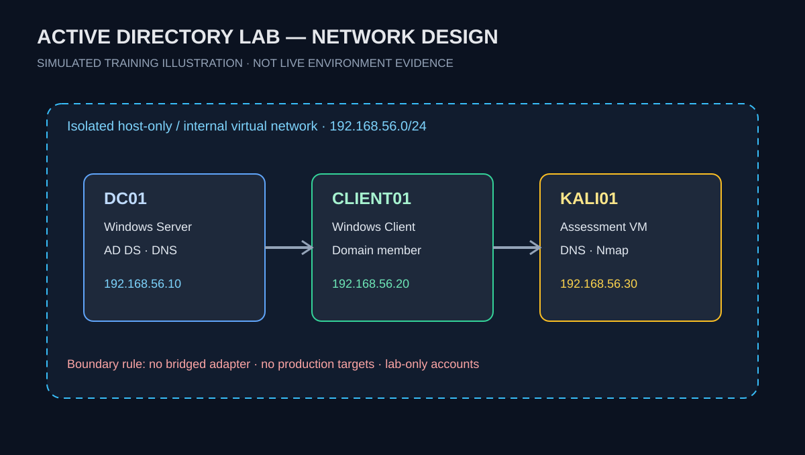
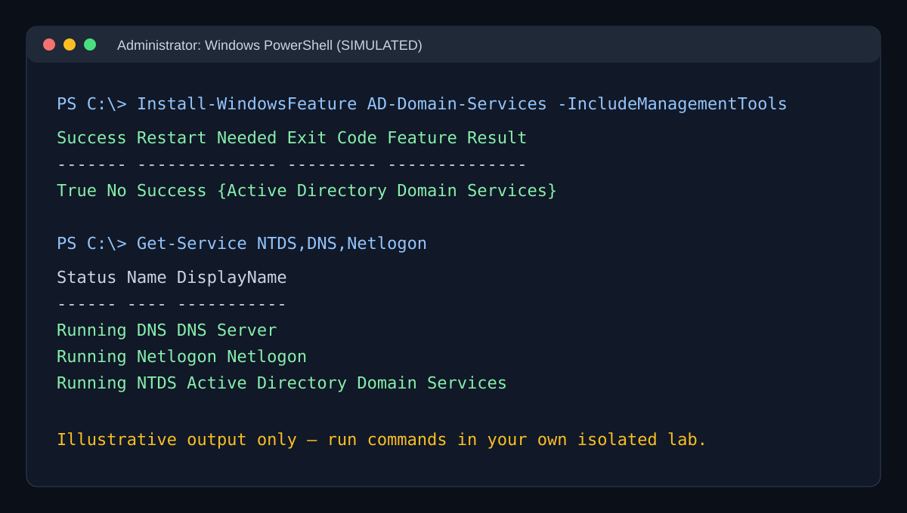

# Project 01 — Active Directory Penetration Testing Lab Setup

<sub>Level: Beginner · Domain: Active Directory · Type: Lab engineering and security assessment preparation</sub>

## 1. Objective

Build a small, isolated Windows Active Directory environment and a separate assessment workstation. By the end, you should be able to:
- Explain the role of a domain controller, DNS, domain members, and domain accounts.
- Reach the lab systems over a private virtual network without exposing vulnerable services to the internet.
- Verify name resolution, connectivity, domain membership, and time synchronization.
- Establish a written scope, test identities, evidence directory, and safe shutdown/reset procedure.

This project establishes the environment used by later projects. It does **not** attempt exploitation or test real production credentials.

## 2. Scope and rules of engagement

**In scope:** the lab domain, its domain controller, one Windows client, and the Kali assessment VM.

**Out of scope:** host operating system, home/office LAN, public IP addresses, cloud tenants, and any system not explicitly created for this lab.

Use fictional identities and passwords. Keep the virtual network host-only or internal. Do not bridge the lab to a production network. Take clean snapshots before configuration changes.

## 3. Reference architecture

| System | Suggested role | Example address |
|---|---|---|
| DC01 | Windows Server domain controller + DNS | 192.168.56.10 |
| CLIENT01 | Windows 10/11 domain workstation | 192.168.56.20 |
| KALI01 | Assessment workstation | 192.168.56.30 |
| Domain | Lab namespace | adlab.test |

These are documentation examples. Choose a subnet that does not overlap with your host or VPN networks. Allocate resources according to the host machine and Windows licensing.

### Network design

Use a VirtualBox **Host-only** or **Internal Network** adapter for the lab segment. An optional second NAT adapter may be used temporarily for updates, but disable it during assessment exercises. Do not use bridged networking for this intentionally vulnerable training environment.

## 4. Prerequisites

- Virtualization platform such as VirtualBox or VMware.
- Windows Server evaluation media and a Windows client evaluation/licensed image.
- Kali Linux VM or another authorized assessment workstation.
- At least 8 GB host RAM is a practical starting point; more is preferable when running three VMs simultaneously.
- Sufficient disk space for VM disks and snapshots.
- A password manager or secure offline record for lab-only credentials.

## 5. Build the lab

### Step 1 — Create the isolated network

In the hypervisor, create a host-only network such as `192.168.56.0/24`. Confirm that DHCP settings will not conflict with static addresses. Attach all three VMs to this same private segment.

### Step 2 — Install and prepare the server

Install Windows Server on the VM named `DC01`. Set a strong unique local Administrator password. Configure its lab-only static address (example `192.168.56.10/24`). For the initial single-subnet lab, leave the default gateway blank unless your isolated design requires one.

Rename the server from an elevated PowerShell prompt:

```powershell
Rename-Computer -NewName "DC01" -Restart
```

After restart, configure the server's preferred DNS address to its own static IP. Do not point a domain controller's DNS client setting at a public resolver.

### Step 3 — Install Active Directory Domain Services

On DC01, open Server Manager → Add Roles and Features → select **Active Directory Domain Services** and the required management tools. After installation, select **Promote this server to a domain controller**.

Create a new forest using the lab namespace `adlab.test`. Set a strong Directory Services Restore Mode (DSRM) password and record it securely. Complete the wizard and allow the server to restart.

PowerShell alternative for installing the role (promotion is a separate, deliberate step):

```powershell
Install-WindowsFeature AD-Domain-Services -IncludeManagementTools
```

For a disposable lab, a forest root domain is sufficient. Do not use a real company domain name.

### Step 4 — Verify domain controller health

Run these commands on DC01:

```powershell
Get-ADDomain
Get-ADForest
Get-Service NTDS,DNS,Netlogon
dcdiag /v
```

Expected: domain and forest report `adlab.test`; NTDS, DNS, and Netlogon are running; DCDIAG does not report a blocking failure. Review warnings rather than assuming every warning is harmless.

### Step 5 — Create a lab user and join the client

On DC01, create a standard test user using Active Directory Users and Computers. Use a fictional name such as `lab.user`; do not reuse personal or corporate credentials.

On CLIENT01, set its DNS server to `192.168.56.10` (or your chosen DC address). Confirm the domain controller can be resolved:

```powershell
Resolve-DnsName DC01.adlab.test
nltest /dsgetdc:adlab.test
```

Join CLIENT01 to `adlab.test) through System Properties → Computer Name → Change → Domain, then restart. Sign in with the dedicated lab account after confirming the join.

### Step 6 — Prepare Kali

Set Kali's adapter to the same isolated network and assign an unused address. Verify the interface and route:

```bash
ip -br address
ip route
ping -c 3 192.168.56.10
```

Install only the tools needed for this initial connectivity baseline:

```bash
sudo apt update
sudo apt install -y dnsutils nmap
```

Verify DNS against the lab DNS server:

```bash
dig @192.168.56.10 adlab.test SOA
dig @192.168.56.10 _ldap._tcp.dc._msdcs.adlab.test SRV
```

Expected: the SOA query returns the lab zone's authority information and the SRV query identifies the domain controller as an LDAP service endpoint. Replace the example IP and domain if your lab differs.

### Step 7 — Record a minimal baseline

From Kali, run a narrow discovery check against **only the lab DC address**:

```bash
nmap -Pn -sT -sV --top-ports 100 192.168.56.10 -oN dc01-baseline.txt
```

This is a baseline inventory, not a vulnerability verdict. Common domain-controller services may include DNS (53), Kerberos (88), RPC endpoint mapper (135), LDAP (389), SMB (445), and Global Catalog (3268). Actual exposure depends on configuration and firewall policy. Do not infer a vulnerability from an open port alone.

## 6. Example observations and analysis

| Check | Example expected observation | Interpretation |
|---|---|---|
| Domain query | `adlab.test` | Domain is discoverable from the DC |
| SRV lookup | DC01 returned for LDAP | DNS service records are functioning |
| Domain join | CLIENT01 reports domain membership | Client can locate and authenticate to the domain |
| Service check | NTDS, DNS, Netlogon running | Core DC services are available |
| Port inventory | Domain-related ports visible on DC | Record as attack surface for later scoped reviews |

**Training finding LAB-01 — Lab network isolation not verified**

- **Severity:** High if the lab is bridged to an untrusted or production network; otherwise Informational after isolation is confirmed.
- **Risk:** Domain services and intentionally created test accounts could be exposed outside the exercise boundary.
- **Evidence:** Hypervisor adapter configuration, VM interface addresses, routing table, and a connectivity test to an address outside the lab.
- **Remediation:** Use host-only/internal networking, remove unnecessary bridged adapters, restrict host firewall access, and verify that only explicitly approved systems can reach the lab.

Do not claim this finding exists until you inspect your own configuration.

## 7. Evidence collection

Create a project evidence folder and keep outputs sanitized:

```bash
mkdir -p evidence/project-01/{network,dns,domain,scan}
```

Save command output with timestamps and note the VM snapshot name, tool version, test source, target, and configuration. Redact usernames, secrets, host identifiers, and unrelated network details before sharing. Never place passwords, NTDS.dit, private keys, or live credential material in the public repository.

## 8. Remediation and hardening checklist

- [ ] Keep the lab on an isolated virtual network.
- [ ] Use unique lab-only passwords and standard user accounts for routine testing.
- [ ] Limit administrative logons to designated management systems.
- [ ] Keep Windows Server and client systems patched.
- [ ] Enable host and guest firewalls with only required lab traffic permitted.
- [ ] Maintain clean snapshots and a documented reset process.
- [ ] Store evidence without secrets or personal data.

## 9. Retest and completion criteria

Project 01 is complete when:
1. DC01 hosts the `adlab.test` forest and passes a reviewed health check.
2. CLIENT01 is joined to the domain and can locate the DC.
3. Kali resolves the lab's DNS records and reaches only the intended lab targets.
4. The network isolation and scope are documented.
5. Baseline outputs and sanitized evidence are saved.

## 10. Screenshots — simulated training illustrations

The three images below are mockups created for instructional documentation. They are **not genuine screenshots**, live scan results, or proof that a lab was deployed. Replace them with your own captured evidence when you complete the exercise.






## 11. Next project

[Project 02 — Windows Server Domain Controller Installation](../02-windows-server-domain-controller/README.md)
