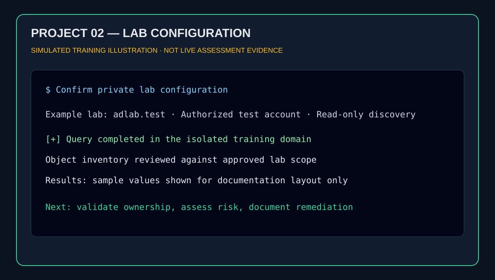
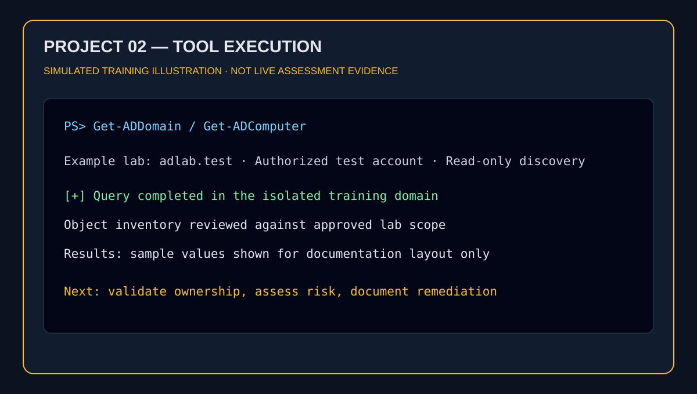
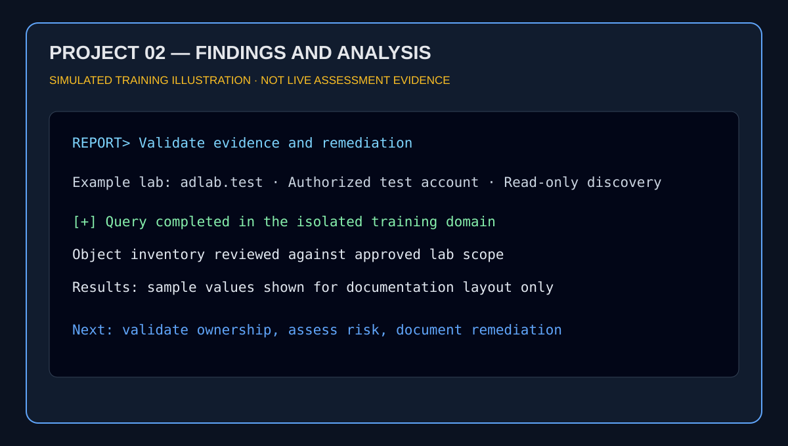

# Project 02 — Windows Server Domain Controller Installation

<sub>Level: Beginner · Active Directory Security Assessment</sub>

## 1. Objective
Install and validate a dedicated Windows Server domain controller in the isolated adlab.test forest.

## 2. Scope and prerequisites
Use only the isolated `adlab.test` training forest created in Projects 01–02. Use a standard lab domain account unless a step explicitly requires administrative access. Confirm written scope, target names, source host, and permitted collection window. Never reuse corporate credentials or publish directory exports containing real identities.

## 3. Tools
- Active Directory PowerShell module / RSAT
- Windows PowerShell 5.1 or supported PowerShell environment
- DNS utilities (`Resolve-DnsName`, `dig`) where applicable
- Optional Nmap for narrow, approved host validation

## 4. Step-by-step walkthrough
## Procedure

### 1. Prepare the server VM
Create a Windows Server VM named DC01 with a supported evaluation or licensed image. Use a private virtual switch, assign a static IP (example 192.168.56.10/24), and record the OS build. Keep the host firewall enabled.

### 2. Set hostname and network
Run elevated PowerShell:
```powershell
Rename-Computer -NewName "DC01" -Restart
```
After reboot, configure the static address and preferred DNS to the server's own address. Verify with `ipconfig /all`.

### 3. Install the AD DS role
```powershell
Install-WindowsFeature AD-Domain-Services -IncludeManagementTools
Get-WindowsFeature AD-Domain-Services
```
Confirm the role reports Installed. Role installation alone does not create a domain.

### 4. Promote as a new forest (new-lab-only)
For a fresh lab server, use Server Manager → notification flag → Promote this server to a domain controller. Choose **Add a new forest**, enter `adlab.test`, retain DNS installation, set a unique DSRM password, review prerequisite checks, and install. This causes a restart. Do not use the new-forest option on an existing production domain controller.

PowerShell alternative, run only on a fresh disposable lab server after reviewing the parameters:
```powershell
Install-ADDSForest -DomainName "adlab.test" -DomainNetbiosName "ADLAB" -InstallDNS
```
The cmdlet prompts for the DSRM password. Follow the wizard's validation and reboot process.

### 5. Verify AD DS and DNS
```powershell
Get-ADDomain
Get-ADForest
Get-Service NTDS,DNS,Netlogon
dcdiag /test:services /test:dns
Resolve-DnsName -Type SRV _ldap._tcp.dc._msdcs.adlab.test
```
Check that the domain/forest identity matches the lab, core services run, and DNS SRV records resolve to DC01.

### 6. Check time and SYSVOL/NETLOGON
```powershell
w32tm /query /status
Get-SmbShare -Name SYSVOL,NETLOGON
```
Confirm time synchronization is healthy and the expected domain shares exist. A newly promoted DC may need a short period before all services are ready; investigate rather than suppressing errors.

### 7. Capture baseline
Record OS version, hostname, IP, DNS configuration, domain/forest functional level, service status, DCDIAG output, and a screenshot of the VM's private adapter settings. Redact machine identifiers before publishing evidence.

## Example result interpretation
A successful role installation, completed forest promotion, running NTDS/DNS/Netlogon, healthy DNS SRV lookup, and available SYSVOL/NETLOGON indicate a functioning lab DC. A running service by itself is not proof of overall domain health.

## Risks and findings
- **LAB-02A — DNS misconfiguration (Medium):** clients using public DNS may fail domain discovery or bypass internal name resolution. Set member DNS to the AD DNS server and configure forwarders on the DNS service as needed.
- **LAB-02B — Domain controller exposed beyond lab (High):** restrict network adapters and firewall scope; remove bridged connectivity.
- **LAB-02C — DSRM secret mishandled (High):** store it securely, restrict access, and never place it in screenshots or Git.

## Evidence and retest
Save sanitized outputs from the commands above under `evidence/project-02/`. Retest after reboot: domain lookup, DNS SRV query, service state, SYSVOL/NETLOGON access. Mark complete only when all checks pass.

## 5. Reporting template
For every confirmed issue record: unique finding ID, affected object/host, evidence timestamp, test account privilege, reproducible command, observed result, security impact, severity rationale, owner validation, remediation, and retest outcome. Separate confirmed vulnerabilities from informational observations and assumptions.

## 6. Evidence handling
Store sanitized output under `evidence/project-02/`. Remove personal data, secrets, domain identifiers from any non-lab environment, and unrelated host details. Do not commit raw directory dumps or credential material. The illustrations below are synthetic mockups.

## 7. Screenshots — simulated training illustrations
These images are illustrative mockups created for the walkthrough. They are not actual tool captures, live environment screenshots, or proof that a test was executed.







## 8. Completion checklist
- [ ] Scope and test identity confirmed.
- [ ] Commands executed only against the authorized lab.
- [ ] Outputs reviewed and sanitized.
- [ ] Findings validated and rated with context.
- [ ] Remediation recommendations and retest criteria documented.

## 9. Related projects
- [Project 01 — Active Directory Penetration Testing Lab Setup](../01-active-directory-lab-setup/README.md)
- [Project 02 — Windows Server Domain Controller Installation](../02-windows-server-domain-controller/README.md)
- [Project 03 — Domain and Forest Enumeration](../03-domain-and-forest-enumeration/README.md)
- [Project 04 — User and Group Enumeration](../04-domain-users-and-groups-enumeration/README.md)
- [Project 05 — Computer and Server Enumeration](../05-computer-and-server-enumeration/README.md)
