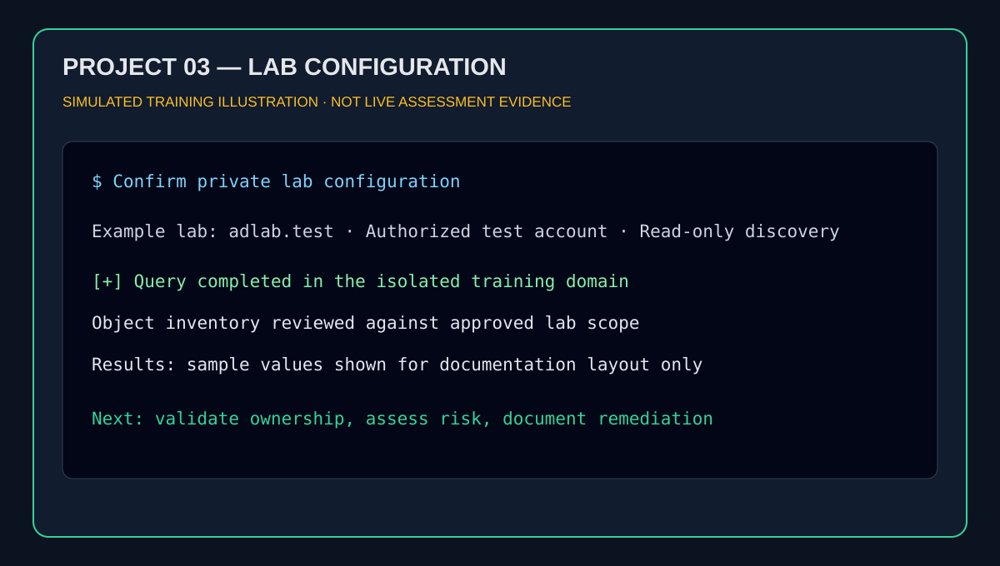
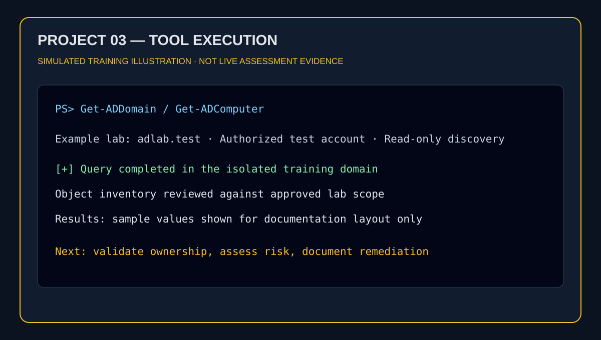
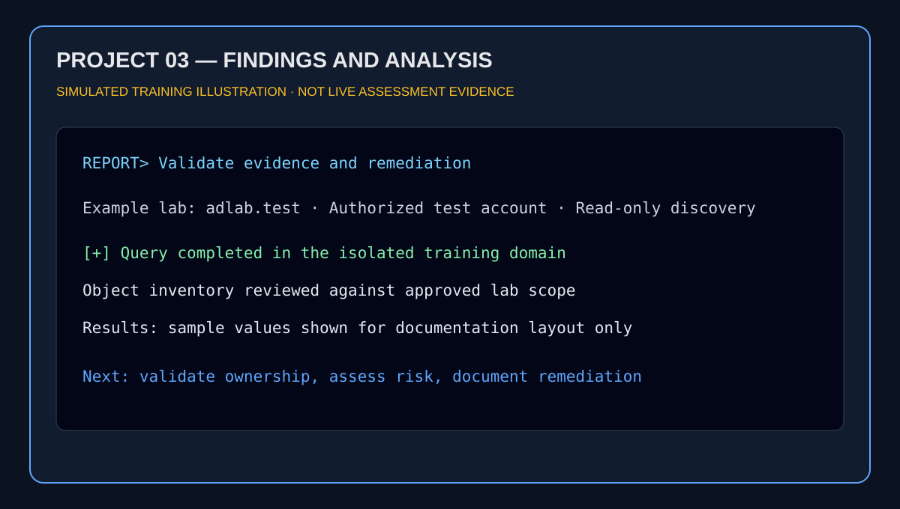

# Project 03 — Active Directory Domain and Forest Enumeration

<sub>Level: Beginner · Active Directory Security Assessment</sub>

## 1. Objective
Collect a low-impact baseline of domain, forest, DNS, and domain-controller configuration using an authorized domain account.

## 2. Scope and prerequisites
Use only the isolated `adlab.test` training forest created in Projects 01–02. Use a standard lab domain account unless a step explicitly requires administrative access. Confirm written scope, target names, source host, and permitted collection window. Never reuse corporate credentials or publish directory exports containing real identities.

## 3. Tools
- Active Directory PowerShell module / RSAT
- Windows PowerShell 5.1 or supported PowerShell environment
- DNS utilities (`Resolve-DnsName`, `dig`) where applicable
- Optional Nmap for narrow, approved host validation

## 4. Step-by-step walkthrough
## Procedure

### 1. Confirm scope and identity
Run from a domain-joined Windows lab client using a standard user:
```powershell
whoami
$env:USERDNSDOMAIN
$env:LOGONSERVER
```
Confirm the account and domain are the intended lab identity. Never run enumeration against an unapproved domain.

### 2. Enumerate domain metadata
```powershell
Import-Module ActiveDirectory
Get-ADDomain | Format-List DNSRoot,NetBIOSName,DomainMode,DomainSID,PDCEmulator
Get-ADForest | Format-List Name,ForestMode,Domains,GlobalCatalogs,SchemaMaster
```
Record domain and forest names, functional levels, FSMO role holders, and Global Catalogs. Treat this metadata as sensitive reconnaissance output.

### 3. Enumerate domain controllers
```powershell
Get-ADDomainController -Filter * |
  Select-Object HostName,IPv4Address,Site,IsGlobalCatalog,OperatingSystem
nltest /dclist:$env:USERDNSDOMAIN
```
Compare results with the approved asset inventory. Unexpected DCs or stale records merit owner validation, not immediate assumptions of compromise.

### 4. Review DNS service records
From a system configured to use lab DNS:
```powershell
Resolve-DnsName -Type SRV _ldap._tcp.dc._msdcs.adlab.test
Resolve-DnsName -Type SRV _kerberos._tcp.adlab.test
```
Check that records identify expected domain controllers and ports.

### 5. Linux-side DNS discovery (optional)
```bash
dig @192.168.56.10 adlab.test SOA
dig @192.168.56.10 _ldap._tcp.dc._msdcs.adlab.test SRV
```
Use the explicitly scoped lab DNS IP. Do not broaden queries to unrelated networks.

### 6. Correlate and document
Compare PowerShell, nltest, DNS, and asset inventory. Record collection time, source host, account privilege level, command, and output. Identify discrepancies for administrator confirmation.

## Findings and risk analysis
- **ENUM-01 — Unrecognized domain controller record (Medium):** stale or unexpected SRV/A records can misdirect clients or indicate weak DNS lifecycle management. Validate ownership, remove stale records through approved change control, and monitor DNS changes.
- **ENUM-02 — Excessive metadata exposure (Low/Medium):** ordinary domain users can often read directory metadata by design. Assess whether sensitive descriptions, naming, or infrastructure details are unnecessarily exposed; minimize sensitive attributes and restrict privileged operational details.

Enumeration visibility alone is not proof of a vulnerability. Rate findings by demonstrated impact and context.

## Evidence and retest
Store sanitized command outputs in `evidence/project-03/`. Retest after DNS cleanup or configuration changes and confirm only authorized DCs are advertised.

## 5. Reporting template
For every confirmed issue record: unique finding ID, affected object/host, evidence timestamp, test account privilege, reproducible command, observed result, security impact, severity rationale, owner validation, remediation, and retest outcome. Separate confirmed vulnerabilities from informational observations and assumptions.

## 6. Evidence handling
Store sanitized output under `evidence/project-03/`. Remove personal data, secrets, domain identifiers from any non-lab environment, and unrelated host details. Do not commit raw directory dumps or credential material. The illustrations below are synthetic mockups.

## 7. Screenshots — simulated training illustrations
These images are illustrative mockups created for the walkthrough. They are not actual tool captures, live environment screenshots, or proof that a test was executed.







## 8. Completion checklist
- [ ] Scope and test identity confirmed.
- [ ] Commands executed only against the authorized lab.
- [ ] Outputs reviewed and sanitized.
- [ ] Findings validated and rated with context.
- [ ] Remediation recommendations and retest criteria documented.

## 9. Related projects
- [Project 01 — Active Directory Penetration Testing Lab Setup](../01-active-directory-lab-setup/README.md)
- [Project 02 — Windows Server Domain Controller Installation](../02-windows-server-domain-controller/README.md)
- [Project 03 — Domain and Forest Enumeration](../03-domain-and-forest-enumeration/README.md)
- [Project 04 — User and Group Enumeration](../04-domain-users-and-groups-enumeration/README.md)
- [Project 05 — Computer and Server Enumeration](../05-computer-and-server-enumeration/README.md)
