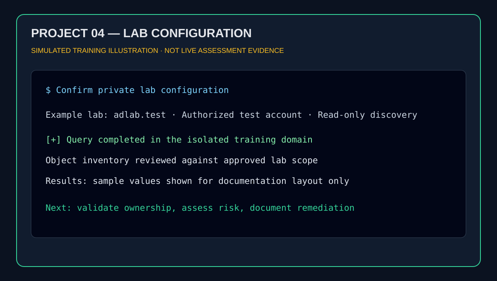
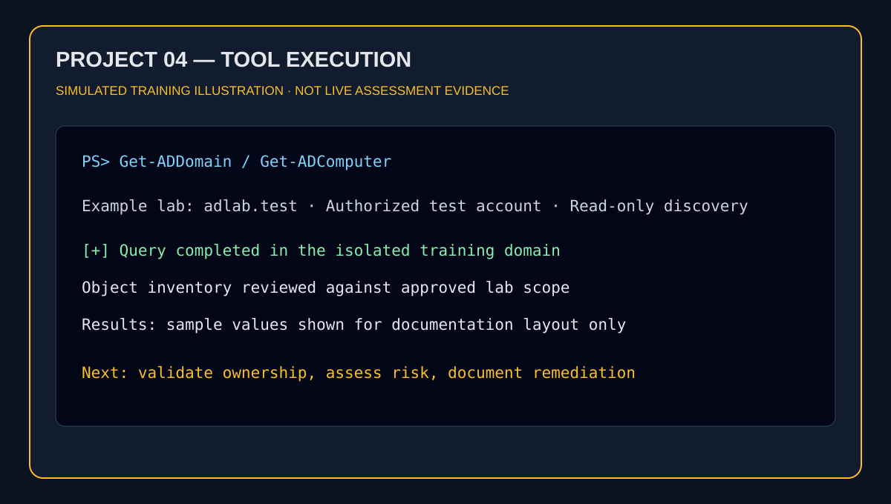
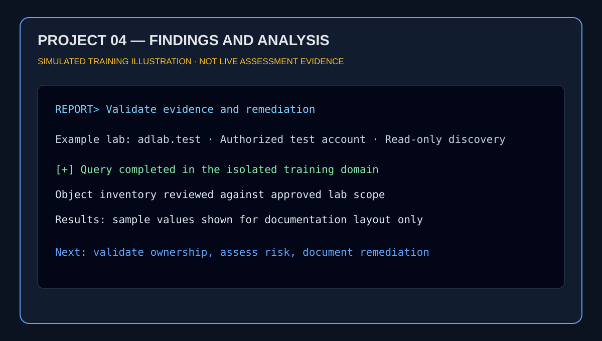

# Project 04 — Domain User and Group Enumeration

<sub>Level: Beginner · Active Directory Security Assessment</sub>

## 1. Objective
Inventory user and group objects, privileged group membership, stale identities, and risky account attributes using read-only queries.

## 2. Scope and prerequisites
Use only the isolated `adlab.test` training forest created in Projects 01–02. Use a standard lab domain account unless a step explicitly requires administrative access. Confirm written scope, target names, source host, and permitted collection window. Never reuse corporate credentials or publish directory exports containing real identities.

## 3. Tools
- Active Directory PowerShell module / RSAT
- Windows PowerShell 5.1 or supported PowerShell environment
- DNS utilities (`Resolve-DnsName`, `dig`) where applicable
- Optional Nmap for narrow, approved host validation

## 4. Step-by-step walkthrough
## Procedure

### 1. Establish a standard-user baseline
On a domain-joined lab client:
```powershell
Import-Module ActiveDirectory
whoami /all
```
Record the effective identity and group SIDs. Use a standard account for baseline enumeration; elevate only if the approved test specifically requires it.

### 2. Enumerate users safely
```powershell
Get-ADUser -Filter * -Properties Enabled,LastLogonDate,PasswordLastSet,PasswordNeverExpires,Description |
  Select-Object SamAccountName,Enabled,LastLogonDate,PasswordLastSet,PasswordNeverExpires,Description
```
Treat last-logon attributes carefully: replicated `LastLogonDate` is approximate, and a blank value does not alone prove an account is unused.

### 3. Enumerate groups and memberships
```powershell
Get-ADGroup -Filter * -Properties GroupScope,GroupCategory |
  Select-Object Name,GroupScope,GroupCategory
Get-ADGroupMember "Domain Admins" -Recursive |
  Select-Object Name,SamAccountName,ObjectClass
Get-ADGroupMember "Enterprise Admins" -Recursive |
  Select-Object Name,SamAccountName,ObjectClass
```
Review privileged groups against the approved administrator roster. Check nested memberships and service identities.

### 4. Review account hygiene indicators
```powershell
Search-ADAccount -AccountDisabled -UsersOnly
Search-ADAccount -PasswordNeverExpires -UsersOnly
Search-ADAccount -LockedOut -UsersOnly
```
These are review queues, not automatic findings. Confirm business ownership and exception records before recommending account changes.

### 5. Identify service-account candidates
```powershell
Get-ADUser -LDAPFilter "(servicePrincipalName=*)" -Properties ServicePrincipalName,Enabled,PasswordLastSet |
  Select-Object SamAccountName,Enabled,PasswordLastSet,ServicePrincipalName
```
This query identifies accounts with SPNs for inventory. Do not request or crack tickets in this project; that is a separate, explicitly scoped assessment.

### 6. Assess exposure and report
Look for excessive privileged membership, enabled stale accounts, human accounts used as services, sensitive data in descriptions, and non-expiring passwords. Validate each item with the account owner and policy.

## Example findings
- **ID-01 — Privileged group membership not aligned to roster (High):** an unapproved account appears in a privileged group. Verify authorization, preserve evidence, and request removal through change control.
- **ID-02 — Enabled stale account (Medium):** account appears inactive based on available attributes. Confirm with owner and identity logs before disabling.
- **ID-03 — Password never expires (Medium):** policy exception may increase credential exposure window. Prefer managed service identities or rotation controls; document approved exceptions.

## Remediation and retest
Apply least privilege, separate admin and standard identities, remove obsolete accounts only after owner approval, use managed service accounts where supported, and monitor privileged group changes. Re-run the same queries and compare before/after results. Never publish real usernames or descriptions.

## 5. Reporting template
For every confirmed issue record: unique finding ID, affected object/host, evidence timestamp, test account privilege, reproducible command, observed result, security impact, severity rationale, owner validation, remediation, and retest outcome. Separate confirmed vulnerabilities from informational observations and assumptions.

## 6. Evidence handling
Store sanitized output under `evidence/project-04/`. Remove personal data, secrets, domain identifiers from any non-lab environment, and unrelated host details. Do not commit raw directory dumps or credential material. The illustrations below are synthetic mockups.

## 7. Screenshots — simulated training illustrations
These images are illustrative mockups created for the walkthrough. They are not actual tool captures, live environment screenshots, or proof that a test was executed.







## 8. Completion checklist
- [ ] Scope and test identity confirmed.
- [ ] Commands executed only against the authorized lab.
- [ ] Outputs reviewed and sanitized.
- [ ] Findings validated and rated with context.
- [ ] Remediation recommendations and retest criteria documented.

## 9. Related projects
- [Project 01 — Active Directory Penetration Testing Lab Setup](../01-active-directory-lab-setup/README.md)
- [Project 02 — Windows Server Domain Controller Installation](../02-windows-server-domain-controller/README.md)
- [Project 03 — Domain and Forest Enumeration](../03-domain-and-forest-enumeration/README.md)
- [Project 04 — User and Group Enumeration](../04-domain-users-and-groups-enumeration/README.md)
- [Project 05 — Computer and Server Enumeration](../05-computer-and-server-enumeration/README.md)
