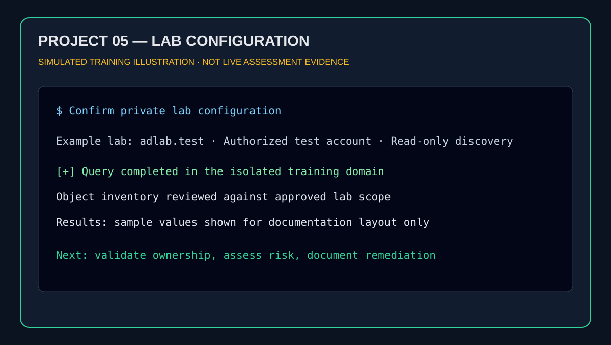
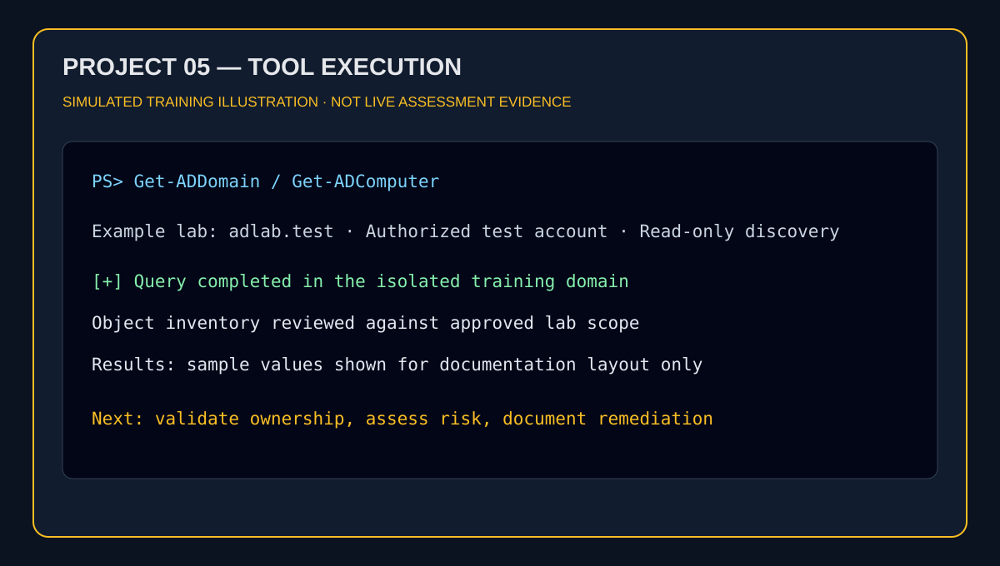
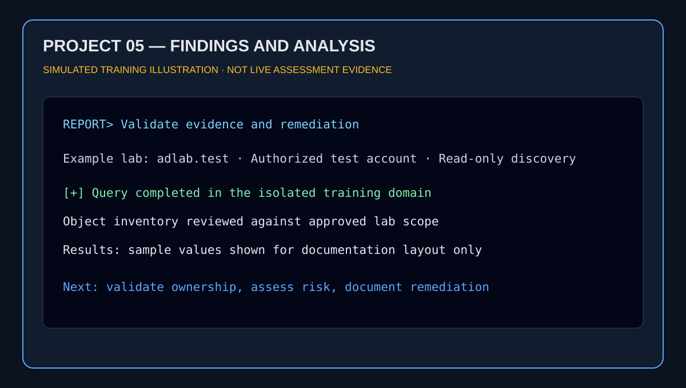

# Project 05 — Computer and Server Enumeration

<sub>Level: Beginner · Active Directory Security Assessment</sub>

## 1. Objective
Build a read-only inventory of domain-joined endpoints, operating systems, enabled state, and stale computer objects.

## 2. Scope and prerequisites
Use only the isolated `adlab.test` training forest created in Projects 01–02. Use a standard lab domain account unless a step explicitly requires administrative access. Confirm written scope, target names, source host, and permitted collection window. Never reuse corporate credentials or publish directory exports containing real identities.

## 3. Tools
- Active Directory PowerShell module / RSAT
- Windows PowerShell 5.1 or supported PowerShell environment
- DNS utilities (`Resolve-DnsName`, `dig`) where applicable
- Optional Nmap for narrow, approved host validation

## 4. Step-by-step walkthrough
## Procedure

### 1. Enumerate computer objects
```powershell
Import-Module ActiveDirectory
Get-ADComputer -Filter * -Properties DNSHostName,OperatingSystem,OperatingSystemVersion,Enabled,LastLogonDate |
  Select-Object Name,DNSHostName,OperatingSystem,OperatingSystemVersion,Enabled,LastLogonDate
```
Export a sanitized copy for analysis:
```powershell
Get-ADComputer -Filter * -Properties DNSHostName,OperatingSystem,Enabled,LastLogonDate |
  Select-Object Name,DNSHostName,OperatingSystem,Enabled,LastLogonDate |
  Export-Csv .\ad-computer-inventory.csv -NoTypeInformation
```

### 2. Identify server-class systems
```powershell
Get-ADComputer -Filter 'OperatingSystem -like "*Server*"' -Properties OperatingSystem,OperatingSystemVersion,Enabled |
  Select-Object Name,OperatingSystem,OperatingSystemVersion,Enabled
```
Validate this inventory with CMDB or system owners. Operating-system attributes may be missing or outdated.

### 3. Review stale and disabled computer objects
```powershell
Search-ADAccount -ComputersOnly -AccountDisabled
Get-ADComputer -Filter * -Properties LastLogonDate |
  Where-Object { $_.LastLogonDate -and $_.LastLogonDate -lt (Get-Date).AddDays(-90) } |
  Select-Object Name,LastLogonDate
```
Use the 90-day threshold only as an example. Replication and logon behavior affect timestamps; corroborate with endpoint management and asset-owner records before classifying an object as stale.

### 4. Validate selected lab hosts
For known lab systems only:
```powershell
Test-Connection CLIENT01 -Count 2
Resolve-DnsName CLIENT01.adlab.test
```
From Kali, conduct a narrow service check only against a confirmed in-scope address:
```bash
nmap -Pn -sT -sV --top-ports 100 192.168.56.20 -oN client01-inventory.txt
```
Do not scan the entire corporate subnet or infer operating-system patch state from a service banner.

### 5. Reconcile inventory
Compare AD computer objects with hypervisor inventory and endpoint management records. Flag duplicate names, missing DNS names, unsupported OS versions, and objects with unclear ownership for manual validation.

## Findings and risk analysis
- **COMP-01 — Unsupported operating system present (High):** confirm actual OS/build and vendor support lifecycle. Isolate, upgrade, or retire according to business continuity requirements.
- **COMP-02 — Stale computer account (Low/Medium):** validate with asset owner and endpoint telemetry, then disable/remove under change control.
- **COMP-03 — Unmanaged domain-joined endpoint (Medium):** bring under endpoint management, patching, EDR, and configuration baselines.

## Remediation and retest
Maintain an authoritative asset inventory, enforce join/retirement procedures, remove stale DNS and computer objects only after validation, and monitor new domain joins. Re-run inventory and reconcile differences after remediation.

## 5. Reporting template
For every confirmed issue record: unique finding ID, affected object/host, evidence timestamp, test account privilege, reproducible command, observed result, security impact, severity rationale, owner validation, remediation, and retest outcome. Separate confirmed vulnerabilities from informational observations and assumptions.

## 6. Evidence handling
Store sanitized output under `evidence/project-05/`. Remove personal data, secrets, domain identifiers from any non-lab environment, and unrelated host details. Do not commit raw directory dumps or credential material. The illustrations below are synthetic mockups.

## 7. Screenshots — simulated training illustrations
These images are illustrative mockups created for the walkthrough. They are not actual tool captures, live environment screenshots, or proof that a test was executed.







## 8. Completion checklist
- [ ] Scope and test identity confirmed.
- [ ] Commands executed only against the authorized lab.
- [ ] Outputs reviewed and sanitized.
- [ ] Findings validated and rated with context.
- [ ] Remediation recommendations and retest criteria documented.

## 9. Related projects
- [Project 01 — Active Directory Penetration Testing Lab Setup](../01-active-directory-lab-setup/README.md)
- [Project 02 — Windows Server Domain Controller Installation](../02-windows-server-domain-controller/README.md)
- [Project 03 — Domain and Forest Enumeration](../03-domain-and-forest-enumeration/README.md)
- [Project 04 — User and Group Enumeration](../04-domain-users-and-groups-enumeration/README.md)
- [Project 05 — Computer and Server Enumeration](../05-computer-and-server-enumeration/README.md)
