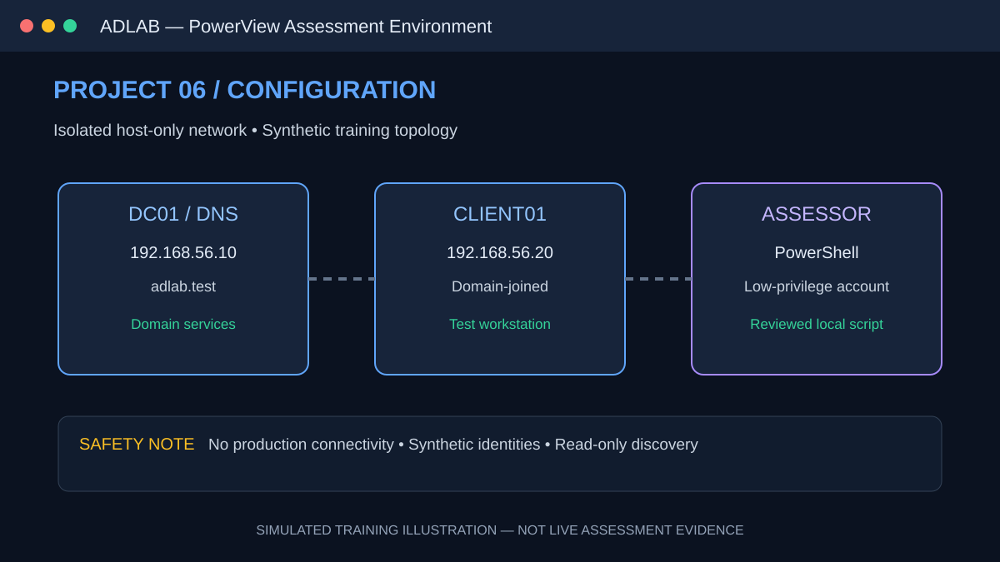
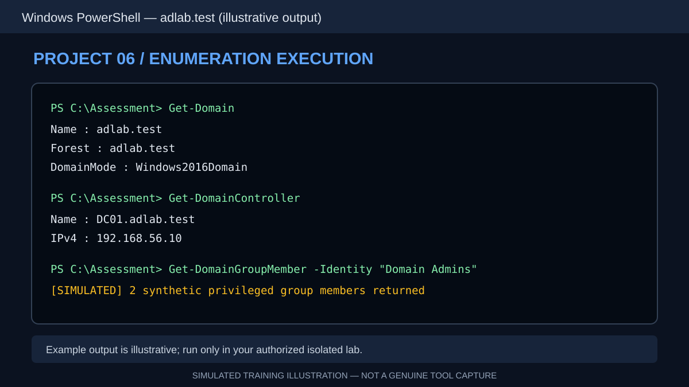
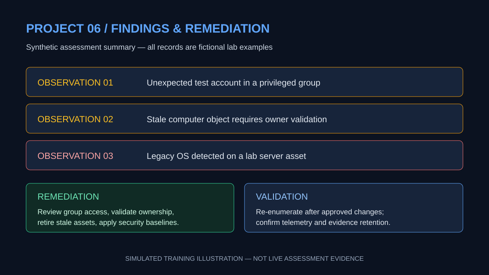

# Project 06 — PowerView Active Directory Enumeration

<sub>Beginner • Directory reconnaissance • Read-only assessment</sub>

## 1. Objective

Use PowerView to perform structured, read-only Active Directory enumeration from an authorized domain-joined assessment host. Build an evidence-backed picture of the domain, domain controllers, users, groups, computers, organizational units, Group Policy Objects, and trust relationships.

This exercise focuses on discovery and security review. It does **not** change directory objects, modify permissions, request service tickets for cracking, dump credentials, or attempt privilege escalation.

## 2. Scope and rules of engagement

| Item | Lab value |
|---|---|
| Domain | `adlab.test` |
| Domain controller | `DC01.adlab.test` — `192.168.56.10` |
| Domain workstation | `CLIENT01.adlab.test` — `192.168.56.20` |
| Assessment host | Domain-joined Windows test workstation |
| Account | Dedicated, non-privileged lab account |
| Network | Host-only / isolated virtual network |

Only assess systems and accounts explicitly included in your authorization. Do not run these commands against a production domain without written approval. Use synthetic identities and sanitized evidence.

## 3. Prerequisites

- Project 01 lab is operational and Project 02 has a working domain controller.
- A domain-joined Windows assessment workstation with PowerShell.
- A dedicated low-privilege domain account.
- DNS configured to use the lab domain controller.
- PowerView obtained from the official [PowerSploit repository](https://github.com/PowerShellMafia/PowerSploit), reviewed, and stored locally.
- PowerShell logging enabled where possible.

> PowerView is a powerful reconnaissance toolkit. Obtain it from its official source, review the exact script version, record its hash, and follow your organization's software approval process. Avoid downloading and executing a remote script directly in memory.

## 4. Lab architecture

```text
                Isolated host-only network
                         |
          +--------------+--------------+
          |              |              |
     DC01 / DNS      CLIENT01       Assessment
     192.168.56.10   192.168.56.20  PowerShell
     adlab.test      Domain member  Low-priv user
```



## 5. Step-by-step walkthrough

### Step 1 — Confirm the assessment context

Open PowerShell as the dedicated domain user. Confirm the current identity, domain, and domain controller discovery:

```powershell
whoami
$env:USERDNSDOMAIN
$env:LOGONSERVER
nltest /dsgetdc:adlab.test
```

Expected result: the current identity belongs to `adlab.test`, and domain controller discovery identifies `DC01.adlab.test`.

Record the timestamp, hostname, account used, and DC address in your notes. Do not include passwords, hashes, or personal data in screenshots.

### Step 2 — Verify the PowerView script

From the approved local tools directory, calculate a file hash and compare it with the hash recorded when the script was acquired:

```powershell
Get-FileHash .\PowerView.ps1 -Algorithm SHA256
Get-AuthenticodeSignature .\PowerView.ps1
```

A script may be unsigned; an unsigned result is not proof of maliciousness or safety. Review the source and validate the file through your approved process.

### Step 3 — Load the reviewed script into the current session

```powershell
. .\PowerView.ps1
Get-Command -Module PowerView
```

If the script is not exposed as a module, verify that expected functions are available:

```powershell
Get-Command Get-Domain, Get-DomainController, Get-DomainUser, Get-DomainGroup
```

Do not weaken machine-wide execution policy to complete this exercise. If execution is blocked, stop and follow the lab administrator's approved script-control procedure.



### Step 4 — Enumerate domain and forest context

```powershell
Get-Domain
Get-Forest
Get-DomainController
Get-DomainTrust
```

Capture:
- Domain and forest names
- Domain SID and functional-level information when returned
- Domain controller hostnames and sites
- Trust names, directions, and types

Validate important details against Active Directory administrative tools or the built-in AD PowerShell module when available.

### Step 5 — Enumerate users and groups

Start with a limited set of attributes and avoid collecting unnecessary personal information:

```powershell
Get-DomainUser |
  Select-Object samaccountname, enabled, pwdlastset, lastlogon |
  Format-Table -AutoSize

Get-DomainGroup |
  Select-Object name, grouptype |
  Sort-Object name

Get-DomainGroupMember -Identity "Domain Admins" |
  Select-Object MemberName, MemberObjectClass
```

Review privileged group membership against the approved access list. Check whether disabled, stale, or unexpected accounts remain members of sensitive groups. Do not assume that a name alone proves an account is unused.

### Step 6 — Enumerate computers and organizational units

```powershell
Get-DomainComputer |
  Select-Object name, dnshostname, operatingsystem, lastlogon

Get-DomainOU |
  Select-Object name, distinguishedname
```

Identify unsupported operating systems, stale computer objects, unexpected server roles, and unusual OU placement. Confirm asset ownership with the system owner before reporting a device as unmanaged.

### Step 7 — Review Group Policy objects

```powershell
Get-DomainGPO |
  Select-Object displayname, name, gpcfilesyspath

Get-DomainPolicy
```

Document policy names and locations. Follow up on weak security settings in a dedicated GPO review; do not change policy during this reconnaissance project.

### Step 8 — Export minimal, sanitized evidence

For a small lab, save selected output to a working directory:

```powershell
New-Item -ItemType Directory -Force .\evidence | Out-Null

Get-DomainUser |
  Select-Object samaccountname, enabled, pwdlastset |
  Export-Csv .\evidence\domain-users.csv -NoTypeInformation

Get-DomainComputer |
  Select-Object name, operatingsystem |
  Export-Csv .\evidence\domain-computers.csv -NoTypeInformation
```

Protect exported files as sensitive security assessment data. Redact real usernames and hostnames before publishing examples.



## 6. Example observations

The following is synthetic training data, not output from a live assessment:

| Observation | Example | Security relevance |
|---|---|---|
| Privileged group membership | A test account is unexpectedly in Domain Admins | Excessive privilege |
| Stale computer object | A workstation object has not logged on for 240 days | Asset hygiene / stale identity |
| Legacy operating system | A lab server reports an unsupported OS | Increased exposure |
| Broad GPO scope | A baseline GPO is not linked to a newly created server OU | Inconsistent hardening |

Do not classify an item as a confirmed vulnerability until ownership, business need, and technical impact have been validated.

## 7. Risk analysis and reporting

For each confirmed observation, record:
1. Asset and directory object (use a sanitized identifier).
2. Evidence source, command, timestamp, and account context.
3. Expected secure state and observed state.
4. Business impact and realistic attack preconditions.
5. Severity with rationale, not just a scanner label.
6. Recommended owner and remediation target date.

Potential issues discovered through enumeration are leads for validation, not automatic proof of compromise.

## 8. Detection and defensive telemetry

Review the domain controller and workstation logs for the assessment window. Depending on audit policy and Windows version, useful telemetry may include:
- Security Event 4688 — process creation (if enabled, with command-line auditing configured as appropriate).
- PowerShell Operational Event 4103 / 4104 — module and script-block logging (if enabled).
- Directory Service access events such as 4662 only when the relevant auditing and SACLs are configured.

Correlate events with the approved test account, host, and time window. A missing event does not prove that enumeration did not occur; logging coverage must be validated.

## 9. Remediation recommendations

- Remove unnecessary privileged group memberships using an approved change process.
- Disable or remove stale accounts and computer objects after owner validation.
- Maintain an accurate inventory of domain-joined assets and supported operating systems.
- Apply consistent security baselines to all relevant OUs.
- Enable centralized PowerShell and security auditing with retention and alerting.
- Review trust relationships and document business justification.
- Restrict access to exported directory data and delete temporary copies according to policy.

## 10. Retest and completion criteria

- [ ] PowerView source and hash are documented.
- [ ] Domain, forest, and domain controllers are identified.
- [ ] Users, groups, computers, OUs, and GPOs are enumerated with a low-privilege account.
- [ ] Privileged membership and stale-object observations are validated with owners.
- [ ] Relevant logs are reviewed and telemetry gaps documented.
- [ ] Findings include evidence, impact, remediation, and retest status.
- [ ] Temporary exports are protected or securely removed.

## 11. Further reading

- [PowerSploit / PowerView source](https://github.com/PowerShellMafia/PowerSploit)
- [Microsoft — Active Directory Domain Services](https://learn.microsoft.com/windows-server/identity/ad-ds/get-started/virtual-dc/active-directory-domain-services-overview)
- [Microsoft — Advanced Security Audit Policy](https://learn.microsoft.com/windows/security/threat-protection/auditing/advanced-security-audit-policy-settings)
- [MITRE ATT&CK — Account Discovery (T1087)](https://attack.mitre.org/techniques/T1087/)
- [MITRE ATT&CK — Permission Groups Discovery (T1069)](https://attack.mitre.org/techniques/T1069/)

## Disclaimer

This is an educational lab walkthrough for systems you own or are authorized to assess. All screenshots and sample observations in this project are simulated illustrations. They are not genuine tool captures or evidence from a customer assessment.
