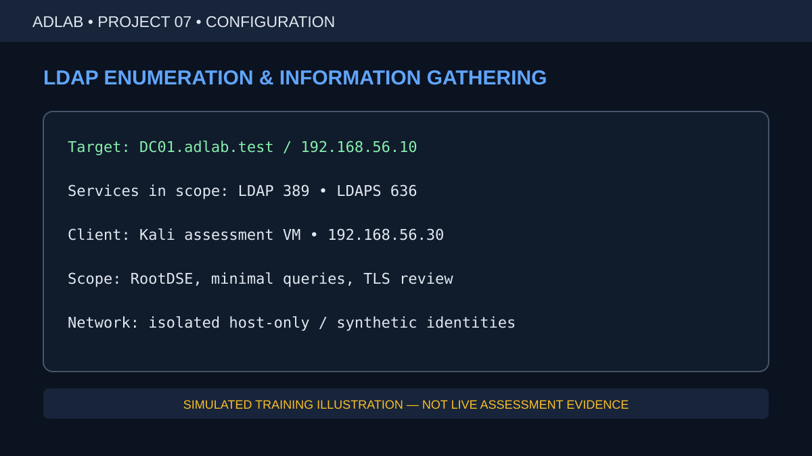
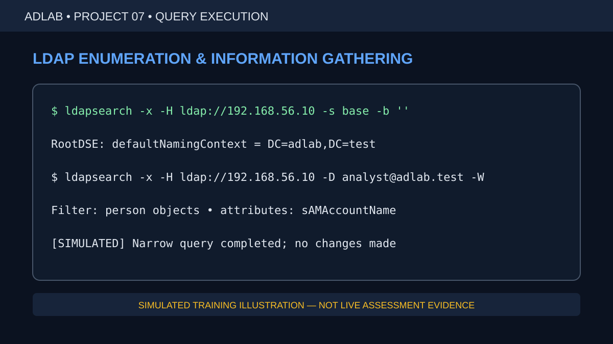

# Project 07 — LDAP Enumeration and Information Gathering

**Beginner | Directory services reconnaissance | Read-only**

## Objective
Assess what an authenticated and unauthenticated client can learn from LDAP/LDAPS in the isolated `adlab.test` domain. Identify directory exposure, anonymous-bind behavior, sensitive attributes, and transport protections without modifying directory objects or collecting secrets.

## Scope and lab
- DC/DNS: `DC01.adlab.test` — `192.168.56.10`
- Domain member: `CLIENT01` — `192.168.56.20`
- Kali assessment VM: `192.168.56.30`
- Network: host-only; synthetic accounts and data only.
- Test both LDAP TCP/389 and LDAPS TCP/636 only where enabled and authorized.

## Prerequisites
Projects 01–03 completed; DNS points to the lab DC; a low-privilege test account; Kali with Nmap and ldapsearch; approved certificate trust for LDAPS where applicable.

## 1. Confirm reachability
```bash
ip route
getent hosts dc01.adlab.test
nmap -Pn -sT -p 389,636 192.168.56.10
```
Record service state and timestamp. An open port only confirms reachability, not that anonymous directory access is permitted.



## 2. Inspect RootDSE
RootDSE exposes server capability and naming-context metadata. Query it without credentials:
```bash
ldapsearch -x -H ldap://192.168.56.10 -s base -b ""   "(objectClass=*)" namingContexts defaultNamingContext dnsHostName supportedLDAPVersion
```
Expected lab-style fields include `defaultNamingContext: DC=adlab,DC=test` and the server DNS name. If the query is rejected, record the result; do not attempt bypasses.

## 3. Test anonymous directory visibility safely
Use a narrow base and a minimal attribute list:
```bash
ldapsearch -x -H ldap://192.168.56.10   -b "DC=adlab,DC=test" -s one "(objectClass=*)" dn
```
If entries are returned without authentication, preserve only the minimum synthetic evidence needed to establish the exposure. Do not bulk-export the directory.

## 4. Perform authenticated, least-privilege queries
Use a dedicated lab account. Avoid putting passwords directly in shell history:
```bash
ldapsearch -x -H ldap://192.168.56.10 -D 'analyst@adlab.test' -W   -b "DC=adlab,DC=test"   '(&(objectCategory=person)(objectClass=user))' sAMAccountName userAccountControl
```
Review whether low-privilege users can read attributes beyond the expected directory baseline. Standard AD read access is common; the security question is whether sensitive information is exposed or permissions are broader than policy permits.



## 5. Check LDAPS and certificate posture
```bash
openssl s_client -connect 192.168.56.10:636 -servername dc01.adlab.test -showcerts
```
Record certificate subject, SAN, issuer, validity, and chain validation. Do not disable certificate validation as a workaround. Where LDAPS is required, validate clients trust the issuing CA and that the certificate matches the DC name.

## 6. Validate server-side LDAP protections
On the domain controller, review Group Policy and registry-backed policy through supported administrative interfaces for LDAP signing and channel binding requirements. Use Microsoft guidance and change-control procedures; do not change DC policy during discovery.

## Example findings (synthetic)
| ID | Observation | Risk consideration |
|---|---|---|
| LDAP-01 | Anonymous query returns more than RootDSE metadata | Unauthenticated directory reconnaissance |
| LDAP-02 | LDAPS certificate name mismatch | Client trust and interception risk |
| LDAP-03 | LDAP signing not required | Potential exposure to relay/tampering scenarios depending on environment |

These are illustrative cases, not claims about your lab. Validate each finding and document compensating controls.

## Detection and evidence
Correlate DC security logs, directory service logs, firewall telemetry, and network flow records with the test window. LDAP query auditing is configuration-dependent; absence of a log is not proof that no query occurred. Capture command, source IP, destination, account context, timestamp, sanitized output, and tool version.

## Remediation
- Disable anonymous directory access unless a documented application dependency requires it.
- Require LDAP signing and configure channel binding in a staged compatibility rollout.
- Prefer LDAPS or StartTLS where encryption is required; maintain valid certificates and trust chains.
- Restrict sensitive attributes and privileged directory read permissions.
- Monitor unusual LDAP query volume and unauthenticated access attempts.
- Retest from both unauthenticated and low-privilege contexts after approved changes.

## Completion checklist
- [ ] LDAP/LDAPS reachability documented
- [ ] RootDSE metadata captured
- [ ] Anonymous access behavior established
- [ ] Authenticated query performed with a low-privilege account
- [ ] Certificate and LDAP protections reviewed
- [ ] Findings validated, remediations assigned, and retest recorded

## References
- [Microsoft LDAP signing](https://learn.microsoft.com/en-us/windows-server/identity/ad-ds/ldap-signing)
- [Microsoft LDAP channel binding](https://learn.microsoft.com/en-us/windows-server/identity/ad-ds/ldap-channel-binding)
- [Nmap LDAP scripts](https://nmap.org/nsedoc/categories/default.html)

**Safety:** Authorized isolated lab only. Screenshots and example outputs are simulated training illustrations, not genuine assessment evidence.
