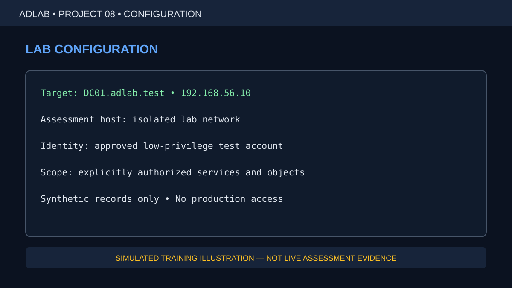
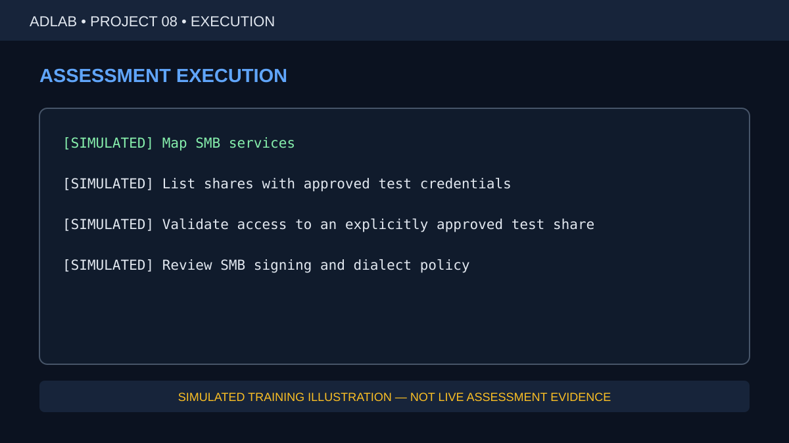
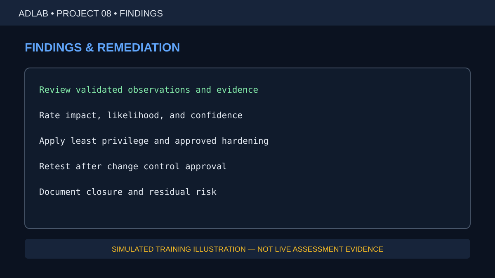

# Project 08 — SMB Enumeration and Share Assessment

**Beginner | Active Directory security assessment | Read-only unless a step explicitly uses a disposable test resource**

## Objective
Assess SMB exposure, share permissions, signing posture, and access boundaries using read-only checks and synthetic files.

## Scope and lab
- Domain: `adlab.test`
- Domain controller: `DC01.adlab.test` — `192.168.56.10`
- Domain workstation: `CLIENT01` — `192.168.56.20`
- Assessment host: Kali or Windows administration workstation on an isolated host-only network.
- Identity: dedicated low-privilege test account; synthetic identities and files only.

Only test systems covered by written authorization. Never copy secrets into reports or public repositories. Commands and outputs below are examples; validate syntax against your installed OS/tool versions.

## Prerequisites
- Projects 01–05 lab foundation and domain controller operational.
- DNS and time synchronization working.
- Nmap and/or Windows RSAT tools as applicable.
- A documented test window, scope, and evidence-handling plan.
- No production network connectivity for the training lab.

## 1. Configuration and baseline
Confirm the target, source host, account, and approved scope before running commands. Save the baseline configuration and record the assessment timestamp.



## 2. Assessment walkthrough
### Step 1 — Map SMB services

```bash
nmap -Pn -sT -p 139,445 --script smb-protocols,smb-security-mode 192.168.56.10
```

Record supported dialects, signing status, and service reachability. Do not infer exploitability from port 445 alone.

### Step 2 — List shares with approved test credentials

```bash
smbclient -L //192.168.56.10 -U 'ADLAB\\analyst'
```

Use the interactive password prompt. Record share names and access-denied results; do not attempt anonymous bypasses.

### Step 3 — Validate access to an explicitly approved test share

```bash
smbclient //192.168.56.10/Shared -U 'ADLAB\\analyst' -c 'ls'
```

Use a lab share containing synthetic files. Test read/write permissions only on a designated disposable test directory.

### Step 4 — Review SMB signing and dialect policy

```powershell
Get-SmbServerConfiguration | Select EnableSMB1Protocol,EnableSMB2Protocol,RequireSecuritySignature
```

Run on the Windows server with approved administrative access; compare with the organization's baseline.



## 3. Example observations
The following are synthetic examples for training, not assertions about your environment.

- **OBS-08-1:** Guest or anonymous access to a share is broader than intended.
- **OBS-08-2:** A test user can write to a share that should be read-only.
- **OBS-08-3:** SMB1 remains enabled without a documented dependency.
- **OBS-08-4:** SMB signing is not required on a server where policy requires it.

Validate each observation against the approved baseline, business owner, and relevant system configuration before rating it as a finding.

## 4. Risk analysis and evidence
For each confirmed issue, record:
- Asset, object, share, policy, or setting affected (sanitized identifier).
- Evidence source, exact command or administrative view, timestamp, and test identity.
- Expected versus observed configuration.
- Attack preconditions and business impact.
- Severity rationale, confidence, owner, and remediation target date.

Do not treat a tool warning or an isolated configuration value as proof of exploitability. Capture minimal evidence and protect assessment exports as sensitive data.

## 5. Remediation
- Remove guest access and apply least-privilege share and NTFS permissions together.
- Separate read-only and write workflows; audit sensitive share access.
- Disable SMB1 after dependency validation.
- Require SMB signing where appropriate and monitor legacy clients.



## 6. Detection and monitoring
Review relevant Windows Security, System, Directory Service, PowerShell, and file-server telemetry for the assessment window. Event availability depends on audit policy, SACLs, OS version, and log retention. Correlate source host, account, time, and action; document telemetry gaps rather than assuming no event means no activity.

## 7. Retest and completion checklist
- [ ] Scope and authorization recorded.
- [ ] Baseline captured using approved read-only methods.
- [ ] Assessment steps completed and results validated.
- [ ] Evidence sanitized and securely stored.
- [ ] Findings rated with impact and confidence.
- [ ] Remediation owner and due date assigned.
- [ ] Approved changes retested and closure documented.

## References
- https://learn.microsoft.com/en-us/windows-server/storage/file-server/smb-security
- https://learn.microsoft.com/en-us/windows-server/storage/file-server/smb-signing-overview
- https://nmap.org/nsedoc/scripts/smb-security-mode.html

## Disclaimer
Educational lab use only. All screenshots and sample findings are simulated training illustrations, not genuine tool captures or customer assessment evidence.
