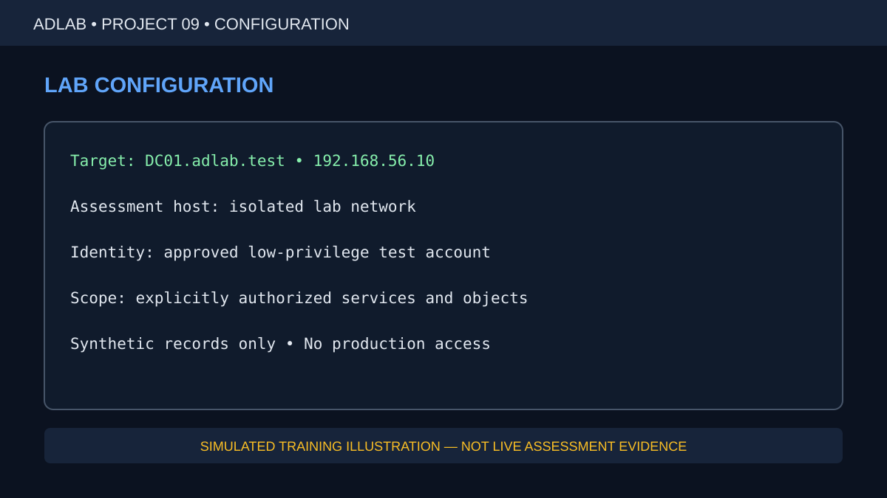
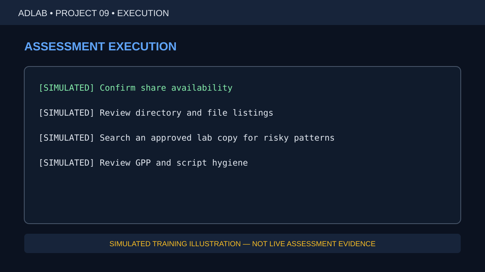
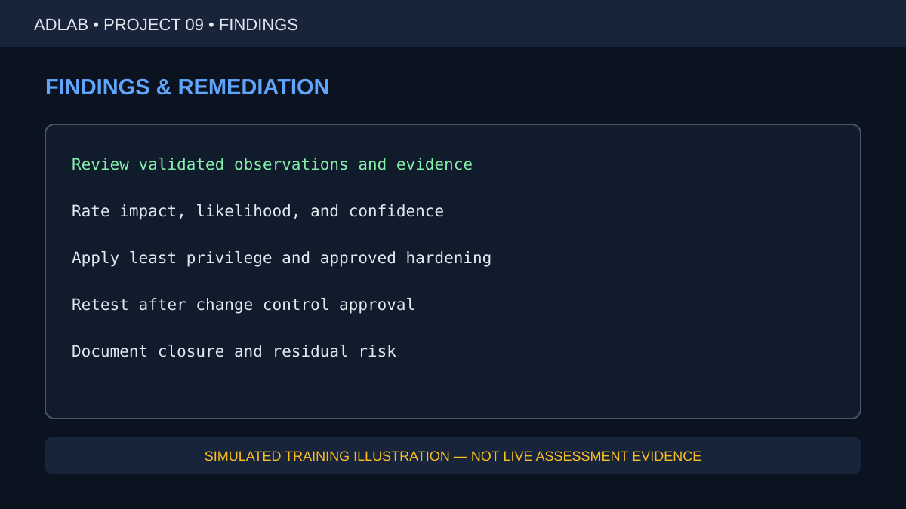

# Project 09 — SYSVOL and NETLOGON Security Assessment

**Beginner | Active Directory security assessment | Read-only unless a step explicitly uses a disposable test resource**

## Objective
Review domain replication shares for access boundaries, legacy scripts, and accidental exposure of secrets or configuration data.

## Scope and lab
- Domain: `adlab.test`
- Domain controller: `DC01.adlab.test` — `192.168.56.10`
- Domain workstation: `CLIENT01` — `192.168.56.20`
- Assessment host: Kali or Windows administration workstation on an isolated host-only network.
- Identity: dedicated low-privilege test account; synthetic identities and files only.

Only test systems covered by written authorization. Never copy secrets into reports or public repositories. Commands and outputs below are examples; validate syntax against your installed OS/tool versions.

## Prerequisites
- Projects 01–05 lab foundation and domain controller operational.
- DNS and time synchronization working.
- Nmap and/or Windows RSAT tools as applicable.
- A documented test window, scope, and evidence-handling plan.
- No production network connectivity for the training lab.

## 1. Configuration and baseline
Confirm the target, source host, account, and approved scope before running commands. Save the baseline configuration and record the assessment timestamp.



## 2. Assessment walkthrough
### Step 1 — Confirm share availability

```bash
smbclient -L //192.168.56.10 -U 'ADLAB\\analyst'
```

Identify SYSVOL and NETLOGON. Use only a dedicated low-privilege domain account.

### Step 2 — Review directory and file listings

```bash
smbclient //192.168.56.10/SYSVOL -U 'ADLAB\\analyst' -c 'ls'
```

Limit review to approved domain paths. Do not bulk-copy domain policy contents.

### Step 3 — Search an approved lab copy for risky patterns

```bash
grep -RniE 'password|passwd|credential|autologon|cpassword' ./approved-sysvol-copy
```

Run only against a sanitized lab export. Treat matches as leads requiring manual validation; do not publish secret values.

### Step 4 — Review GPP and script hygiene

```powershell
Get-GPOReport -All -ReportType Html -Path .\\gpo-report.html
```

Inspect policy reports and approved startup/logon scripts for embedded credentials, overly broad permissions, and insecure configuration.



## 3. Example observations
The following are synthetic examples for training, not assertions about your environment.

- **OBS-09-1:** Legacy Group Policy Preferences XML contains a cpassword attribute.
- **OBS-09-2:** A logon script contains a plaintext lab credential.
- **OBS-09-3:** A script folder allows unintended write access.
- **OBS-09-4:** A policy file exposes sensitive infrastructure details to an overly broad audience.

Validate each observation against the approved baseline, business owner, and relevant system configuration before rating it as a finding.

## 4. Risk analysis and evidence
For each confirmed issue, record:
- Asset, object, share, policy, or setting affected (sanitized identifier).
- Evidence source, exact command or administrative view, timestamp, and test identity.
- Expected versus observed configuration.
- Attack preconditions and business impact.
- Severity rationale, confidence, owner, and remediation target date.

Do not treat a tool warning or an isolated configuration value as proof of exploitability. Capture minimal evidence and protect assessment exports as sensitive data.

## 5. Remediation
- Remove and rotate exposed credentials; treat historical exposure as compromise.
- Use Windows LAPS or a managed secret solution rather than embedded passwords.
- Restrict write access to policy and script deployment paths.
- Review GPO scope and monitor changes to SYSVOL/NETLOGON.



## 6. Detection and monitoring
Review relevant Windows Security, System, Directory Service, PowerShell, and file-server telemetry for the assessment window. Event availability depends on audit policy, SACLs, OS version, and log retention. Correlate source host, account, time, and action; document telemetry gaps rather than assuming no event means no activity.

## 7. Retest and completion checklist
- [ ] Scope and authorization recorded.
- [ ] Baseline captured using approved read-only methods.
- [ ] Assessment steps completed and results validated.
- [ ] Evidence sanitized and securely stored.
- [ ] Findings rated with impact and confidence.
- [ ] Remediation owner and due date assigned.
- [ ] Approved changes retested and closure documented.

## References
- https://learn.microsoft.com/en-us/troubleshoot/windows-server/group-policy/cpassword-attribute-is-no-longer-supported
- https://learn.microsoft.com/en-us/windows-server/identity/laps/laps-overview
- https://learn.microsoft.com/en-us/windows-server/identity/ad-ds/manage/understand-security-groups

## Disclaimer
Educational lab use only. All screenshots and sample findings are simulated training illustrations, not genuine tool captures or customer assessment evidence.
