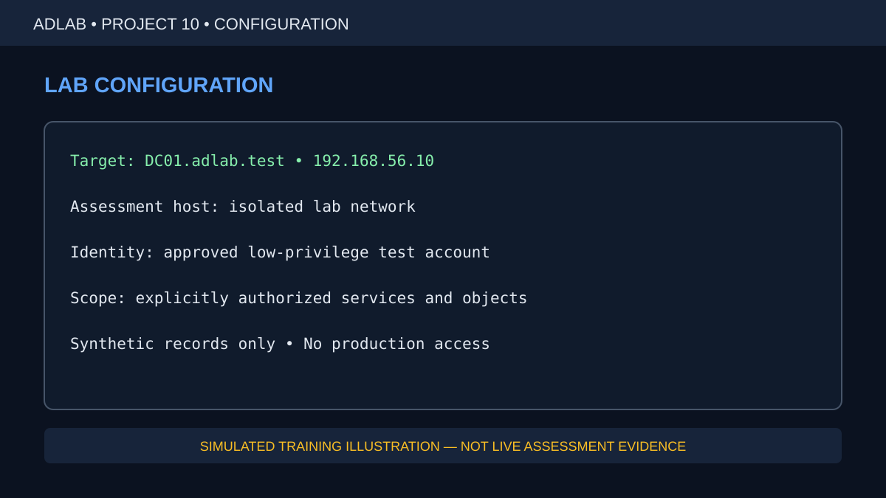
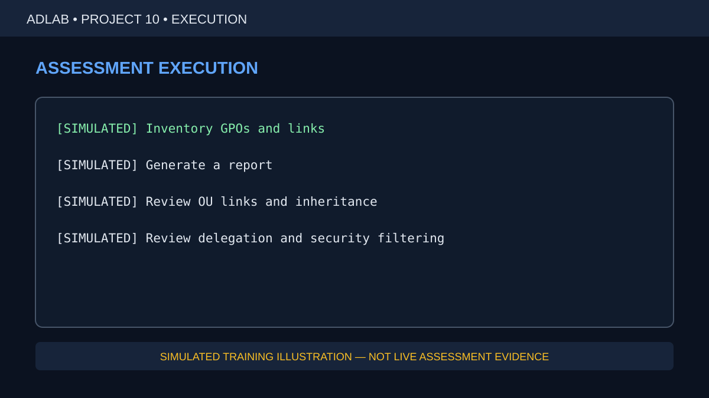
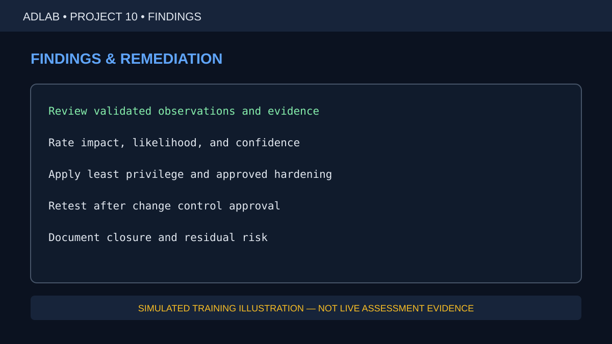

# Project 10 — Group Policy Object (GPO) Security Assessment

**Beginner | Active Directory security assessment | Read-only unless a step explicitly uses a disposable test resource**

## Objective
Inventory GPOs, links, scope, delegation, and security settings; identify policy drift and risky configuration without changing production policy.

## Scope and lab
- Domain: `adlab.test`
- Domain controller: `DC01.adlab.test` — `192.168.56.10`
- Domain workstation: `CLIENT01` — `192.168.56.20`
- Assessment host: Kali or Windows administration workstation on an isolated host-only network.
- Identity: dedicated low-privilege test account; synthetic identities and files only.

Only test systems covered by written authorization. Never copy secrets into reports or public repositories. Commands and outputs below are examples; validate syntax against your installed OS/tool versions.

## Prerequisites
- Projects 01–05 lab foundation and domain controller operational.
- DNS and time synchronization working.
- Nmap and/or Windows RSAT tools as applicable.
- A documented test window, scope, and evidence-handling plan.
- No production network connectivity for the training lab.

## 1. Configuration and baseline
Confirm the target, source host, account, and approved scope before running commands. Save the baseline configuration and record the assessment timestamp.



## 2. Assessment walkthrough
### Step 1 — Inventory GPOs and links

```powershell
Get-GPO -All | Select DisplayName,Id,GpoStatus,CreationTime,ModificationTime
```

Record owner, last change, status, and intended business purpose.

### Step 2 — Generate a report

```powershell
Get-GPOReport -All -ReportType Html -Path .\\all-gpos.html
```

Store the report as sensitive assessment evidence. Redact domain and user identifiers before sharing.

### Step 3 — Review OU links and inheritance

```powershell
Get-GPInheritance -Target 'OU=Workstations,DC=adlab,DC=test'
```

Compare enforced links, inheritance blocks, and scope with the approved design.

### Step 4 — Review delegation and security filtering

```powershell
Get-GPPermission -All -Guid '<GPO-GUID>'
```

Check who can edit, delete, or modify GPO security filtering. Use a real GUID from the lab report.

### Step 5 — Validate representative settings

```powershell
gpresult /h .\\client01-gpresult.html
```

On a test endpoint, compare applied policy with the intended security baseline.



## 3. Example observations
The following are synthetic examples for training, not assertions about your environment.

- **OBS-10-1:** Unapproved principal can edit a GPO linked to privileged systems.
- **OBS-10-2:** A security baseline is disabled or not linked to a target OU.
- **OBS-10-3:** GPO scope includes more systems than intended.
- **OBS-10-4:** Conflicting settings create inconsistent hardening.

Validate each observation against the approved baseline, business owner, and relevant system configuration before rating it as a finding.

## 4. Risk analysis and evidence
For each confirmed issue, record:
- Asset, object, share, policy, or setting affected (sanitized identifier).
- Evidence source, exact command or administrative view, timestamp, and test identity.
- Expected versus observed configuration.
- Attack preconditions and business impact.
- Severity rationale, confidence, owner, and remediation target date.

Do not treat a tool warning or an isolated configuration value as proof of exploitability. Capture minimal evidence and protect assessment exports as sensitive data.

## 5. Remediation
- Limit GPO edit rights to a small controlled administrator group.
- Use change control, versioning, and periodic delegation reviews.
- Correct OU links and security filtering after owner approval.
- Validate effective policy on representative endpoints after changes.



## 6. Detection and monitoring
Review relevant Windows Security, System, Directory Service, PowerShell, and file-server telemetry for the assessment window. Event availability depends on audit policy, SACLs, OS version, and log retention. Correlate source host, account, time, and action; document telemetry gaps rather than assuming no event means no activity.

## 7. Retest and completion checklist
- [ ] Scope and authorization recorded.
- [ ] Baseline captured using approved read-only methods.
- [ ] Assessment steps completed and results validated.
- [ ] Evidence sanitized and securely stored.
- [ ] Findings rated with impact and confidence.
- [ ] Remediation owner and due date assigned.
- [ ] Approved changes retested and closure documented.

## References
- https://learn.microsoft.com/en-us/windows-server/identity/ad-ds/manage/group-policy/group-policy-overview
- https://learn.microsoft.com/en-us/powershell/module/grouppolicy/get-gporeport
- https://learn.microsoft.com/en-us/windows/security/threat-protection/security-policy-settings/security-policy-settings

## Disclaimer
Educational lab use only. All screenshots and sample findings are simulated training illustrations, not genuine tool captures or customer assessment evidence.
