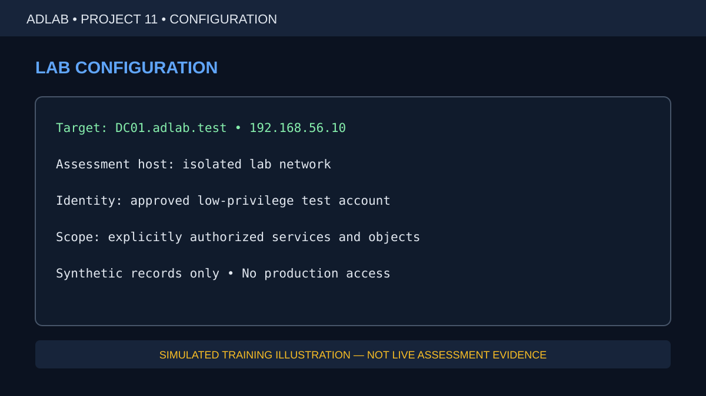
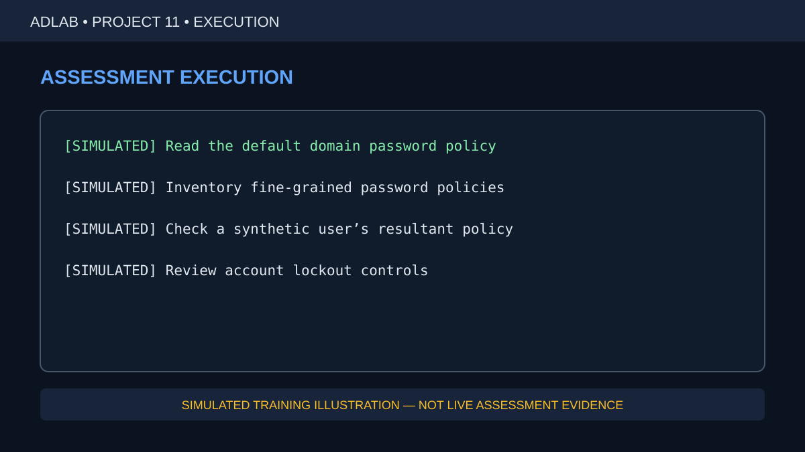
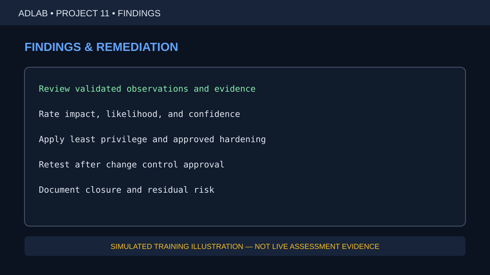

# Project 11 — Password Policy and Account Lockout Assessment

**Beginner | Active Directory security assessment | Read-only unless a step explicitly uses a disposable test resource**

## Objective
Evaluate domain password policy, fine-grained password policies, lockout thresholds, and user-facing controls using read-only policy inspection.

## Scope and lab
- Domain: `adlab.test`
- Domain controller: `DC01.adlab.test` — `192.168.56.10`
- Domain workstation: `CLIENT01` — `192.168.56.20`
- Assessment host: Kali or Windows administration workstation on an isolated host-only network.
- Identity: dedicated low-privilege test account; synthetic identities and files only.

Only test systems covered by written authorization. Never copy secrets into reports or public repositories. Commands and outputs below are examples; validate syntax against your installed OS/tool versions.

## Prerequisites
- Projects 01–05 lab foundation and domain controller operational.
- DNS and time synchronization working.
- Nmap and/or Windows RSAT tools as applicable.
- A documented test window, scope, and evidence-handling plan.
- No production network connectivity for the training lab.

## 1. Configuration and baseline
Confirm the target, source host, account, and approved scope before running commands. Save the baseline configuration and record the assessment timestamp.



## 2. Assessment walkthrough
### Step 1 — Read the default domain password policy

```powershell
Get-ADDefaultDomainPasswordPolicy | Format-List
```

Record minimum length, complexity, history, age, lockout threshold, and observation/reset windows.

### Step 2 — Inventory fine-grained password policies

```powershell
Get-ADFineGrainedPasswordPolicy -Filter * | Select Name,Precedence,MinPasswordLength,LockoutThreshold
```

Determine which users receive each policy through resultant policy checks.

### Step 3 — Check a synthetic user’s resultant policy

```powershell
Get-ADUserResultantPasswordPolicy -Identity 'lab.user'
```

Use a disposable test account. Confirm policy assignment and precedence.

### Step 4 — Review account lockout controls

```powershell
Get-ADDefaultDomainPasswordPolicy | Select LockoutThreshold,LockoutDuration,LockoutObservationWindow
```

Compare policy with the organization's identity standard and operational support model.

### Step 5 — Document password protection coverage

```powershell
Review approved Entra ID / identity protection or on-premises password filter controls
```

Do not conduct password guessing in this project; evaluate controls through configuration and documented validation.



## 3. Example observations
The following are synthetic examples for training, not assertions about your environment.

- **OBS-11-1:** Weak password length or history settings.
- **OBS-11-2:** No lockout policy where one is required by policy.
- **OBS-11-3:** Fine-grained policy precedence is unclear or inconsistent.
- **OBS-11-4:** Password protection controls are absent or unmonitored.

Validate each observation against the approved baseline, business owner, and relevant system configuration before rating it as a finding.

## 4. Risk analysis and evidence
For each confirmed issue, record:
- Asset, object, share, policy, or setting affected (sanitized identifier).
- Evidence source, exact command or administrative view, timestamp, and test identity.
- Expected versus observed configuration.
- Attack preconditions and business impact.
- Severity rationale, confidence, owner, and remediation target date.

Do not treat a tool warning or an isolated configuration value as proof of exploitability. Capture minimal evidence and protect assessment exports as sensitive data.

## 5. Remediation
- Adopt long passphrases and modern password screening aligned to current guidance.
- Tune lockout controls to balance attack resistance and denial-of-service risk.
- Document fine-grained policy precedence and ownership.
- Deploy banned-password screening and MFA; monitor risky authentication.



## 6. Detection and monitoring
Review relevant Windows Security, System, Directory Service, PowerShell, and file-server telemetry for the assessment window. Event availability depends on audit policy, SACLs, OS version, and log retention. Correlate source host, account, time, and action; document telemetry gaps rather than assuming no event means no activity.

## 7. Retest and completion checklist
- [ ] Scope and authorization recorded.
- [ ] Baseline captured using approved read-only methods.
- [ ] Assessment steps completed and results validated.
- [ ] Evidence sanitized and securely stored.
- [ ] Findings rated with impact and confidence.
- [ ] Remediation owner and due date assigned.
- [ ] Approved changes retested and closure documented.

## References
- https://learn.microsoft.com/en-us/windows-server/identity/ad-ds/manage/understand-security-identifiers
- https://learn.microsoft.com/en-us/windows-server/identity/ad-ds/get-started/adac/fine-grained-password-policies
- https://pages.nist.gov/800-63-4/sp800-63b.html

## Disclaimer
Educational lab use only. All screenshots and sample findings are simulated training illustrations, not genuine tool captures or customer assessment evidence.
