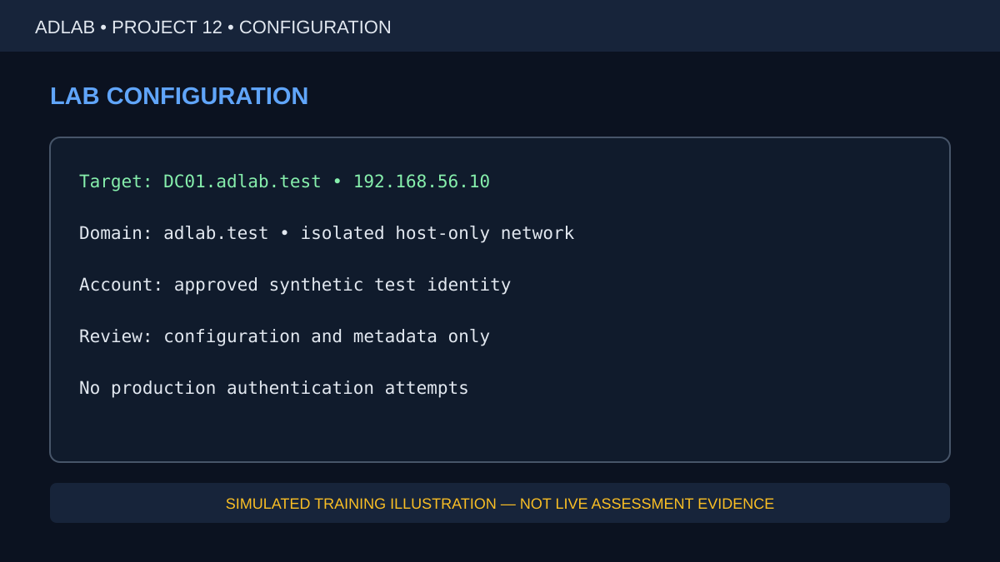
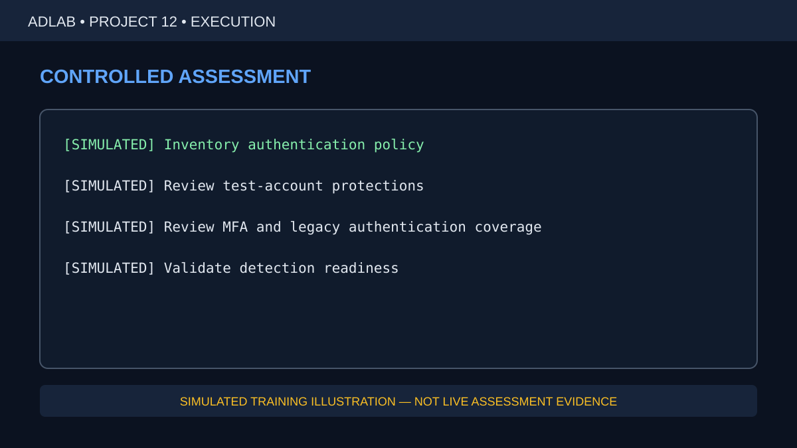
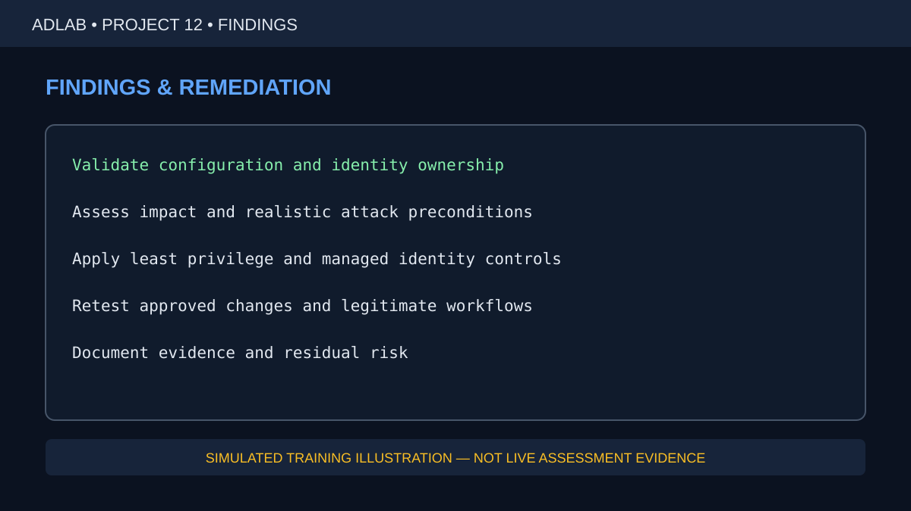

# Project 12 — Password Spraying Risk Assessment

**Beginner | Kerberos and identity security | Authorized lab assessment**

## Objective
Assess password-spraying exposure through policy, identity controls, MFA coverage, lockout resilience, and authentication telemetry. This is a configuration-and-detection review: no password guessing or spraying is performed.

## Scope and safety
- Domain: `adlab.test`; DC: `DC01.adlab.test` (`192.168.56.10`)
- Use an isolated host-only network, synthetic accounts, and approved low-privilege access.
- This project is a configuration and exposure assessment. No credential guessing, password spraying, ticket cracking, credential dumping, or unauthorized account changes.
- Record the assessment window and sanitize all evidence.

## Prerequisites
Projects 01–05 lab baseline; Windows RSAT ActiveDirectory module; domain DNS/time healthy; approved test account; PowerShell logging and evidence storage.

## 1. Lab configuration
Confirm the target domain, source host, account context, and written authorization. Use the dedicated lab domain only.



## 2. Step-by-step walkthrough
### Step 1 — Inventory authentication policy

```powershell
Get-ADDefaultDomainPasswordPolicy | Format-List MinPasswordLength,ComplexityEnabled,LockoutThreshold,LockoutDuration,LockoutObservationWindow
```

Record policy values and compare them with approved standards. Do not infer safety from a lockout threshold alone.

### Step 2 — Review test-account protections

```powershell
Get-ADUser -Filter * -Properties Enabled,PasswordNeverExpires,SmartcardLogonRequired | Select SamAccountName,Enabled,PasswordNeverExpires,SmartcardLogonRequired
```

Use synthetic lab accounts. Avoid exporting real user lists or sensitive attributes.

### Step 3 — Review MFA and legacy authentication coverage

```powershell
Review approved identity provider reports and conditional access/MFA configuration
```

Identify privileged and remote-access accounts lacking strong authentication. Do not change access policies during assessment.

### Step 4 — Validate detection readiness

```powershell
Review SIEM rules for repeated authentication failures across multiple accounts and source addresses
```

Use existing logs or a pre-approved synthetic event replay. Do not generate failed logins against real users.



## 3. Example findings (synthetic)
- **OBS-12-1:** Authentication protections differ between privileged and ordinary accounts.
- **OBS-12-2:** MFA coverage gaps exist for remote or privileged access.
- **OBS-12-3:** Detection rules alert only on per-account failures and miss distributed patterns.
- **OBS-12-4:** Lockout settings create a risk of user disruption or denial of service.

These are possible training observations, not claims about your domain. Validate each result with the identity or application owner before assigning severity.

## 4. Risk and evidence
For every validated issue, record the affected object (sanitized), exact query or configuration source, timestamp, account context, expected state, observed state, business impact, likelihood, confidence, and owner. Preserve minimal evidence only. Never include passwords, hashes, ticket blobs, or real user information in a public repository.

## 5. Remediation
- Require phishing-resistant MFA for privileged and sensitive access where supported.
- Use banned-password screening and long unique passwords.
- Correlate failures across accounts, sources, and time windows; alert on anomalous patterns.
- Tune lockout and smart lockout controls with service-desk and availability requirements.



## 6. Detection and validation
Review DC Security and Kerberos-related telemetry for the approved test window. Event generation depends on audit policy and Windows version; verify logging is enabled before relying on it. Correlate user, source host, service, and time. After approved remediation, repeat the same read-only query and test legitimate application authentication.

## 7. Completion checklist
- [ ] Scope and authorization documented.
- [ ] Baseline and identity context recorded.
- [ ] All checks performed without unauthorized authentication attempts.
- [ ] Findings validated with owners and evidence sanitized.
- [ ] Remediation plan approved and assigned.
- [ ] Retest completed and residual risk documented.

## References
- https://learn.microsoft.com/en-us/entra/identity/authentication/concept-authentication-password-protection
- https://learn.microsoft.com/en-us/entra/identity/authentication/concept-authentication-smart-lockout
- https://attack.mitre.org/techniques/T1110/003/

## Disclaimer
Educational lab use only. Screenshots and sample findings are simulated training illustrations, not genuine tool captures or customer assessment evidence.
