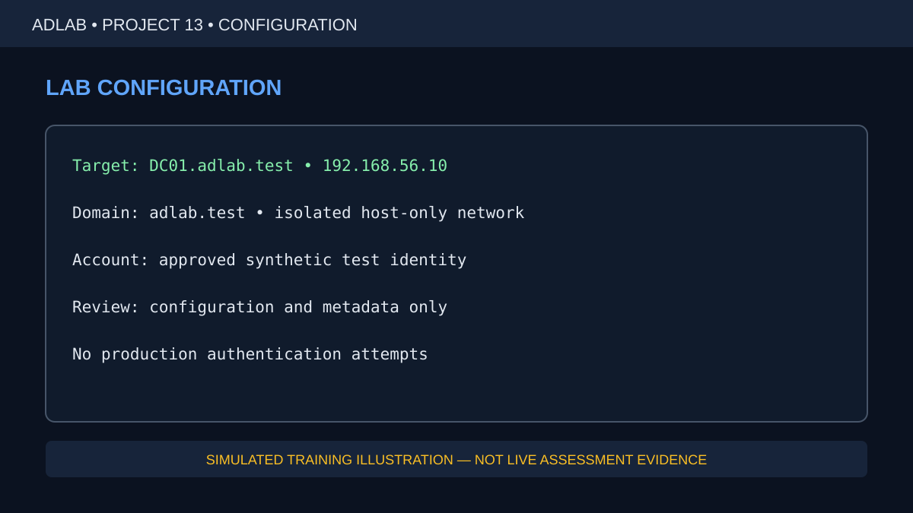
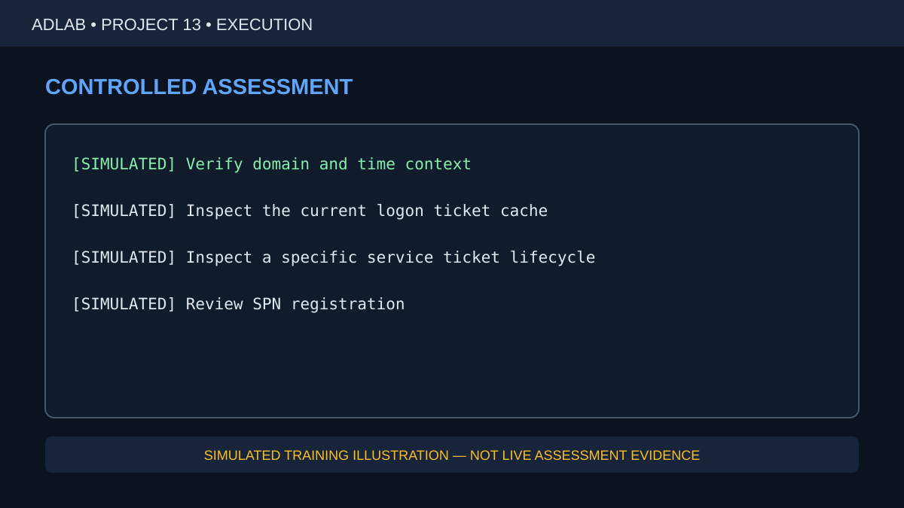
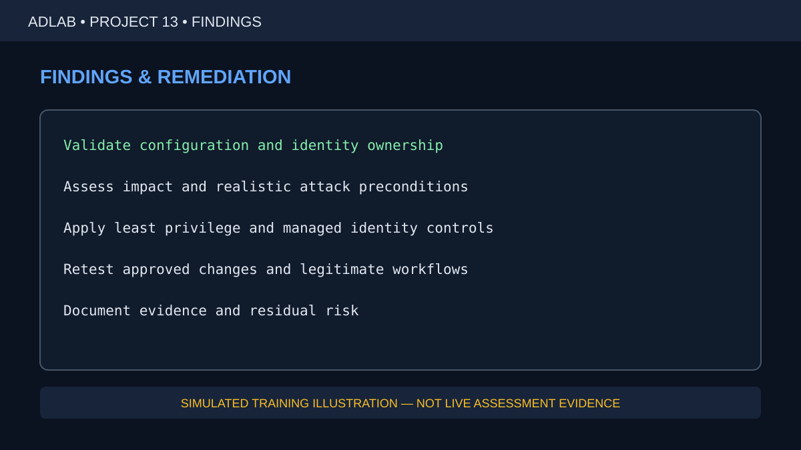

# Project 13 — Kerberos Authentication Fundamentals

**Beginner | Kerberos and identity security | Authorized lab assessment**

## Objective
Understand the Kerberos ticket workflow in Active Directory and inspect normal ticket state, time synchronization, SPNs, and encryption types in a controlled domain.

## Scope and safety
- Domain: `adlab.test`; DC: `DC01.adlab.test` (`192.168.56.10`)
- Use an isolated host-only network, synthetic accounts, and approved low-privilege access.
- This project is a configuration and exposure assessment. No credential guessing, password spraying, ticket cracking, credential dumping, or unauthorized account changes.
- Record the assessment window and sanitize all evidence.

## Prerequisites
Projects 01–05 lab baseline; Windows RSAT ActiveDirectory module; domain DNS/time healthy; approved test account; PowerShell logging and evidence storage.

## 1. Lab configuration
Confirm the target domain, source host, account context, and written authorization. Use the dedicated lab domain only.



## 2. Step-by-step walkthrough
### Step 1 — Verify domain and time context

```powershell
whoami /upn
w32tm /query /status
nltest /dsgetdc:adlab.test
```

Kerberos is time-sensitive. Record the domain identity, selected DC, time source, and offset.

### Step 2 — Inspect the current logon ticket cache

```powershell
klist
```

Identify ticket client, server principal, validity period, and encryption type. Do not export or publish ticket material.

### Step 3 — Inspect a specific service ticket lifecycle

```powershell
klist get cifs/dc01.adlab.test
klist
```

Request only a normal service ticket for a lab service you are authorized to access; compare cache state before and after.

### Step 4 — Review SPN registration

```powershell
setspn -Q */*
```

Run from an authorized Windows host. Review duplicate SPNs and ownership with the service team; avoid changing SPNs during discovery.

### Step 5 — Observe normal authentication

```powershell
Access an approved lab SMB share and correlate client/DC telemetry
```

Record expected service access and relevant event IDs where auditing is enabled.



## 3. Example findings (synthetic)
- **OBS-13-1:** Client clock drift causes authentication failures.
- **OBS-13-2:** Duplicate or stale SPNs complicate service identity and troubleshooting.
- **OBS-13-3:** Legacy encryption types remain enabled without an approved dependency.
- **OBS-13-4:** Kerberos ticket lifetime or privileged account handling differs from policy.

These are possible training observations, not claims about your domain. Validate each result with the identity or application owner before assigning severity.

## 4. Risk and evidence
For every validated issue, record the affected object (sanitized), exact query or configuration source, timestamp, account context, expected state, observed state, business impact, likelihood, confidence, and owner. Preserve minimal evidence only. Never include passwords, hashes, ticket blobs, or real user information in a public repository.

## 5. Remediation
- Maintain reliable domain time hierarchy and monitor clock drift.
- Resolve duplicate and stale SPNs through service-owner change control.
- Modernize encryption settings after compatibility testing.
- Protect privileged logon sessions and monitor unusual ticket activity.



## 6. Detection and validation
Review DC Security and Kerberos-related telemetry for the approved test window. Event generation depends on audit policy and Windows version; verify logging is enabled before relying on it. Correlate user, source host, service, and time. After approved remediation, repeat the same read-only query and test legitimate application authentication.

## 7. Completion checklist
- [ ] Scope and authorization documented.
- [ ] Baseline and identity context recorded.
- [ ] All checks performed without unauthorized authentication attempts.
- [ ] Findings validated with owners and evidence sanitized.
- [ ] Remediation plan approved and assigned.
- [ ] Retest completed and residual risk documented.

## References
- https://learn.microsoft.com/en-us/windows-server/security/kerberos/kerberos-authentication-overview
- https://learn.microsoft.com/en-us/windows-server/security/kerberos/kerberos-authentication-troubleshooting-guidance
- https://attack.mitre.org/techniques/T1558/

## Disclaimer
Educational lab use only. Screenshots and sample findings are simulated training illustrations, not genuine tool captures or customer assessment evidence.
