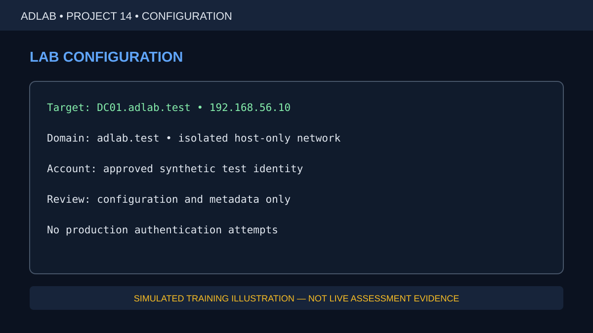
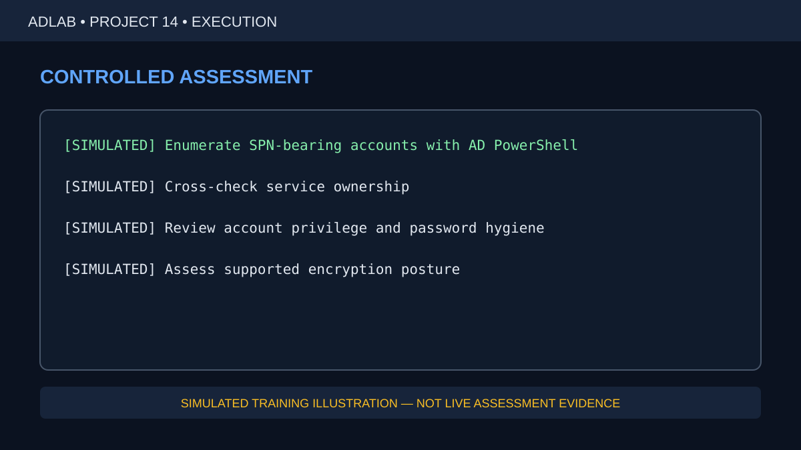
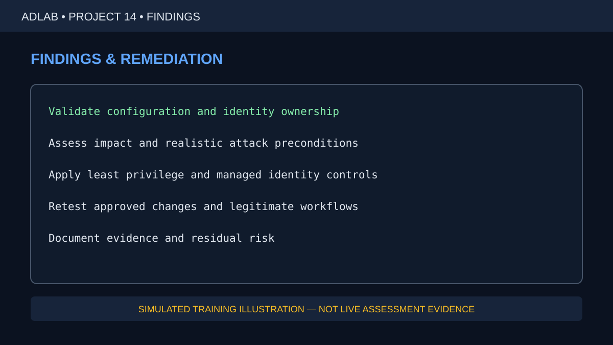

# Project 14 — Kerberoasting Assessment

**Beginner | Kerberos and identity security | Authorized lab assessment**

## Objective
Identify service accounts with SPNs and assess whether their configuration increases Kerberoasting risk. This walkthrough uses directory metadata review only; it does not request tickets for offline cracking or crack passwords.

## Scope and safety
- Domain: `adlab.test`; DC: `DC01.adlab.test` (`192.168.56.10`)
- Use an isolated host-only network, synthetic accounts, and approved low-privilege access.
- This project is a configuration and exposure assessment. No credential guessing, password spraying, ticket cracking, credential dumping, or unauthorized account changes.
- Record the assessment window and sanitize all evidence.

## Prerequisites
Projects 01–05 lab baseline; Windows RSAT ActiveDirectory module; domain DNS/time healthy; approved test account; PowerShell logging and evidence storage.

## 1. Lab configuration
Confirm the target domain, source host, account context, and written authorization. Use the dedicated lab domain only.



## 2. Step-by-step walkthrough
### Step 1 — Enumerate SPN-bearing accounts with AD PowerShell

```powershell
Get-ADUser -LDAPFilter '(servicePrincipalName=*)' -Properties ServicePrincipalName,PasswordLastSet,Enabled,AccountNotDelegated | Select SamAccountName,Enabled,PasswordLastSet,AccountNotDelegated,ServicePrincipalName
```

Limit output to required fields and synthetic lab users.

### Step 2 — Cross-check service ownership

```powershell
Get-ADServiceAccount -Filter * | Select Name,ObjectClass
```

Where gMSAs are deployed, verify service dependencies and authorized retrieval principals with the owner.

### Step 3 — Review account privilege and password hygiene

```powershell
Get-ADGroupMember 'Domain Admins' -Recursive | Select Name,SamAccountName
```

Compare SPN-bearing user accounts with privileged groups, password management, and service ownership records.

### Step 4 — Assess supported encryption posture

```powershell
Review domain Kerberos encryption policy and account settings through approved AD administrative interfaces
```

Do not downgrade encryption or request roastable material as part of this configuration review.



## 3. Example findings (synthetic)
- **OBS-14-1:** SPN-bearing user account has excessive privileges.
- **OBS-14-2:** Service account password is old or manually managed.
- **OBS-14-3:** Service identity is shared by multiple applications without clear ownership.
- **OBS-14-4:** Managed service account is available but a legacy user account remains in use.

These are possible training observations, not claims about your domain. Validate each result with the identity or application owner before assigning severity.

## 4. Risk and evidence
For every validated issue, record the affected object (sanitized), exact query or configuration source, timestamp, account context, expected state, observed state, business impact, likelihood, confidence, and owner. Preserve minimal evidence only. Never include passwords, hashes, ticket blobs, or real user information in a public repository.

## 5. Remediation
- Migrate eligible services to gMSA or another managed identity.
- Use long random managed credentials and rotate on a controlled schedule.
- Remove unnecessary privileged group memberships.
- Inventory SPNs and assign accountable service owners; monitor changes.



## 6. Detection and validation
Review DC Security and Kerberos-related telemetry for the approved test window. Event generation depends on audit policy and Windows version; verify logging is enabled before relying on it. Correlate user, source host, service, and time. After approved remediation, repeat the same read-only query and test legitimate application authentication.

## 7. Completion checklist
- [ ] Scope and authorization documented.
- [ ] Baseline and identity context recorded.
- [ ] All checks performed without unauthorized authentication attempts.
- [ ] Findings validated with owners and evidence sanitized.
- [ ] Remediation plan approved and assigned.
- [ ] Retest completed and residual risk documented.

## References
- https://learn.microsoft.com/en-us/windows-server/identity/ad-ds/manage/group-managed-service-accounts/group-managed-service-accounts-overview
- https://attack.mitre.org/techniques/T1558/003/
- https://learn.microsoft.com/en-us/windows-server/security/kerberos/kerberos-authentication-overview

## Disclaimer
Educational lab use only. Screenshots and sample findings are simulated training illustrations, not genuine tool captures or customer assessment evidence.
