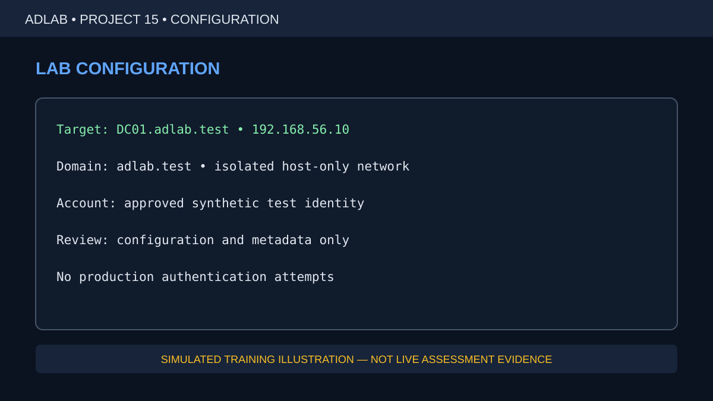
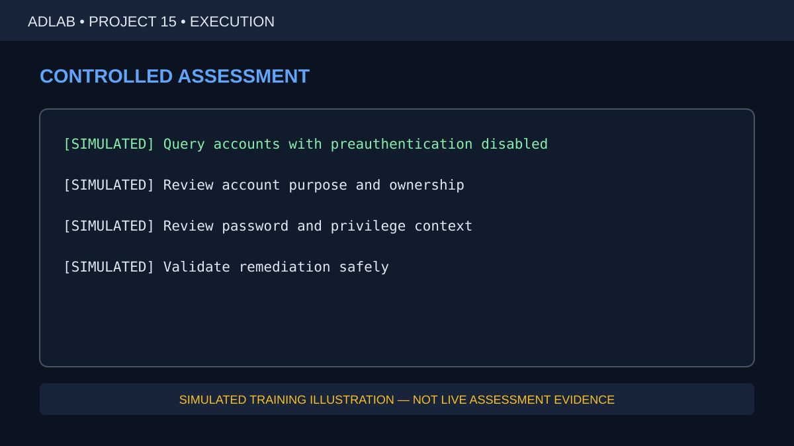
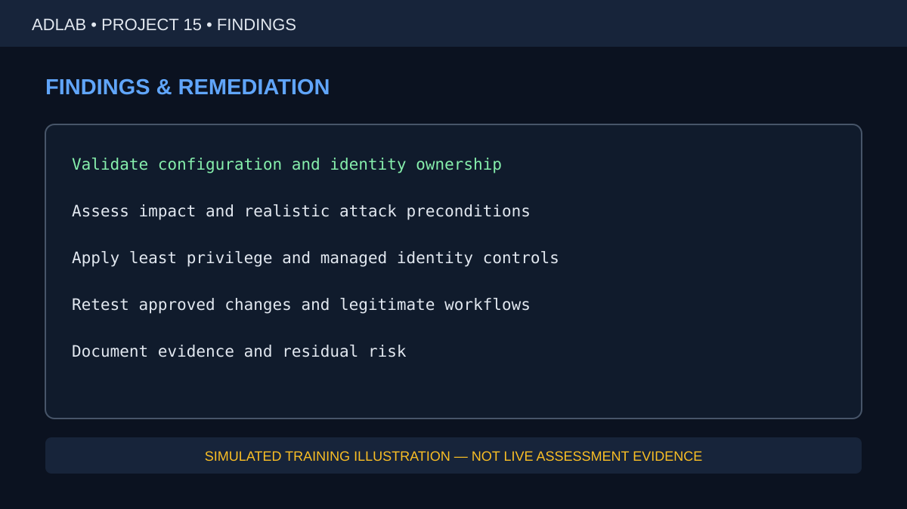

# Project 15 — AS-REP Roasting Assessment

**Beginner | Kerberos and identity security | Authorized lab assessment**

## Objective
Find accounts configured not to require Kerberos preauthentication and assess the exposure. This project checks directory flags only; it does not request AS-REP responses or extract offline-cracking material.

## Scope and safety
- Domain: `adlab.test`; DC: `DC01.adlab.test` (`192.168.56.10`)
- Use an isolated host-only network, synthetic accounts, and approved low-privilege access.
- This project is a configuration and exposure assessment. No credential guessing, password spraying, ticket cracking, credential dumping, or unauthorized account changes.
- Record the assessment window and sanitize all evidence.

## Prerequisites
Projects 01–05 lab baseline; Windows RSAT ActiveDirectory module; domain DNS/time healthy; approved test account; PowerShell logging and evidence storage.

## 1. Lab configuration
Confirm the target domain, source host, account context, and written authorization. Use the dedicated lab domain only.



## 2. Step-by-step walkthrough
### Step 1 — Query accounts with preauthentication disabled

```powershell
Get-ADUser -LDAPFilter '(&(objectCategory=person)(objectClass=user)(userAccountControl:1.2.840.113556.1.4.803:=4194304))' -Properties Enabled,PasswordLastSet,ServicePrincipalName | Select SamAccountName,Enabled,PasswordLastSet
```

The LDAP bitwise matching rule identifies the DONT_REQUIRE_PREAUTH flag. Confirm results against the account's actual configuration.

### Step 2 — Review account purpose and ownership

```powershell
ForEach-Object over the approved result set; validate each identity with its application owner
```

Do not expose real account names in public evidence. Confirm whether the flag is required by a documented legacy dependency.

### Step 3 — Review password and privilege context

```powershell
Get-ADGroupMember 'Domain Admins' -Recursive | Select SamAccountName
```

Check whether any affected identity is privileged, stale, or used for a service.

### Step 4 — Validate remediation safely

```powershell
After approved change, re-query the flag and test the account's legitimate application authentication
```

Coordinate with service owners before changing authentication behavior.



## 3. Example findings (synthetic)
- **OBS-15-1:** A normal user account has preauthentication disabled without documented need.
- **OBS-15-2:** A privileged or service identity has the flag enabled.
- **OBS-15-3:** Affected account has weak or unmanaged password hygiene.
- **OBS-15-4:** Legacy application dependency is undocumented.

These are possible training observations, not claims about your domain. Validate each result with the identity or application owner before assigning severity.

## 4. Risk and evidence
For every validated issue, record the affected object (sanitized), exact query or configuration source, timestamp, account context, expected state, observed state, business impact, likelihood, confidence, and owner. Preserve minimal evidence only. Never include passwords, hashes, ticket blobs, or real user information in a public repository.

## 5. Remediation
- Enable Kerberos preauthentication unless an approved exception exists.
- Rotate affected credentials if exposure is suspected and follow incident-response procedures.
- Move service workloads to managed identities where feasible.
- Monitor changes to userAccountControl and anomalous Kerberos authentication.



## 6. Detection and validation
Review DC Security and Kerberos-related telemetry for the approved test window. Event generation depends on audit policy and Windows version; verify logging is enabled before relying on it. Correlate user, source host, service, and time. After approved remediation, repeat the same read-only query and test legitimate application authentication.

## 7. Completion checklist
- [ ] Scope and authorization documented.
- [ ] Baseline and identity context recorded.
- [ ] All checks performed without unauthorized authentication attempts.
- [ ] Findings validated with owners and evidence sanitized.
- [ ] Remediation plan approved and assigned.
- [ ] Retest completed and residual risk documented.

## References
- https://learn.microsoft.com/en-us/windows-server/security/kerberos/kerberos-authentication-overview
- https://attack.mitre.org/techniques/T1558/004/
- https://learn.microsoft.com/en-us/powershell/module/activedirectory/get-aduser

## Disclaimer
Educational lab use only. Screenshots and sample findings are simulated training illustrations, not genuine tool captures or customer assessment evidence.
