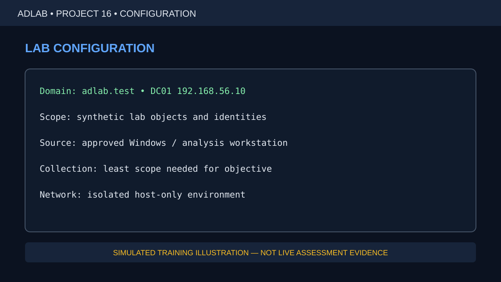
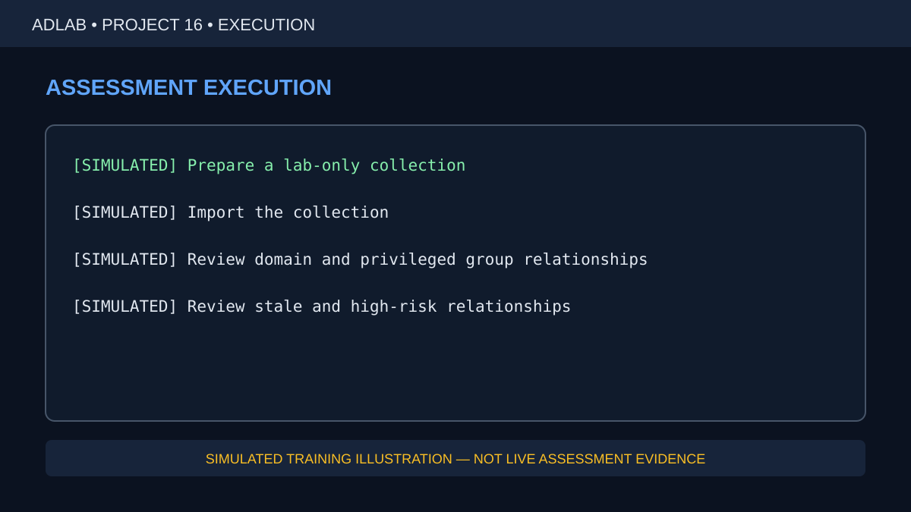
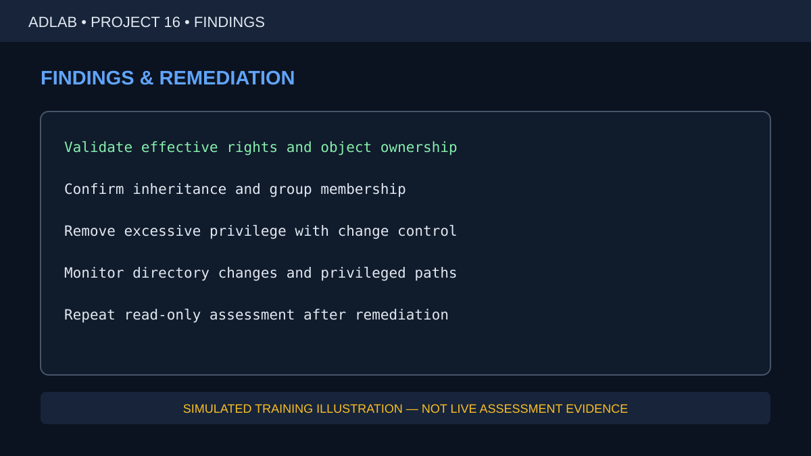

# Project 16 — BloodHound Active Directory Analysis

**Intermediate | Active Directory attack-surface assessment | Read-only validation**

## Objective
Analyze a sanitized BloodHound dataset to identify relationships, excessive privileges, and risky attack paths. Use a lab collection and focus on defensive validation rather than exploitation.

## Scope and lab
- Domain: `adlab.test`; DC: `DC01.adlab.test` (`192.168.56.10`)
- Use an isolated host-only network and synthetic identities/objects.
- Use an approved low-privilege account for collection unless a specific administrative view requires a separately approved account.
- Do not exploit discovered relationships or modify directory permissions during assessment.

## Prerequisites
Projects 01–18 as applicable; Windows RSAT; current approved BloodHound/SharpHound release where applicable; lab snapshot; documented scope and evidence handling.

## 1. Prepare the assessment
Confirm lab snapshot, target objects, tool provenance, collection scope, and assessment window. Capture the initial configuration.



## 2. Step-by-step walkthrough
### Step 1 — Prepare a lab-only collection

```powershell
Install BloodHound Community Edition using its official deployment guide; collect only the isolated adlab.test domain.
```

Use a dedicated low-privilege collector account, approved collection scope, and a snapshot of the lab.

### Step 2 — Import the collection

```powershell
Import the generated lab dataset into the BloodHound interface.
```

Confirm the domain label and collection timestamp. Do not import production data into a personal or public instance.

### Step 3 — Review domain and privileged group relationships

```powershell
Use built-in analysis queries for domain admins, privileged groups, and shortest paths to high-value groups.
```

Treat paths as hypotheses. Validate every edge against actual AD ACLs, group nesting, and business ownership.

### Step 4 — Review stale and high-risk relationships

```powershell
Inspect stale sessions, local admin relationships, unconstrained delegation, and unusual group nesting.
```

Avoid using any discovered relationship to access another system. Record the affected synthetic object IDs only.



## 3. Example observations (synthetic)
- **OBS-16-1:** A low-privilege identity appears on a path to a privileged group.
- **OBS-16-2:** Excessive local administrator relationships are present.
- **OBS-16-3:** Stale sessions or group membership increase exposure.
- **OBS-16-4:** A relationship is misrepresented due to stale or incomplete collection.

These are possible lab findings, not claims about your environment. Validate object ownership, effective permissions, inheritance, and business requirements before assigning severity.

## 4. Evidence and risk analysis
Record sanitized object identifiers, trustee and right, inheritance scope, data source, collection timestamp, account context, expected versus observed access, attack preconditions, business impact, confidence, and owner. Protect graph databases and collection archives as sensitive security data.

## 5. Remediation
- Remove unnecessary group and local administrator relationships.
- Reduce privileged account logon exposure and use dedicated admin tiers.
- Repeat collections on a schedule and label dataset freshness.
- Validate graph relationships against source directory permissions before reporting.



## 6. Detection and retest
Review directory auditing and change monitoring for the relevant object classes and attributes. Audit coverage depends on policy and SACL configuration. After an approved change, repeat the same read-only collection and confirm the risky relationship or delegation no longer exists. Do not perform exploitation as a validation shortcut.

## 7. Completion checklist
- [ ] Written scope and lab boundary confirmed.
- [ ] Collection and tool version documented.
- [ ] Relevant relationships or attributes reviewed.
- [ ] Findings validated against source directory permissions.
- [ ] Evidence sanitized and securely stored.
- [ ] Remediation approved, implemented, and retested.

## References
- https://github.com/SpecterOps/BloodHound
- https://bloodhound.specterops.io/
- https://attack.mitre.org/techniques/T1069/

## Disclaimer
For authorized training labs only. Screenshots and sample observations are simulated illustrations, not genuine tool captures or customer assessment evidence.
