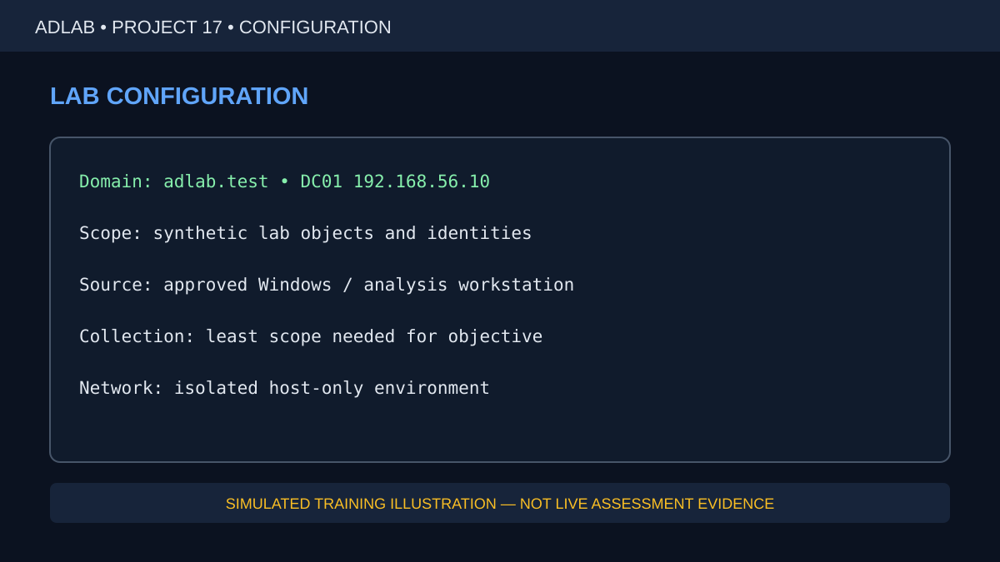
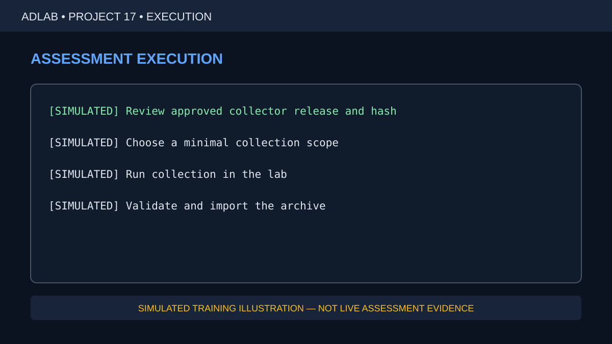
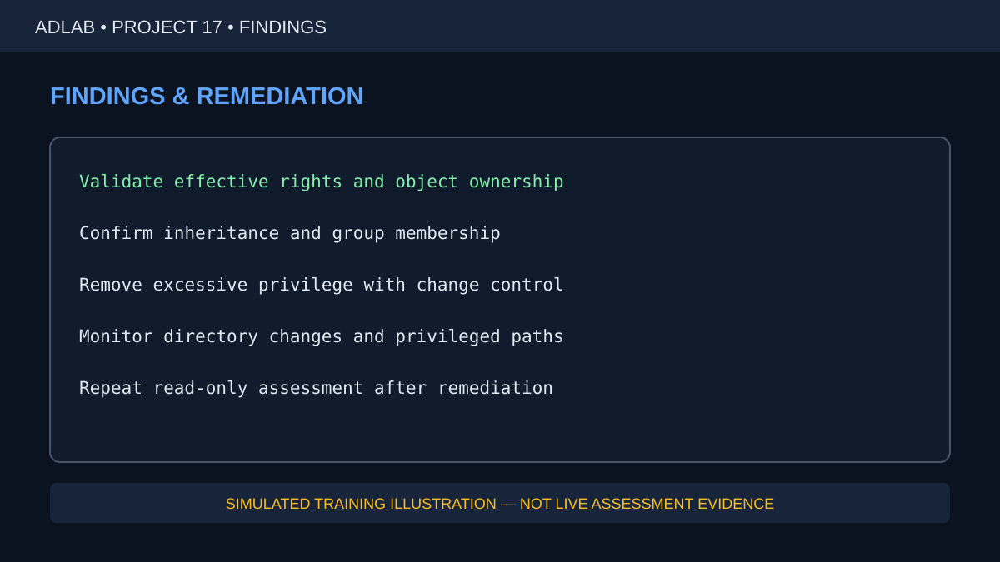

# Project 17 — SharpHound Data Collection and Analysis

**Intermediate | Active Directory attack-surface assessment | Read-only validation**

## Objective
Plan and execute a minimal, authorized SharpHound collection in an isolated lab, then assess dataset coverage, integrity, and handling.

## Scope and lab
- Domain: `adlab.test`; DC: `DC01.adlab.test` (`192.168.56.10`)
- Use an isolated host-only network and synthetic identities/objects.
- Use an approved low-privilege account for collection unless a specific administrative view requires a separately approved account.
- Do not exploit discovered relationships or modify directory permissions during assessment.

## Prerequisites
Projects 01–18 as applicable; Windows RSAT; current approved BloodHound/SharpHound release where applicable; lab snapshot; documented scope and evidence handling.

## 1. Prepare the assessment
Confirm lab snapshot, target objects, tool provenance, collection scope, and assessment window. Capture the initial configuration.



## 2. Step-by-step walkthrough
### Step 1 — Review approved collector release and hash

```powershell
Download SharpHound only from the official BloodHound/SpecterOps release source; record version and SHA-256.
```

Do not use repackaged binaries. Follow endpoint security approval and lab change controls.

### Step 2 — Choose a minimal collection scope

```powershell
Select the smallest collection method required for the learning objective, such as group and trust discovery.
```

Avoid session or local-admin collection unless the isolated lab objective requires it and it is approved.

### Step 3 — Run collection in the lab

```powershell
Execute the approved SharpHound binary with documented options for the lab domain.
```

Capture the exact command, version, host, account, start/end time, and any collection errors.

### Step 4 — Validate and import the archive

```powershell
Verify archive contents and import into the dedicated local BloodHound instance.
```

Treat collection archives as sensitive directory intelligence; restrict access and securely delete temporary copies.



## 3. Example observations (synthetic)
- **OBS-17-1:** Collection scope exceeds the written authorization.
- **OBS-17-2:** Archive contains unnecessary identity or session data.
- **OBS-17-3:** Collection errors produce incomplete or misleading graph results.
- **OBS-17-4:** Sensitive archives are stored without access controls or retention limits.

These are possible lab findings, not claims about your environment. Validate object ownership, effective permissions, inheritance, and business requirements before assigning severity.

## 4. Evidence and risk analysis
Record sanitized object identifiers, trustee and right, inheritance scope, data source, collection timestamp, account context, expected versus observed access, attack preconditions, business impact, confidence, and owner. Protect graph databases and collection archives as sensitive security data.

## 5. Remediation
- Use least-scope collection profiles and record authorization.
- Restrict archive access, encrypt storage, and define retention.
- Repeat incomplete collection only after correcting the cause.
- Remove temporary archives securely after approved analysis.



## 6. Detection and retest
Review directory auditing and change monitoring for the relevant object classes and attributes. Audit coverage depends on policy and SACL configuration. After an approved change, repeat the same read-only collection and confirm the risky relationship or delegation no longer exists. Do not perform exploitation as a validation shortcut.

## 7. Completion checklist
- [ ] Written scope and lab boundary confirmed.
- [ ] Collection and tool version documented.
- [ ] Relevant relationships or attributes reviewed.
- [ ] Findings validated against source directory permissions.
- [ ] Evidence sanitized and securely stored.
- [ ] Remediation approved, implemented, and retested.

## References
- https://bloodhound.specterops.io/collect-data/
- https://github.com/SpecterOps/SharpHound
- https://learn.microsoft.com/en-us/security/

## Disclaimer
For authorized training labs only. Screenshots and sample observations are simulated illustrations, not genuine tool captures or customer assessment evidence.
