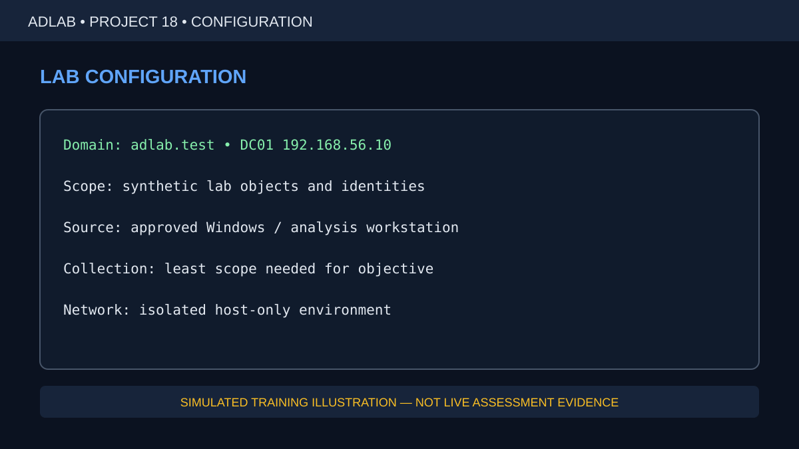
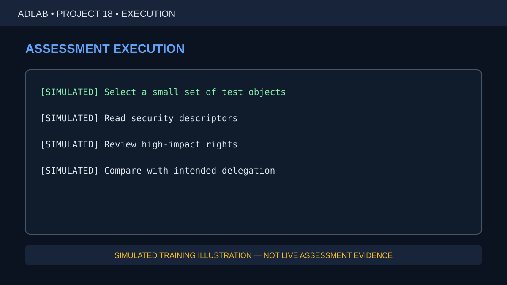
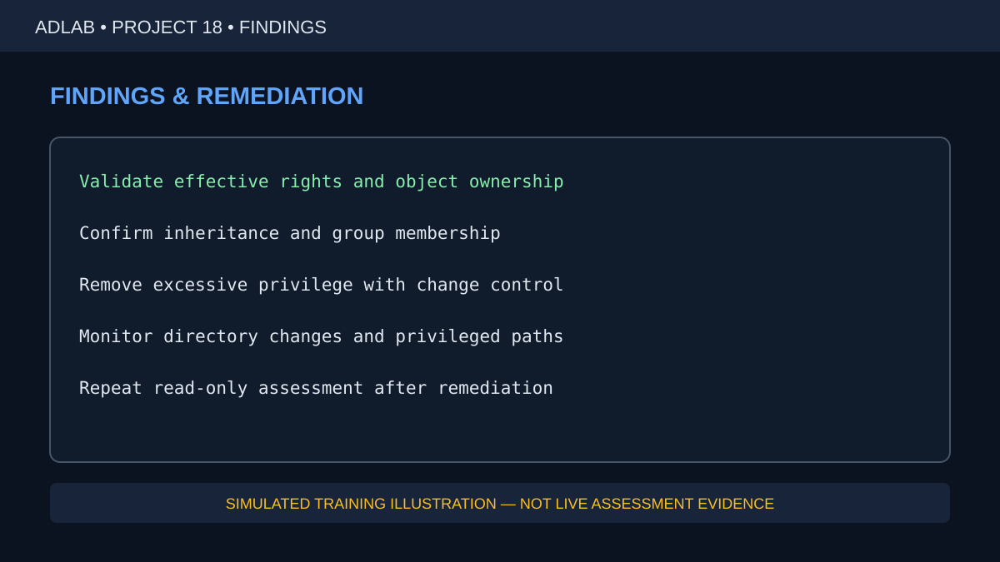

# Project 18 — Active Directory ACL Enumeration

**Intermediate | Active Directory attack-surface assessment | Read-only validation**

## Objective
Review Active Directory access control entries on selected lab objects to understand delegated rights, inheritance, and effective permissions.

## Scope and lab
- Domain: `adlab.test`; DC: `DC01.adlab.test` (`192.168.56.10`)
- Use an isolated host-only network and synthetic identities/objects.
- Use an approved low-privilege account for collection unless a specific administrative view requires a separately approved account.
- Do not exploit discovered relationships or modify directory permissions during assessment.

## Prerequisites
Projects 01–18 as applicable; Windows RSAT; current approved BloodHound/SharpHound release where applicable; lab snapshot; documented scope and evidence handling.

## 1. Prepare the assessment
Confirm lab snapshot, target objects, tool provenance, collection scope, and assessment window. Capture the initial configuration.



## 2. Step-by-step walkthrough
### Step 1 — Select a small set of test objects

```powershell
Choose a synthetic OU, user, group, and computer object created for this assessment.
```

Document object distinguished names and expected owner/delegation.

### Step 2 — Read security descriptors

```powershell
Use Active Directory Users and Computers advanced security view or approved PowerShell/.NET inspection to read the DACL.
```

Do not modify ACEs during enumeration. Preserve only the relevant trustee, right, inheritance, and object scope.

### Step 3 — Review high-impact rights

```powershell
Check for GenericAll, GenericWrite, WriteDACL, WriteOwner, and sensitive extended rights on selected objects.
```

Confirm effective rights with nested group membership and inheritance; do not test abuse or take ownership.

### Step 4 — Compare with intended delegation

```powershell
Compare observed ACEs with the OU delegation matrix and approved admin roles.
```

Record unexplained principals and inherited permissions for owner validation.



## 3. Example observations (synthetic)
- **OBS-18-1:** Unapproved principal has write or ownership rights on sensitive objects.
- **OBS-18-2:** Broad inherited permissions grant unintended control.
- **OBS-18-3:** Delegation is inconsistent with the documented role model.
- **OBS-18-4:** Stale groups retain delegated rights.

These are possible lab findings, not claims about your environment. Validate object ownership, effective permissions, inheritance, and business requirements before assigning severity.

## 4. Evidence and risk analysis
Record sanitized object identifiers, trustee and right, inheritance scope, data source, collection timestamp, account context, expected versus observed access, attack preconditions, business impact, confidence, and owner. Protect graph databases and collection archives as sensitive security data.

## 5. Remediation
- Remove excessive ACEs through reviewed change control.
- Use role-based delegation scoped to dedicated OUs.
- Review inheritance and nested groups before changing ACLs.
- Audit ACL changes and periodically recertify delegated access.



## 6. Detection and retest
Review directory auditing and change monitoring for the relevant object classes and attributes. Audit coverage depends on policy and SACL configuration. After an approved change, repeat the same read-only collection and confirm the risky relationship or delegation no longer exists. Do not perform exploitation as a validation shortcut.

## 7. Completion checklist
- [ ] Written scope and lab boundary confirmed.
- [ ] Collection and tool version documented.
- [ ] Relevant relationships or attributes reviewed.
- [ ] Findings validated against source directory permissions.
- [ ] Evidence sanitized and securely stored.
- [ ] Remediation approved, implemented, and retested.

## References
- https://learn.microsoft.com/en-us/windows/win32/secauthz/access-control-lists
- https://learn.microsoft.com/en-us/windows-server/identity/ad-ds/plan/security-best-practices/implementing-least-privilege-administrative-models

## Disclaimer
For authorized training labs only. Screenshots and sample observations are simulated illustrations, not genuine tool captures or customer assessment evidence.
