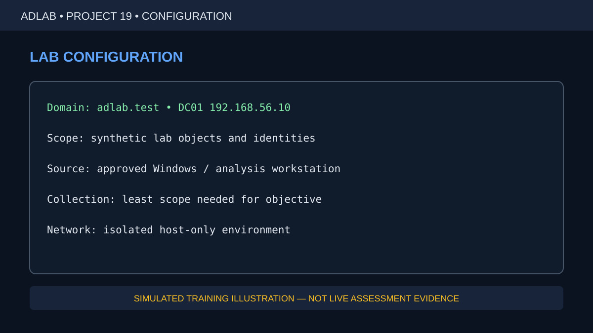
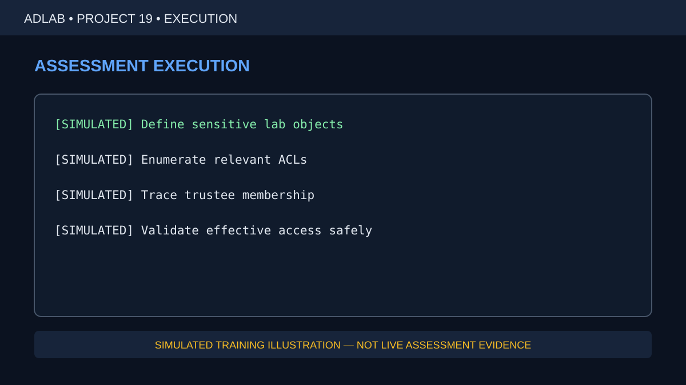
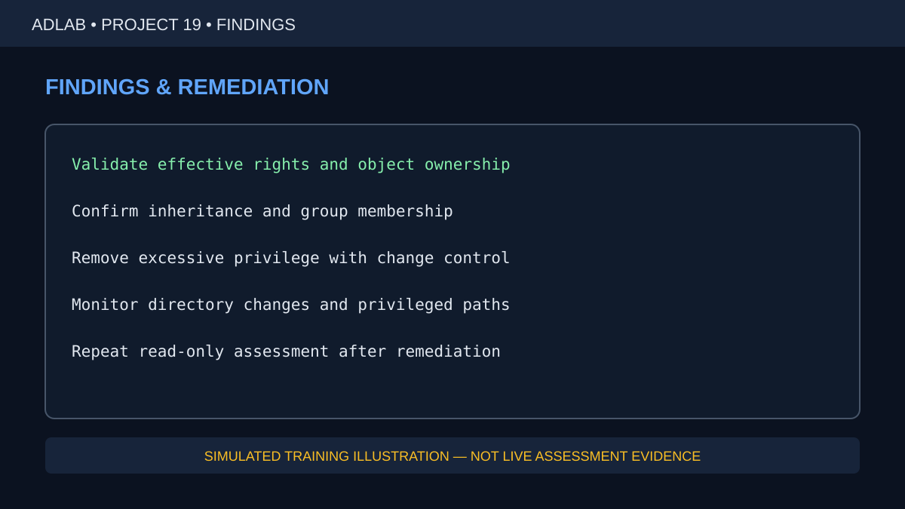

# Project 19 — Dangerous ACL and Permission Abuse Assessment

**Intermediate | Active Directory attack-surface assessment | Read-only validation**

## Objective
Identify directory permissions that could allow unauthorized modification of privileged users, groups, or policy objects. Validate the permission configuration without exercising privilege escalation.

## Scope and lab
- Domain: `adlab.test`; DC: `DC01.adlab.test` (`192.168.56.10`)
- Use an isolated host-only network and synthetic identities/objects.
- Use an approved low-privilege account for collection unless a specific administrative view requires a separately approved account.
- Do not exploit discovered relationships or modify directory permissions during assessment.

## Prerequisites
Projects 01–18 as applicable; Windows RSAT; current approved BloodHound/SharpHound release where applicable; lab snapshot; documented scope and evidence handling.

## 1. Prepare the assessment
Confirm lab snapshot, target objects, tool provenance, collection scope, and assessment window. Capture the initial configuration.



## 2. Step-by-step walkthrough
### Step 1 — Define sensitive lab objects

```powershell
Select synthetic privileged test group, user, OU, and GPO objects.
```

Record expected delegated administrators and permitted operations.

### Step 2 — Enumerate relevant ACLs

```powershell
Use the ACL review approach from Project 18 and a graph analysis tool against the lab dataset.
```

Focus on write permissions, ownership changes, DACL modification, group membership modification, and extended rights.

### Step 3 — Trace trustee membership

```powershell
Resolve each trustee to its direct and nested group membership using read-only directory queries.
```

Do not assume a group is harmless because its name appears ordinary; validate membership and nesting.

### Step 4 — Validate effective access safely

```powershell
Compare access entries with documented role assignments and Windows security descriptor interpretation.
```

Do not add users to groups, modify DACLs, or attempt to change protected objects.



## 3. Example observations (synthetic)
- **OBS-19-1:** A standard user or broad group can modify a privileged group.
- **OBS-19-2:** A non-admin principal can change an object's DACL or owner.
- **OBS-19-3:** Delegated rights apply to descendant objects unexpectedly.
- **OBS-19-4:** A stale group retains sensitive permissions.

These are possible lab findings, not claims about your environment. Validate object ownership, effective permissions, inheritance, and business requirements before assigning severity.

## 4. Evidence and risk analysis
Record sanitized object identifiers, trustee and right, inheritance scope, data source, collection timestamp, account context, expected versus observed access, attack preconditions, business impact, confidence, and owner. Protect graph databases and collection archives as sensitive security data.

## 5. Remediation
- Remove unneeded rights with peer-reviewed ACL changes.
- Separate administration roles and protect privileged groups.
- Constrain delegation scope and inheritance.
- Monitor directory object and ACL changes; retest effective permissions.



## 6. Detection and retest
Review directory auditing and change monitoring for the relevant object classes and attributes. Audit coverage depends on policy and SACL configuration. After an approved change, repeat the same read-only collection and confirm the risky relationship or delegation no longer exists. Do not perform exploitation as a validation shortcut.

## 7. Completion checklist
- [ ] Written scope and lab boundary confirmed.
- [ ] Collection and tool version documented.
- [ ] Relevant relationships or attributes reviewed.
- [ ] Findings validated against source directory permissions.
- [ ] Evidence sanitized and securely stored.
- [ ] Remediation approved, implemented, and retested.

## References
- https://learn.microsoft.com/en-us/windows/win32/secauthz/access-control-lists
- https://attack.mitre.org/techniques/T1098/

## Disclaimer
For authorized training labs only. Screenshots and sample observations are simulated illustrations, not genuine tool captures or customer assessment evidence.
