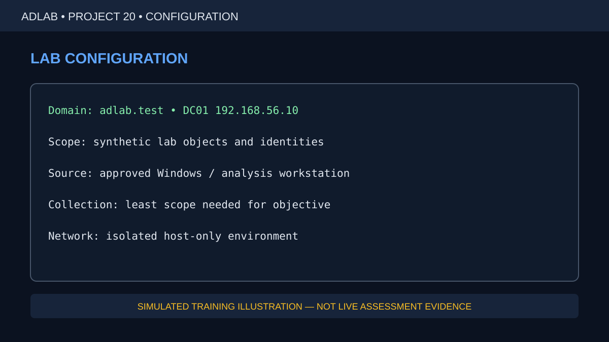
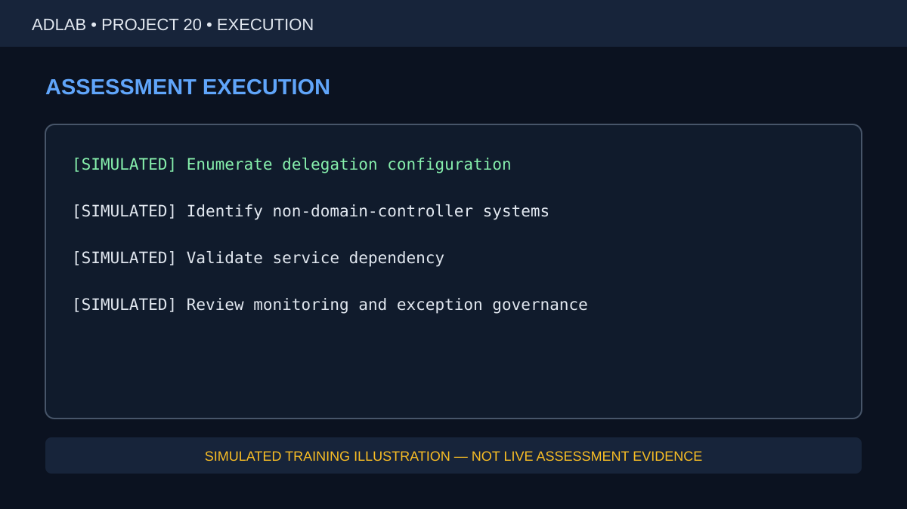
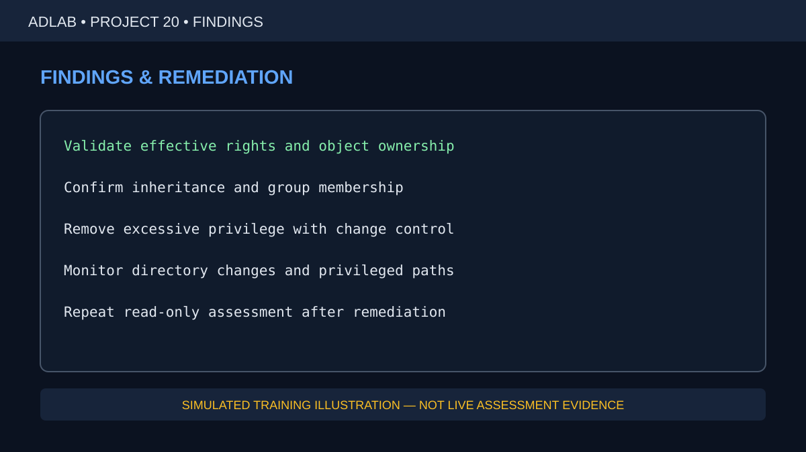

# Project 20 — Unconstrained Delegation Assessment

**Intermediate | Active Directory attack-surface assessment | Read-only validation**

## Objective
Identify computers configured for unconstrained Kerberos delegation and assess business necessity, tiering, and exposure without harvesting tickets or attempting impersonation.

## Scope and lab
- Domain: `adlab.test`; DC: `DC01.adlab.test` (`192.168.56.10`)
- Use an isolated host-only network and synthetic identities/objects.
- Use an approved low-privilege account for collection unless a specific administrative view requires a separately approved account.
- Do not exploit discovered relationships or modify directory permissions during assessment.

## Prerequisites
Projects 01–18 as applicable; Windows RSAT; current approved BloodHound/SharpHound release where applicable; lab snapshot; documented scope and evidence handling.

## 1. Prepare the assessment
Confirm lab snapshot, target objects, tool provenance, collection scope, and assessment window. Capture the initial configuration.



## 2. Step-by-step walkthrough
### Step 1 — Enumerate delegation configuration

```powershell
Get-ADComputer -Filter * -Properties TrustedForDelegation,OperatingSystem | Where-Object {$_.TrustedForDelegation -eq $true} | Select Name,OperatingSystem,TrustedForDelegation
```

Run read-only against the lab domain. Review only authorized computer objects.

### Step 2 — Identify non-domain-controller systems

```powershell
Compare results with approved DC inventory and server ownership.
```

Investigate unexpected workstations, application servers, or systems in lower trust tiers.

### Step 3 — Validate service dependency

```powershell
Ask system owners to document why delegation is required and whether constrained alternatives are supported.
```

Do not access LSASS, inspect ticket caches on other systems, or collect credentials.

### Step 4 — Review monitoring and exception governance

```powershell
Check for approved delegation exceptions, system hardening, and change monitoring.
```

Record owner, business justification, expiry date, and compensating controls.



## 3. Example observations (synthetic)
- **OBS-20-1:** Unconstrained delegation is enabled on a non-DC server without justification.
- **OBS-20-2:** A lower-trust system is configured to accept delegated credentials.
- **OBS-20-3:** Exceptions lack owner, expiry, or monitoring.

These are possible lab findings, not claims about your environment. Validate object ownership, effective permissions, inheritance, and business requirements before assigning severity.

## 4. Evidence and risk analysis
Record sanitized object identifiers, trustee and right, inheritance scope, data source, collection timestamp, account context, expected versus observed access, attack preconditions, business impact, confidence, and owner. Protect graph databases and collection archives as sensitive security data.

## 5. Remediation
- Remove unconstrained delegation where not required.
- Prefer resource-based constrained delegation or constrained delegation with protocol transition only where justified.
- Isolate and harden systems with unavoidable delegation.
- Monitor delegation attribute changes and privileged authentication to delegated hosts.



## 6. Detection and retest
Review directory auditing and change monitoring for the relevant object classes and attributes. Audit coverage depends on policy and SACL configuration. After an approved change, repeat the same read-only collection and confirm the risky relationship or delegation no longer exists. Do not perform exploitation as a validation shortcut.

## 7. Completion checklist
- [ ] Written scope and lab boundary confirmed.
- [ ] Collection and tool version documented.
- [ ] Relevant relationships or attributes reviewed.
- [ ] Findings validated against source directory permissions.
- [ ] Evidence sanitized and securely stored.
- [ ] Remediation approved, implemented, and retested.

## References
- https://learn.microsoft.com/en-us/windows-server/security/kerberos/kerberos-constrained-delegation-overview
- https://attack.mitre.org/techniques/T1558/

## Disclaimer
For authorized training labs only. Screenshots and sample observations are simulated illustrations, not genuine tool captures or customer assessment evidence.
