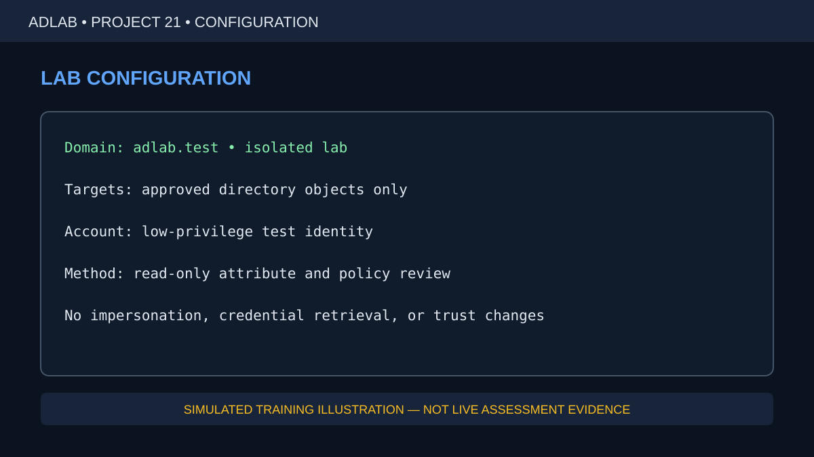
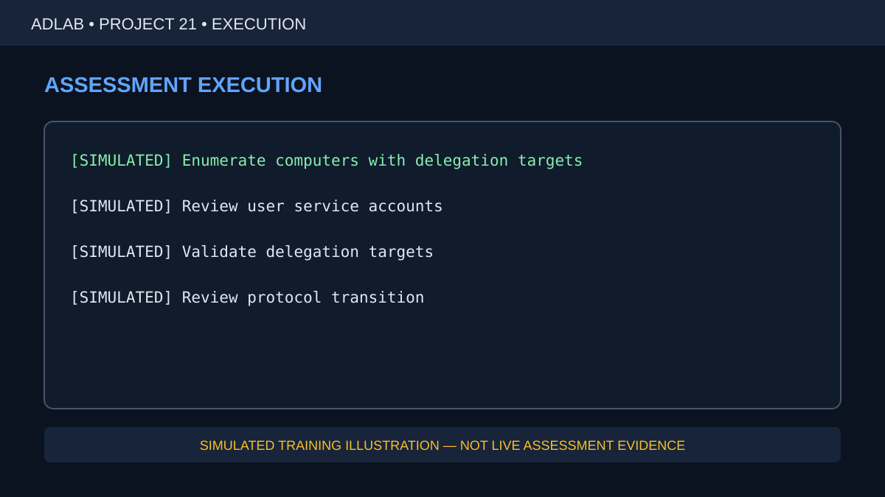
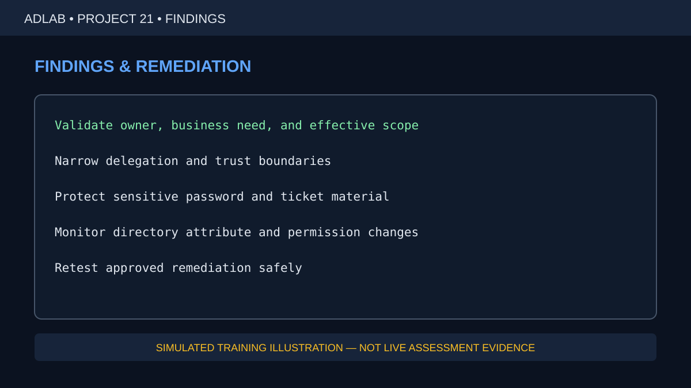

# Project 21 — Constrained Delegation Assessment

**Intermediate | Kerberos delegation and trust security | Read-only assessment**

## Objective
Inventory constrained Kerberos delegation configuration, validate service targets and protocol-transition settings, and assess whether delegation scope is justified.

## Scope and safety
- Lab domain: `adlab.test`; DC: `DC01.adlab.test` — `192.168.56.10`.
- Use synthetic accounts, computer objects, and isolated virtual networks.
- Do not impersonate users, extract tickets, retrieve managed passwords, or alter trust/delegation descriptors during discovery.
- Any change must be approved by the relevant domain and service owners.

## Prerequisites
Projects 01–20 as applicable; Windows RSAT ActiveDirectory module; current lab snapshot; documented object scope and evidence-handling plan.

## 1. Configuration
Confirm target domain(s), DCs, source host, account context, and authorization. Record the baseline before enumeration.



## 2. Step-by-step walkthrough
### Step 1 — Enumerate computers with delegation targets

```powershell
Get-ADComputer -Filter * -Properties 'msDS-AllowedToDelegateTo','TrustedToAuthForDelegation' | Where-Object {$_.'msDS-AllowedToDelegateTo'} | Select Name,TrustedToAuthForDelegation,'msDS-AllowedToDelegateTo'
```

Use read-only directory queries. Review only authorized lab objects.

### Step 2 — Review user service accounts

```powershell
Get-ADUser -LDAPFilter '(servicePrincipalName=*)' -Properties 'msDS-AllowedToDelegateTo','TrustedToAuthForDelegation' | Select SamAccountName,TrustedToAuthForDelegation,'msDS-AllowedToDelegateTo'
```

Identify service principals with delegation configuration and validate the owner.

### Step 3 — Validate delegation targets

```powershell
Compare each listed SPN with the approved service inventory and server ownership records.
```

Look for broad or unexpected target services, stale entries, and services outside the intended trust boundary.

### Step 4 — Review protocol transition

```powershell
Check whether TrustedToAuthForDelegation is enabled and whether the application design requires it.
```

Do not request delegated tickets or impersonate users as part of this review.



## 3. Example findings (synthetic)
- **OBS-21-1:** Delegation targets include services outside the documented application boundary.
- **OBS-21-2:** Protocol transition is enabled without a business justification.
- **OBS-21-3:** A service account has excessive privilege relative to its delegated target.

A populated attribute or existing trust is not automatically a vulnerability. Confirm effective behavior, owner intent, and business need before assigning severity.

## 4. Evidence and risk analysis
Record sanitized object identifiers, source domain, target domain/service, relevant attribute or permission, command and timestamp, account context, business justification, attack preconditions, impact, confidence, and owner. Never publish passwords, tickets, security descriptors containing sensitive identifiers, or customer topology.

## 5. Remediation
- Remove stale delegation targets after owner validation.
- Constrain delegation to the exact SPNs required by the application.
- Avoid protocol transition unless a documented design requires it.
- Use dedicated service identities, least privilege, and periodic delegation reviews.



## 6. Detection and retest
Review directory attribute-change auditing, authentication telemetry, and change-management records. Audit visibility depends on policy and SACL configuration. After approved remediation, repeat the same read-only queries and verify legitimate service authentication still works.

## 7. Completion checklist
- [ ] Scope and owners confirmed.
- [ ] Read-only configuration inventory completed.
- [ ] Every finding validated with service/domain owners.
- [ ] Evidence sanitized and stored securely.
- [ ] Remediation approved and scheduled.
- [ ] Retest and residual risk documented.

## References
- https://learn.microsoft.com/en-us/windows-server/security/kerberos/kerberos-constrained-delegation-overview
- https://learn.microsoft.com/en-us/windows-server/identity/ad-ds/manage/understand-security-groups

## Disclaimer
For authorized lab use only. Screenshots and sample findings are simulated training illustrations, not genuine tool captures or customer assessment evidence.
