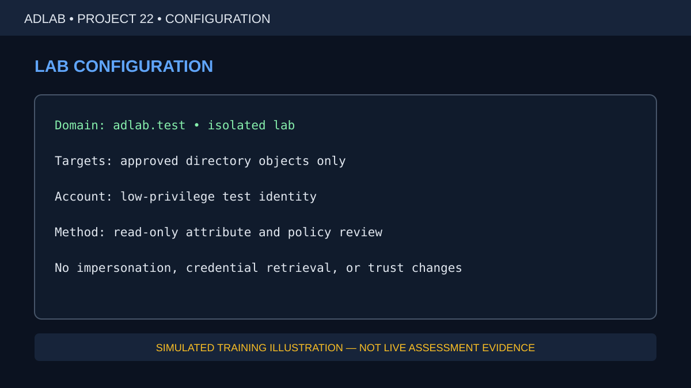
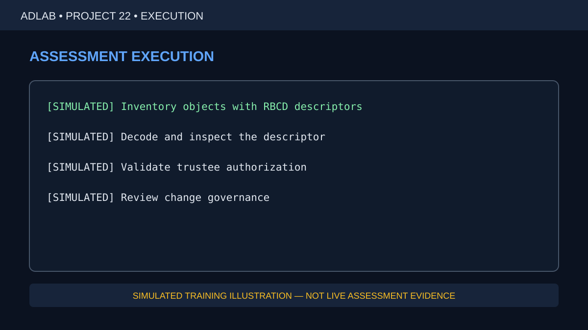
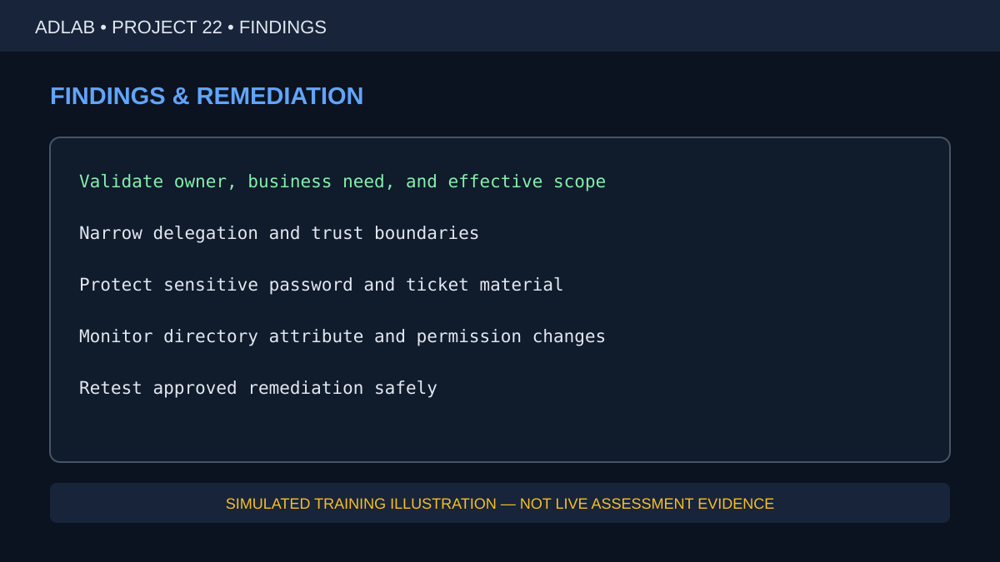

# Project 22 — Resource-Based Constrained Delegation Assessment

**Intermediate | Kerberos delegation and trust security | Read-only assessment**

## Objective
Review resource-based constrained delegation (RBCD) security descriptors on computer objects and identify unapproved principals without attempting impersonation.

## Scope and safety
- Lab domain: `adlab.test`; DC: `DC01.adlab.test` — `192.168.56.10`.
- Use synthetic accounts, computer objects, and isolated virtual networks.
- Do not impersonate users, extract tickets, retrieve managed passwords, or alter trust/delegation descriptors during discovery.
- Any change must be approved by the relevant domain and service owners.

## Prerequisites
Projects 01–20 as applicable; Windows RSAT ActiveDirectory module; current lab snapshot; documented object scope and evidence-handling plan.

## 1. Configuration
Confirm target domain(s), DCs, source host, account context, and authorization. Record the baseline before enumeration.



## 2. Step-by-step walkthrough
### Step 1 — Inventory objects with RBCD descriptors

```powershell
Get-ADComputer -Filter * -Properties 'msDS-AllowedToActOnBehalfOfOtherIdentity' | Where-Object {$_.'msDS-AllowedToActOnBehalfOfOtherIdentity'} | Select Name,DistinguishedName
```

A populated attribute warrants review, not an automatic vulnerability verdict.

### Step 2 — Decode and inspect the descriptor

```powershell
Use a reviewed, read-only security descriptor parser in the lab to resolve trustee SIDs and access rights.
```

Document trustee, SID resolution, ACE type, and target computer. Do not change the descriptor.

### Step 3 — Validate trustee authorization

```powershell
Resolve each trustee against the directory and compare it with the approved service relationship.
```

Check stale computer accounts, unexpected principals, and broad group trustees.

### Step 4 — Review change governance

```powershell
Inspect change records and audit coverage for writes to the RBCD attribute.
```

Do not test the relationship by requesting service tickets or impersonating a user.



## 3. Example findings (synthetic)
- **OBS-22-1:** Unexpected computer or user principal is permitted by an RBCD descriptor.
- **OBS-22-2:** A stale principal remains authorized to delegate to a server.
- **OBS-22-3:** RBCD configuration has no accountable owner or change record.

A populated attribute or existing trust is not automatically a vulnerability. Confirm effective behavior, owner intent, and business need before assigning severity.

## 4. Evidence and risk analysis
Record sanitized object identifiers, source domain, target domain/service, relevant attribute or permission, command and timestamp, account context, business justification, attack preconditions, impact, confidence, and owner. Never publish passwords, tickets, security descriptors containing sensitive identifiers, or customer topology.

## 5. Remediation
- Remove unauthorized trustees through approved ACL change control.
- Restrict RBCD to the exact managed service principal required.
- Disable or retire stale principals after dependency validation.
- Alert on changes to msDS-AllowedToActOnBehalfOfOtherIdentity.



## 6. Detection and retest
Review directory attribute-change auditing, authentication telemetry, and change-management records. Audit visibility depends on policy and SACL configuration. After approved remediation, repeat the same read-only queries and verify legitimate service authentication still works.

## 7. Completion checklist
- [ ] Scope and owners confirmed.
- [ ] Read-only configuration inventory completed.
- [ ] Every finding validated with service/domain owners.
- [ ] Evidence sanitized and stored securely.
- [ ] Remediation approved and scheduled.
- [ ] Retest and residual risk documented.

## References
- https://learn.microsoft.com/en-us/windows-server/security/kerberos/kerberos-constrained-delegation-overview
- https://learn.microsoft.com/en-us/windows/win32/adschema/a-msds-allowedtoactonbehalfofotheridentity

## Disclaimer
For authorized lab use only. Screenshots and sample findings are simulated training illustrations, not genuine tool captures or customer assessment evidence.
