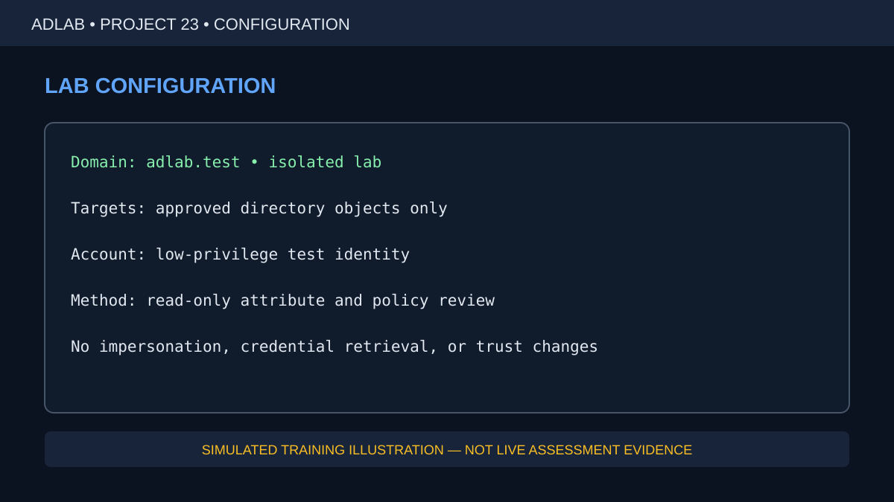
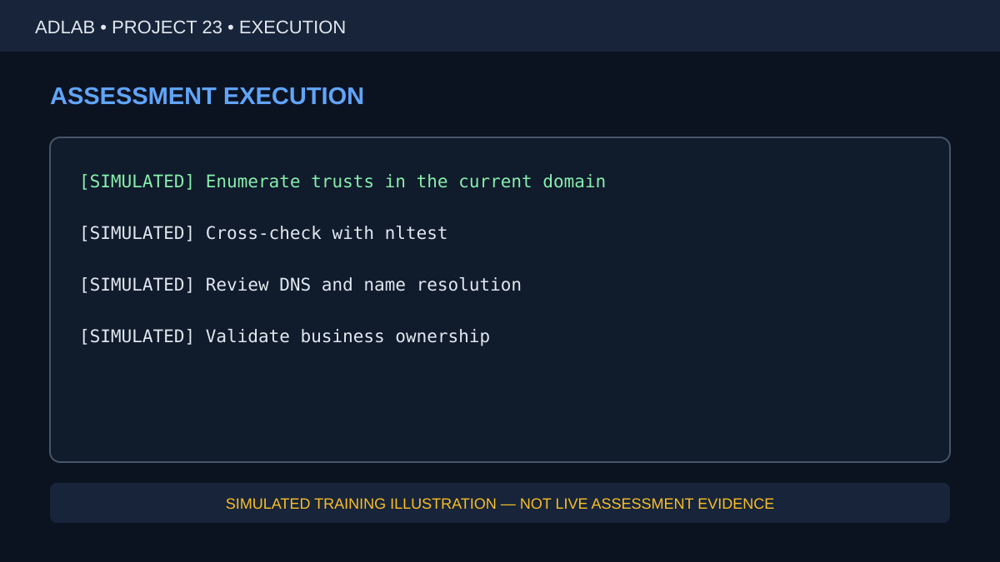
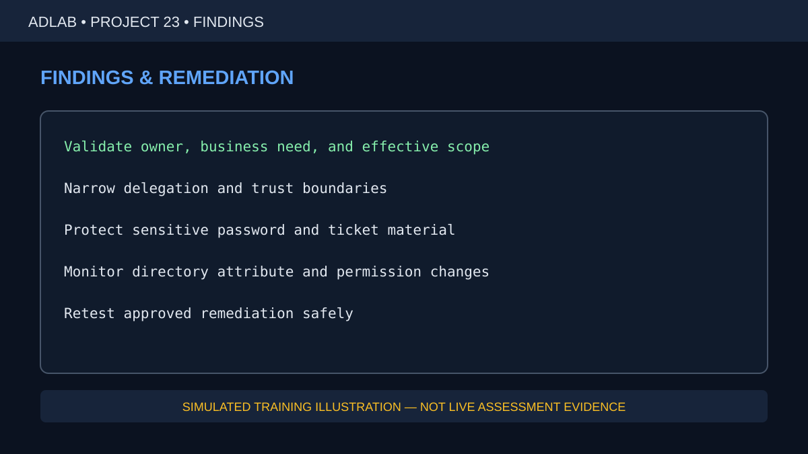

# Project 23 — Domain Trust Enumeration

**Intermediate | Kerberos delegation and trust security | Read-only assessment**

## Objective
Inventory domain and forest trust relationships, trust direction, type, transitivity, and security ownership.

## Scope and safety
- Lab domain: `adlab.test`; DC: `DC01.adlab.test` — `192.168.56.10`.
- Use synthetic accounts, computer objects, and isolated virtual networks.
- Do not impersonate users, extract tickets, retrieve managed passwords, or alter trust/delegation descriptors during discovery.
- Any change must be approved by the relevant domain and service owners.

## Prerequisites
Projects 01–20 as applicable; Windows RSAT ActiveDirectory module; current lab snapshot; documented object scope and evidence-handling plan.

## 1. Configuration
Confirm target domain(s), DCs, source host, account context, and authorization. Record the baseline before enumeration.



## 2. Step-by-step walkthrough
### Step 1 — Enumerate trusts in the current domain

```powershell
Get-ADTrust -Filter * | Select Name,Source,Target,Direction,TrustType,ForestTransitive,SelectiveAuthentication
```

Run from an authorized domain member with RSAT.

### Step 2 — Cross-check with nltest

```powershell
nltest /domain_trusts /all_trusts
```

Compare command output with directory metadata; note unavailable or stale trust records.

### Step 3 — Review DNS and name resolution

```powershell
Resolve each trusted domain's approved DNS records using the configured lab DNS infrastructure.
```

Do not scan or enumerate systems in the trusted domain unless separately authorized.

### Step 4 — Validate business ownership

```powershell
Compare trust inventory with architecture diagrams, application dependencies, and owner records.
```

Record purpose, data boundary, authentication requirements, and review date.



## 3. Example findings (synthetic)
- **OBS-23-1:** Trust exists without a current business owner.
- **OBS-23-2:** Trust direction or transitivity is broader than required.
- **OBS-23-3:** Selective authentication is not used where the security design expects it.
- **OBS-23-4:** Legacy trust is still active after migration.

A populated attribute or existing trust is not automatically a vulnerability. Confirm effective behavior, owner intent, and business need before assigning severity.

## 4. Evidence and risk analysis
Record sanitized object identifiers, source domain, target domain/service, relevant attribute or permission, command and timestamp, account context, business justification, attack preconditions, impact, confidence, and owner. Never publish passwords, tickets, security descriptors containing sensitive identifiers, or customer topology.

## 5. Remediation
- Remove obsolete trusts through a planned change with both domain owners.
- Use the narrowest trust direction and scope that meets business needs.
- Apply selective authentication where appropriate and test application dependencies.
- Review trust configuration and ownership periodically.



## 6. Detection and retest
Review directory attribute-change auditing, authentication telemetry, and change-management records. Audit visibility depends on policy and SACL configuration. After approved remediation, repeat the same read-only queries and verify legitimate service authentication still works.

## 7. Completion checklist
- [ ] Scope and owners confirmed.
- [ ] Read-only configuration inventory completed.
- [ ] Every finding validated with service/domain owners.
- [ ] Evidence sanitized and stored securely.
- [ ] Remediation approved and scheduled.
- [ ] Retest and residual risk documented.

## References
- https://learn.microsoft.com/en-us/windows-server/identity/ad-ds/plan/security-best-practices/understanding-trusts
- https://learn.microsoft.com/en-us/powershell/module/activedirectory/get-adtrust

## Disclaimer
For authorized lab use only. Screenshots and sample findings are simulated training illustrations, not genuine tool captures or customer assessment evidence.
