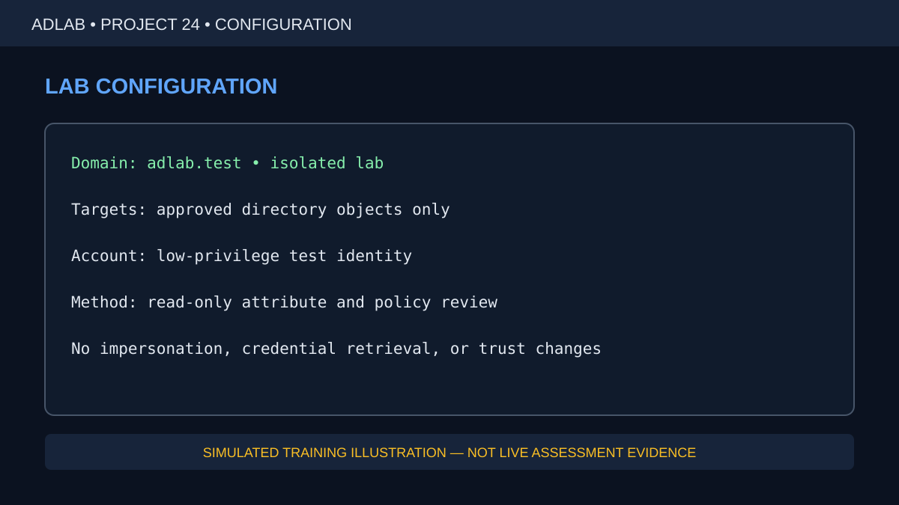
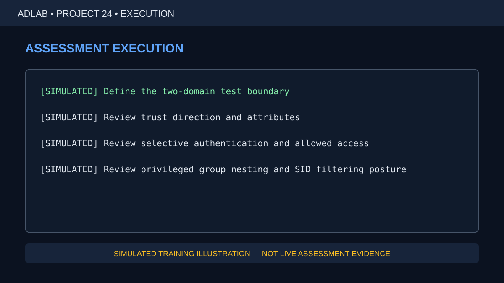
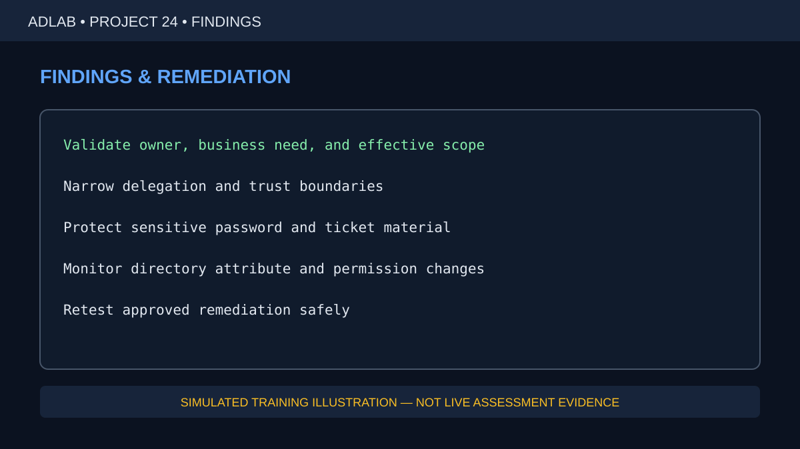

# Project 24 — Cross-Domain Trust Security Assessment

**Intermediate | Kerberos delegation and trust security | Read-only assessment**

## Objective
Assess the security boundaries created by an approved pair of lab domains, including trust scope, authentication restrictions, privileged group exposure, and name-resolution dependencies.

## Scope and safety
- Lab domain: `adlab.test`; DC: `DC01.adlab.test` — `192.168.56.10`.
- Use synthetic accounts, computer objects, and isolated virtual networks.
- Do not impersonate users, extract tickets, retrieve managed passwords, or alter trust/delegation descriptors during discovery.
- Any change must be approved by the relevant domain and service owners.

## Prerequisites
Projects 01–20 as applicable; Windows RSAT ActiveDirectory module; current lab snapshot; documented object scope and evidence-handling plan.

## 1. Configuration
Confirm target domain(s), DCs, source host, account context, and authorization. Record the baseline before enumeration.



## 2. Step-by-step walkthrough
### Step 1 — Define the two-domain test boundary

```powershell
Document source domain, target domain, trust owners, DCs, approved test identities, and allowed services.
```

Use only domains created for this lab or explicitly authorized by both owners.

### Step 2 — Review trust direction and attributes

```powershell
Get-ADTrust -Filter * -Server 'dc01.adlab.test' | Format-List Name,Direction,TrustType,ForestTransitive,SelectiveAuthentication
```

Run on the source domain and repeat from the other domain with its approved DC.

### Step 3 — Review selective authentication and allowed access

```powershell
Inspect the target domain's allowed-to-authenticate delegation for the synthetic test computer and service.
```

Do not attempt access to unapproved hosts or use privileged credentials across the trust.

### Step 4 — Review privileged group nesting and SID filtering posture

```powershell
Compare trust configuration and privileged group memberships with Microsoft's current trust-hardening guidance.
```

Do not manipulate SID history or test forged identities.



## 3. Example findings (synthetic)
- **OBS-24-1:** Trust grants wider authentication than the approved design.
- **OBS-24-2:** Cross-domain privileged group nesting is not justified.
- **OBS-24-3:** Selective authentication settings are inconsistent with the documented boundary.
- **OBS-24-4:** Trust maintenance and ownership are unclear.

A populated attribute or existing trust is not automatically a vulnerability. Confirm effective behavior, owner intent, and business need before assigning severity.

## 4. Evidence and risk analysis
Record sanitized object identifiers, source domain, target domain/service, relevant attribute or permission, command and timestamp, account context, business justification, attack preconditions, impact, confidence, and owner. Never publish passwords, tickets, security descriptors containing sensitive identifiers, or customer topology.

## 5. Remediation
- Narrow trust direction and transitivity where possible.
- Use selective authentication and explicit allowed-to-authenticate assignments where suitable.
- Review privileged group nesting and remove unnecessary cross-domain access.
- Maintain documented owners, renewal/review dates, and monitoring.



## 6. Detection and retest
Review directory attribute-change auditing, authentication telemetry, and change-management records. Audit visibility depends on policy and SACL configuration. After approved remediation, repeat the same read-only queries and verify legitimate service authentication still works.

## 7. Completion checklist
- [ ] Scope and owners confirmed.
- [ ] Read-only configuration inventory completed.
- [ ] Every finding validated with service/domain owners.
- [ ] Evidence sanitized and stored securely.
- [ ] Remediation approved and scheduled.
- [ ] Retest and residual risk documented.

## References
- https://learn.microsoft.com/en-us/windows-server/identity/ad-ds/plan/security-best-practices/understanding-trusts
- https://learn.microsoft.com/en-us/windows-server/identity/ad-ds/manage/forest-trusts
- https://attack.mitre.org/techniques/T1482/

## Disclaimer
For authorized lab use only. Screenshots and sample findings are simulated training illustrations, not genuine tool captures or customer assessment evidence.
