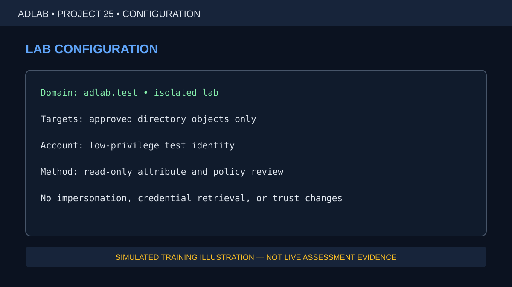
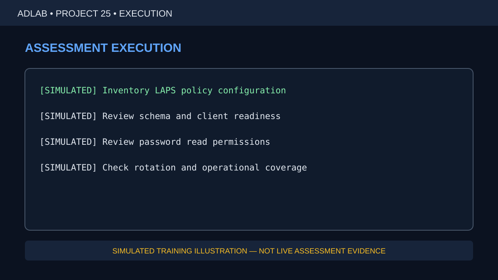
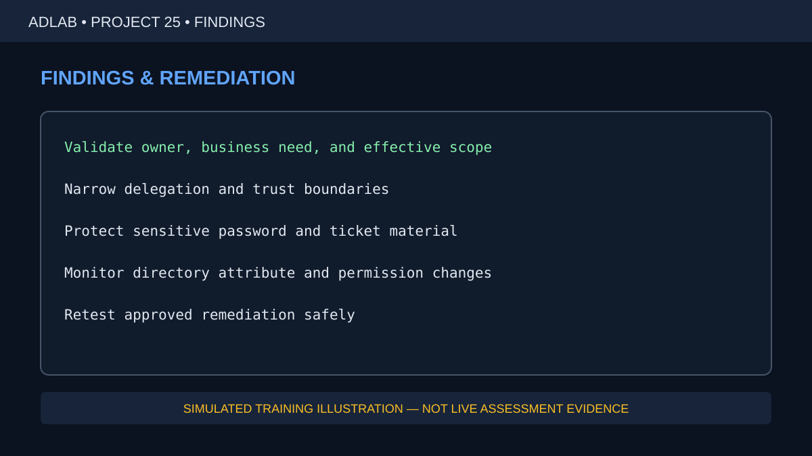

# Project 25 — LAPS and Windows LAPS Security Assessment

**Intermediate | Kerberos delegation and trust security | Read-only assessment**

## Objective
Verify Windows LAPS deployment, policy scope, password access delegation, rotation health, and legacy LAPS dependencies.

## Scope and safety
- Lab domain: `adlab.test`; DC: `DC01.adlab.test` — `192.168.56.10`.
- Use synthetic accounts, computer objects, and isolated virtual networks.
- Do not impersonate users, extract tickets, retrieve managed passwords, or alter trust/delegation descriptors during discovery.
- Any change must be approved by the relevant domain and service owners.

## Prerequisites
Projects 01–20 as applicable; Windows RSAT ActiveDirectory module; current lab snapshot; documented object scope and evidence-handling plan.

## 1. Configuration
Confirm target domain(s), DCs, source host, account context, and authorization. Record the baseline before enumeration.



## 2. Step-by-step walkthrough
### Step 1 — Inventory LAPS policy configuration

```powershell
Review Windows LAPS Group Policy or Intune policy and identify the target OUs.
```

Record backup directory, password age, encryption, and post-authentication actions where configured.

### Step 2 — Review schema and client readiness

```powershell
Get-Command *Laps*; Get-ADComputer -Filter * -Properties msLAPS-PasswordExpirationTime | Select Name,msLAPS-PasswordExpirationTime
```

Use read-only checks; do not retrieve or display stored LAPS passwords.

### Step 3 — Review password read permissions

```powershell
Use the supported LAPS PowerShell permission cmdlets to inspect extended rights and delegated readers.
```

Validate that only approved support tiers can retrieve passwords for their assigned OUs.

### Step 4 — Check rotation and operational coverage

```powershell
Compare password expiration metadata with policy and endpoint health reporting.
```

Do not force resets or retrieve credentials during this assessment.



## 3. Example findings (synthetic)
- **OBS-25-1:** LAPS policy is not applied to a server or workstation OU.
- **OBS-25-2:** Too many users can read managed local administrator passwords.
- **OBS-25-3:** Password expiration is stale or rotation is failing.
- **OBS-25-4:** Legacy LAPS and Windows LAPS configurations overlap without a migration plan.

A populated attribute or existing trust is not automatically a vulnerability. Confirm effective behavior, owner intent, and business need before assigning severity.

## 4. Evidence and risk analysis
Record sanitized object identifiers, source domain, target domain/service, relevant attribute or permission, command and timestamp, account context, business justification, attack preconditions, impact, confidence, and owner. Never publish passwords, tickets, security descriptors containing sensitive identifiers, or customer topology.

## 5. Remediation
- Deploy Windows LAPS to all eligible endpoints with tested policy scope.
- Delegate password retrieval to the minimum support groups and OU scope.
- Enable encryption and appropriate post-authentication actions where supported.
- Monitor expiration and backup health; remove legacy configuration after migration.



## 6. Detection and retest
Review directory attribute-change auditing, authentication telemetry, and change-management records. Audit visibility depends on policy and SACL configuration. After approved remediation, repeat the same read-only queries and verify legitimate service authentication still works.

## 7. Completion checklist
- [ ] Scope and owners confirmed.
- [ ] Read-only configuration inventory completed.
- [ ] Every finding validated with service/domain owners.
- [ ] Evidence sanitized and stored securely.
- [ ] Remediation approved and scheduled.
- [ ] Retest and residual risk documented.

## References
- https://learn.microsoft.com/en-us/windows-server/identity/laps/laps-overview
- https://learn.microsoft.com/en-us/windows-server/identity/laps/laps-management-powershell
- https://learn.microsoft.com/en-us/windows-server/identity/laps/laps-scenarios-windows-server-active-directory

## Disclaimer
For authorized lab use only. Screenshots and sample findings are simulated training illustrations, not genuine tool captures or customer assessment evidence.
