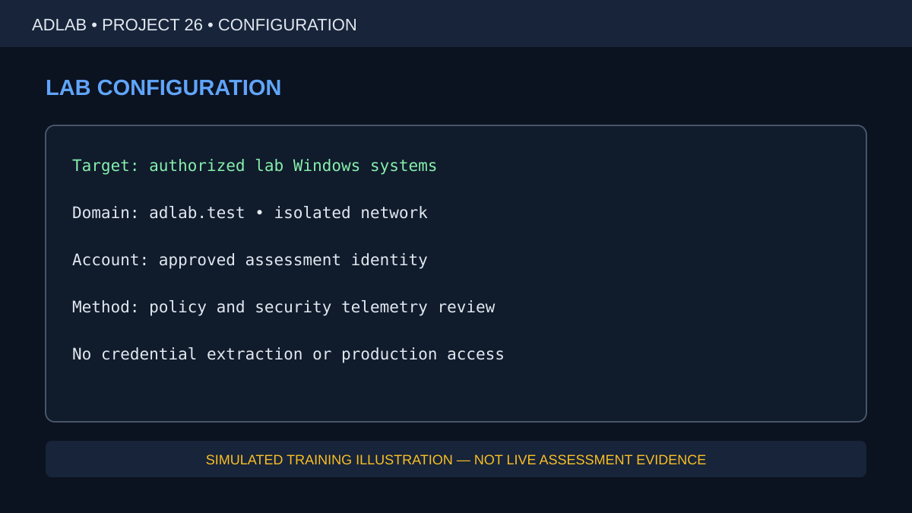
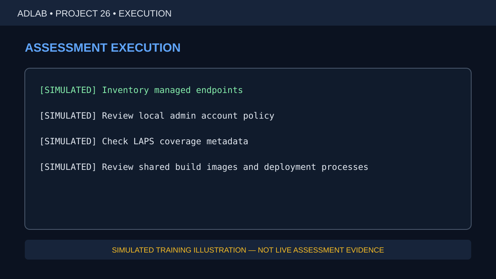
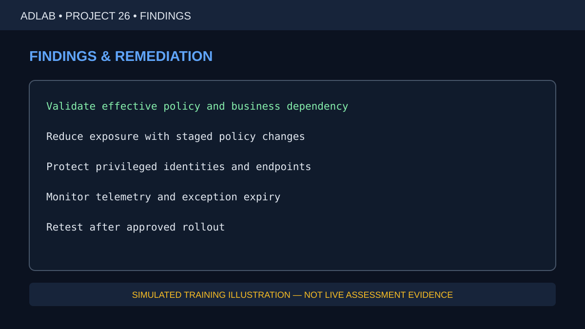

# Project 26 — Local Administrator Password Reuse Assessment

**Intermediate | Windows identity security | Authorized configuration assessment**

## Objective
Evaluate local administrator account hygiene and password-reuse exposure through policy, LAPS coverage, inventory, and approved configuration evidence. Do not collect or compare password hashes.

## Scope and safety
- Domain: `adlab.test`; DC: `DC01.adlab.test` (`192.168.56.10`); client: `CLIENT01` (`192.168.56.20`).
- Use an isolated lab and approved test systems only.
- Do not dump credentials, extract hashes, perform password guessing, or disable protections during assessment.
- Treat endpoint inventory and security reports as sensitive.

## Prerequisites
Projects 01–05 lab baseline; Windows RSAT/PowerShell; authorized local or domain read access; endpoint owner approval; current backup/snapshot.

## 1. Baseline and configuration
Confirm system role, OS version, policy scope, source account, and assessment window. Record a baseline before reviewing settings.



## 2. Step-by-step walkthrough
### Step 1 — Inventory managed endpoints

```powershell
Get-ADComputer -Filter * -Properties OperatingSystem,Enabled | Select Name,OperatingSystem,Enabled
```

Compare with the approved asset inventory and identify systems that may be outside management.

### Step 2 — Review local admin account policy

```powershell
Review Windows security baseline and endpoint configuration management for local Administrators group membership.
```

Use Group Policy/Intune/RMM reporting. Do not attempt remote logons with candidate passwords.

### Step 3 — Check LAPS coverage metadata

```powershell
Get-ADComputer -Filter * -Properties msLAPS-PasswordExpirationTime | Select Name,msLAPS-PasswordExpirationTime
```

Do not retrieve or export local administrator passwords.

### Step 4 — Review shared build images and deployment processes

```powershell
Inspect approved golden-image and provisioning documentation for default local administrator settings.
```

Do not search production devices for secrets or extract credential material.



## 3. Example findings (synthetic)
- **OBS-26-1:** Multiple systems rely on a common unmanaged local administrator credential.
- **OBS-26-2:** LAPS is missing from part of the endpoint fleet.
- **OBS-26-3:** Local admin membership is broader than the support role requires.
- **OBS-26-4:** Build process leaves a default local administrator enabled.

These are training scenarios. Confirm OS support, endpoint role, business need, and effective policy before assigning severity.

## 4. Evidence and risk
Record sanitized asset ID, policy or setting, effective value, source command/report, timestamp, OS build, owner, business impact, likelihood, confidence, and exceptions. Do not include secrets or sensitive endpoint data in public evidence.

## 5. Remediation
- Deploy Windows LAPS and verify backup/rotation coverage.
- Use unique managed local administrator passwords per endpoint.
- Restrict local Administrators group membership through controlled policy.
- Remove default credentials from images and validate provisioning pipelines.



## 6. Detection and retest
Validate endpoint security telemetry, Group Policy processing, and centralized compliance reporting. After approved changes, repeat the same configuration checks and test legitimate business workflows. Roll out changes in a pilot before broad enforcement.

## 7. Completion checklist
- [ ] Scope and system ownership confirmed.
- [ ] Baseline and effective policy captured.
- [ ] Configuration reviewed without credential extraction.
- [ ] Findings validated with endpoint/application owners.
- [ ] Remediation and exception plan approved.
- [ ] Pilot/retest results and residual risk documented.

## References
- https://learn.microsoft.com/en-us/windows-server/identity/laps/laps-overview
- https://learn.microsoft.com/en-us/windows/security/identity-protection/access-control/local-accounts

## Disclaimer
Authorized lab use only. Screenshots and sample findings are simulated training illustrations, not genuine tool captures or customer assessment evidence.
