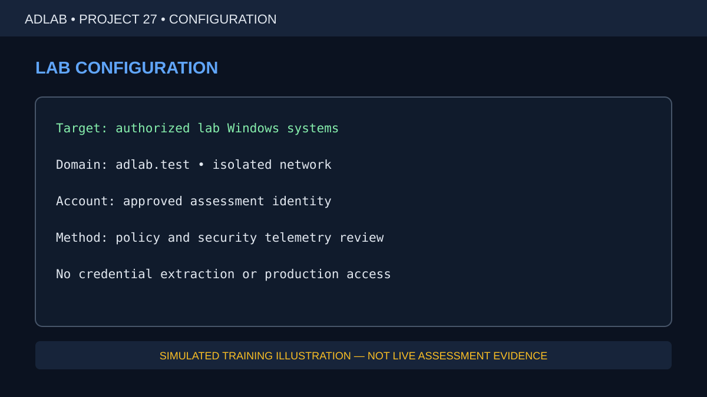
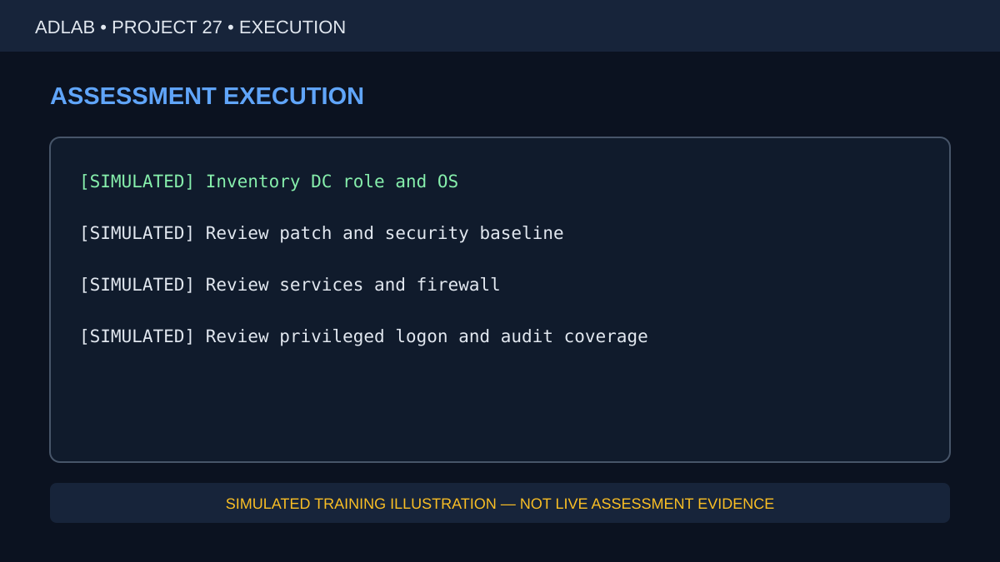
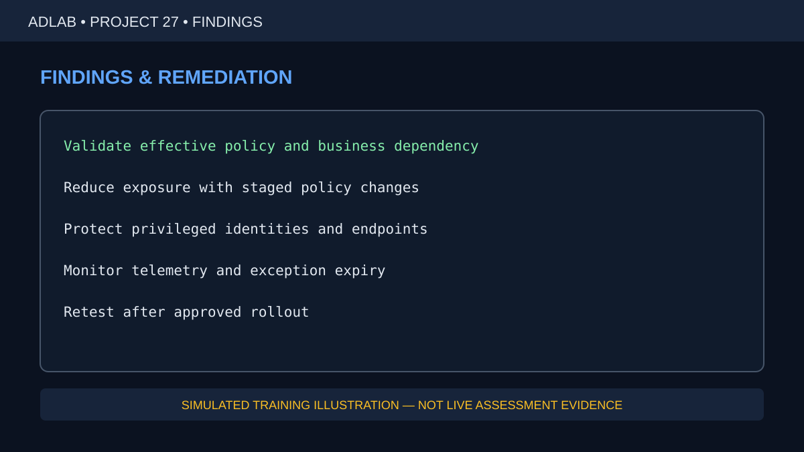

# Project 27 — Domain Controller Security Assessment

**Intermediate | Windows identity security | Authorized configuration assessment**

## Objective
Review domain controller hardening, roles, patching, services, firewall, auditing, backup, and administrative access against an approved baseline.

## Scope and safety
- Domain: `adlab.test`; DC: `DC01.adlab.test` (`192.168.56.10`); client: `CLIENT01` (`192.168.56.20`).
- Use an isolated lab and approved test systems only.
- Do not dump credentials, extract hashes, perform password guessing, or disable protections during assessment.
- Treat endpoint inventory and security reports as sensitive.

## Prerequisites
Projects 01–05 lab baseline; Windows RSAT/PowerShell; authorized local or domain read access; endpoint owner approval; current backup/snapshot.

## 1. Baseline and configuration
Confirm system role, OS version, policy scope, source account, and assessment window. Record a baseline before reviewing settings.



## 2. Step-by-step walkthrough
### Step 1 — Inventory DC role and OS

```powershell
Get-ADDomainController -Filter * | Select HostName,OperatingSystem,Site,IsGlobalCatalog
```

Confirm all DCs are in the asset inventory and assigned to approved sites.

### Step 2 — Review patch and security baseline

```powershell
Get-HotFix | Sort-Object InstalledOn -Descending | Select-Object -First 15
```

Compare patch state with the organization's supported release and patch SLA; validate with centralized compliance reporting.

### Step 3 — Review services and firewall

```powershell
Get-Service | Where-Object {$_.Status -eq 'Running'} | Select Name,StartType
Get-NetFirewallProfile
```

Do not stop services or alter firewall policy during assessment.

### Step 4 — Review privileged logon and audit coverage

```powershell
Inspect effective audit policy, privileged group membership, and approved tiering model.
```

Verify backups, recovery procedures, and monitoring ownership without accessing backup secrets.



## 3. Example findings (synthetic)
- **OBS-27-1:** DC operating system is unsupported or missing critical updates.
- **OBS-27-2:** Interactive logon is permitted for ordinary users or broad admin groups.
- **OBS-27-3:** Unnecessary services or firewall exceptions expand attack surface.
- **OBS-27-4:** Backup/recovery or audit coverage is unverified.

These are training scenarios. Confirm OS support, endpoint role, business need, and effective policy before assigning severity.

## 4. Evidence and risk
Record sanitized asset ID, policy or setting, effective value, source command/report, timestamp, OS build, owner, business impact, likelihood, confidence, and exceptions. Do not include secrets or sensitive endpoint data in public evidence.

## 5. Remediation
- Maintain supported DC OS versions and patch within defined SLAs.
- Restrict DC logon to dedicated tier-0 administrators.
- Harden services and firewall rules with dependency validation.
- Test system-state backups and forest recovery procedures; centralize security logs.



## 6. Detection and retest
Validate endpoint security telemetry, Group Policy processing, and centralized compliance reporting. After approved changes, repeat the same configuration checks and test legitimate business workflows. Roll out changes in a pilot before broad enforcement.

## 7. Completion checklist
- [ ] Scope and system ownership confirmed.
- [ ] Baseline and effective policy captured.
- [ ] Configuration reviewed without credential extraction.
- [ ] Findings validated with endpoint/application owners.
- [ ] Remediation and exception plan approved.
- [ ] Pilot/retest results and residual risk documented.

## References
- https://learn.microsoft.com/en-us/windows-server/identity/ad-ds/plan/security-best-practices/best-practices-for-securing-active-directory
- https://learn.microsoft.com/en-us/windows-server/identity/ad-ds/manage/forest-recovery-guide/ad-forest-recovery-guide
- https://www.cisecurity.org/benchmark/microsoft_windows_server

## Disclaimer
Authorized lab use only. Screenshots and sample findings are simulated training illustrations, not genuine tool captures or customer assessment evidence.
