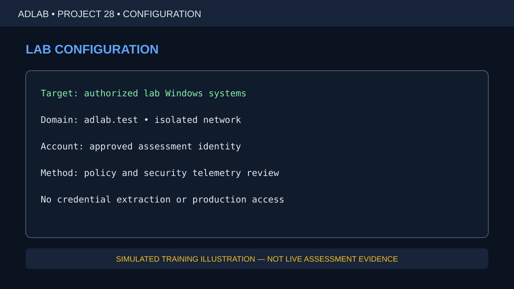
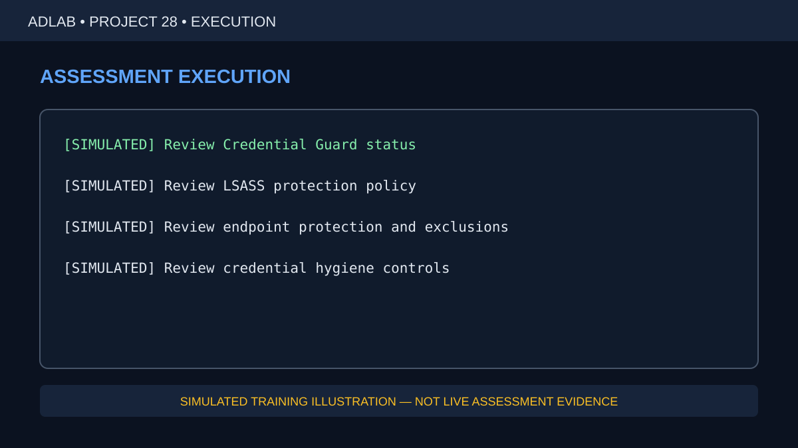
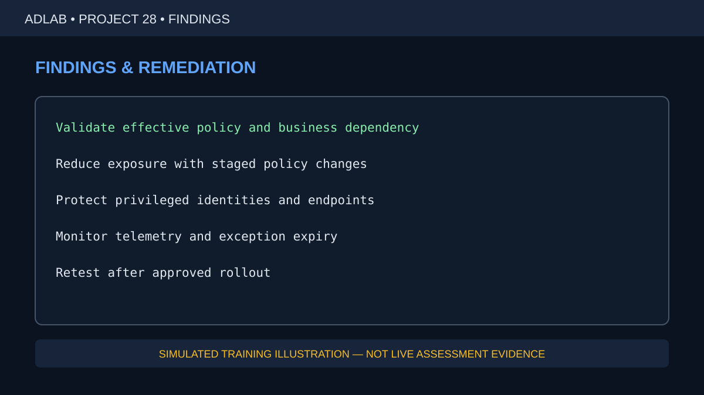

# Project 28 — Windows Credential Exposure Assessment

**Intermediate | Windows identity security | Authorized configuration assessment**

## Objective
Assess credential exposure controls on Windows endpoints and servers through configuration review, credential guard status, protection policy, and incident telemetry without dumping credentials.

## Scope and safety
- Domain: `adlab.test`; DC: `DC01.adlab.test` (`192.168.56.10`); client: `CLIENT01` (`192.168.56.20`).
- Use an isolated lab and approved test systems only.
- Do not dump credentials, extract hashes, perform password guessing, or disable protections during assessment.
- Treat endpoint inventory and security reports as sensitive.

## Prerequisites
Projects 01–05 lab baseline; Windows RSAT/PowerShell; authorized local or domain read access; endpoint owner approval; current backup/snapshot.

## 1. Baseline and configuration
Confirm system role, OS version, policy scope, source account, and assessment window. Record a baseline before reviewing settings.



## 2. Step-by-step walkthrough
### Step 1 — Review Credential Guard status

```powershell
Get-CimInstance -ClassName Win32_DeviceGuard -Namespace root\Microsoft\Windows\DeviceGuard | Select VirtualizationBasedSecurityStatus,SecurityServicesConfigured,SecurityServicesRunning
```

Interpret status according to OS and hardware support; verify centrally managed policy.

### Step 2 — Review LSASS protection policy

```powershell
Inspect Windows Defender Credential Guard and LSA protection configuration through approved endpoint security policy reporting.
```

Do not access LSASS memory or run credential dumping utilities.

### Step 3 — Review endpoint protection and exclusions

```powershell
Get-MpComputerStatus | Select AMServiceEnabled,AntivirusEnabled,RealTimeProtectionEnabled,BehaviorMonitorEnabled
```

Review security tooling health and exclusions with the endpoint security owner.

### Step 4 — Review credential hygiene controls

```powershell
Check Windows Hello for Business, privileged access workstations, and remote credential guard deployment records.
```

Validate policy scope and exception lists without collecting credentials.



## 3. Example findings (synthetic)
- **OBS-28-1:** Credential Guard or LSA protection is not enabled on supported systems.
- **OBS-28-2:** Endpoint protection has broad exclusions affecting credential protections.
- **OBS-28-3:** Privileged users routinely sign in to lower-trust workstations.
- **OBS-28-4:** Credential protection coverage is not monitored.

These are training scenarios. Confirm OS support, endpoint role, business need, and effective policy before assigning severity.

## 4. Evidence and risk
Record sanitized asset ID, policy or setting, effective value, source command/report, timestamp, OS build, owner, business impact, likelihood, confidence, and exceptions. Do not include secrets or sensitive endpoint data in public evidence.

## 5. Remediation
- Enable Credential Guard and LSA protection where supported.
- Reduce and review endpoint security exclusions.
- Use dedicated privileged workstations and tiered administration.
- Deploy phishing-resistant authentication and monitor credential access alerts.



## 6. Detection and retest
Validate endpoint security telemetry, Group Policy processing, and centralized compliance reporting. After approved changes, repeat the same configuration checks and test legitimate business workflows. Roll out changes in a pilot before broad enforcement.

## 7. Completion checklist
- [ ] Scope and system ownership confirmed.
- [ ] Baseline and effective policy captured.
- [ ] Configuration reviewed without credential extraction.
- [ ] Findings validated with endpoint/application owners.
- [ ] Remediation and exception plan approved.
- [ ] Pilot/retest results and residual risk documented.

## References
- https://learn.microsoft.com/en-us/windows/security/identity-protection/credential-guard/
- https://learn.microsoft.com/en-us/windows-server/security/credentials-protection-and-management/configuring-additional-lsa-protection
- https://attack.mitre.org/techniques/T1003/

## Disclaimer
Authorized lab use only. Screenshots and sample findings are simulated training illustrations, not genuine tool captures or customer assessment evidence.
