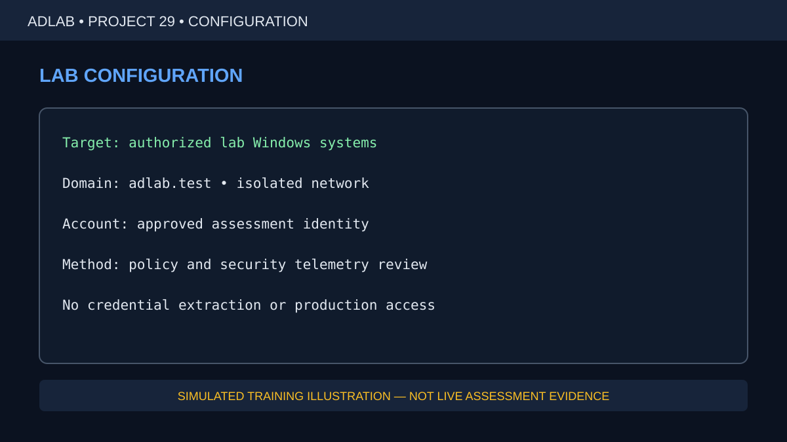
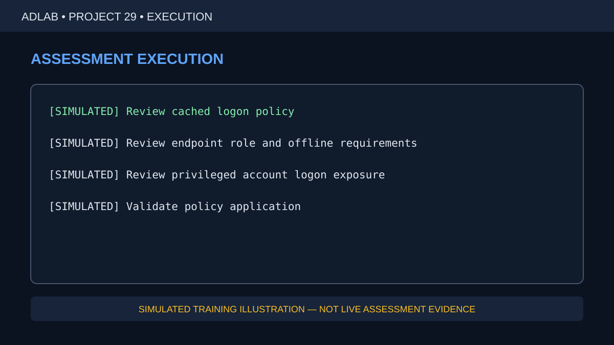
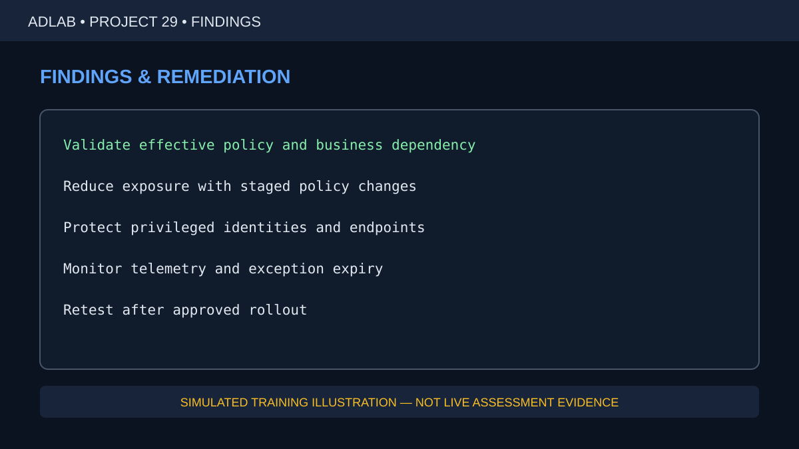

# Project 29 — Cached Credentials and Credential Hygiene

**Intermediate | Windows identity security | Authorized configuration assessment**

## Objective
Review Windows cached domain logon policy and endpoint usage risks, focusing on exposure reduction and administrative policy rather than extracting cached secrets.

## Scope and safety
- Domain: `adlab.test`; DC: `DC01.adlab.test` (`192.168.56.10`); client: `CLIENT01` (`192.168.56.20`).
- Use an isolated lab and approved test systems only.
- Do not dump credentials, extract hashes, perform password guessing, or disable protections during assessment.
- Treat endpoint inventory and security reports as sensitive.

## Prerequisites
Projects 01–05 lab baseline; Windows RSAT/PowerShell; authorized local or domain read access; endpoint owner approval; current backup/snapshot.

## 1. Baseline and configuration
Confirm system role, OS version, policy scope, source account, and assessment window. Record a baseline before reviewing settings.



## 2. Step-by-step walkthrough
### Step 1 — Review cached logon policy

```powershell
secedit /export /cfg .\security-policy.inf
Select-String -Path .\security-policy.inf -Pattern 'CachedLogonsCount'
```

Run on a designated lab endpoint and protect the exported policy file.

### Step 2 — Review endpoint role and offline requirements

```powershell
Inventory laptops, shared workstations, jump hosts, and servers that permit cached interactive logon.
```

Validate business need with endpoint owners; do not attempt offline credential recovery.

### Step 3 — Review privileged account logon exposure

```powershell
Compare privileged logon policy with endpoint tiering and privileged workstation standards.
```

Use sign-in records and policy reports; do not inspect cached credential stores.

### Step 4 — Validate policy application

```powershell
gpresult /h .\cached-logon-policy.html
```

Confirm the effective policy and document any OU or policy inheritance exceptions.



## 3. Example findings (synthetic)
- **OBS-29-1:** Cached logon count exceeds approved business requirement.
- **OBS-29-2:** Privileged identities are used on general-purpose endpoints.
- **OBS-29-3:** Shared devices retain cached logon capability without compensating controls.
- **OBS-29-4:** Policy is inconsistently applied across endpoint OUs.

These are training scenarios. Confirm OS support, endpoint role, business need, and effective policy before assigning severity.

## 4. Evidence and risk
Record sanitized asset ID, policy or setting, effective value, source command/report, timestamp, OS build, owner, business impact, likelihood, confidence, and exceptions. Do not include secrets or sensitive endpoint data in public evidence.

## 5. Remediation
- Set cached logon count based on documented offline access need.
- Prevent privileged accounts from interactive logon to lower-trust devices.
- Use dedicated admin workstations and controlled remote access.
- Protect shared endpoints and validate policy application after changes.



## 6. Detection and retest
Validate endpoint security telemetry, Group Policy processing, and centralized compliance reporting. After approved changes, repeat the same configuration checks and test legitimate business workflows. Roll out changes in a pilot before broad enforcement.

## 7. Completion checklist
- [ ] Scope and system ownership confirmed.
- [ ] Baseline and effective policy captured.
- [ ] Configuration reviewed without credential extraction.
- [ ] Findings validated with endpoint/application owners.
- [ ] Remediation and exception plan approved.
- [ ] Pilot/retest results and residual risk documented.

## References
- https://learn.microsoft.com/en-us/windows/security/threat-protection/security-policy-settings/interactive-logon-number-of-previous-logons-to-cache-in-case-domain-controller-is-not-available
- https://learn.microsoft.com/en-us/windows/security/identity-protection/access-control/credentials-processes-in-windows-authentication

## Disclaimer
Authorized lab use only. Screenshots and sample findings are simulated training illustrations, not genuine tool captures or customer assessment evidence.
