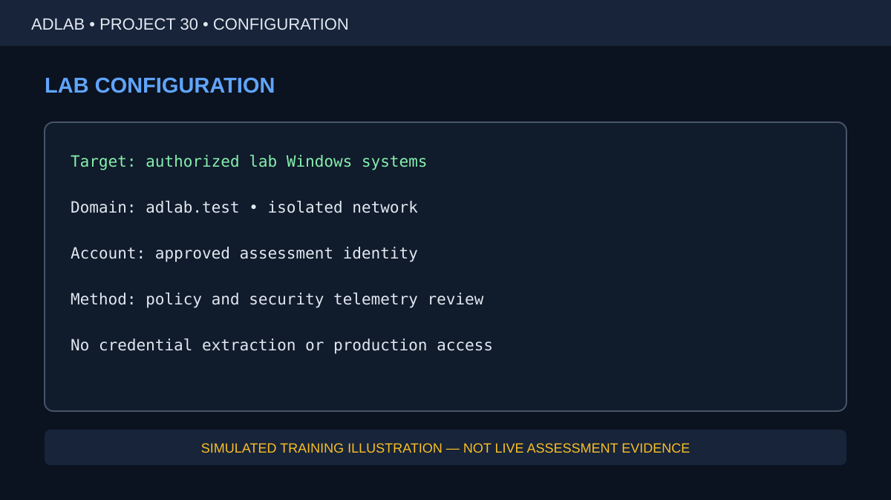
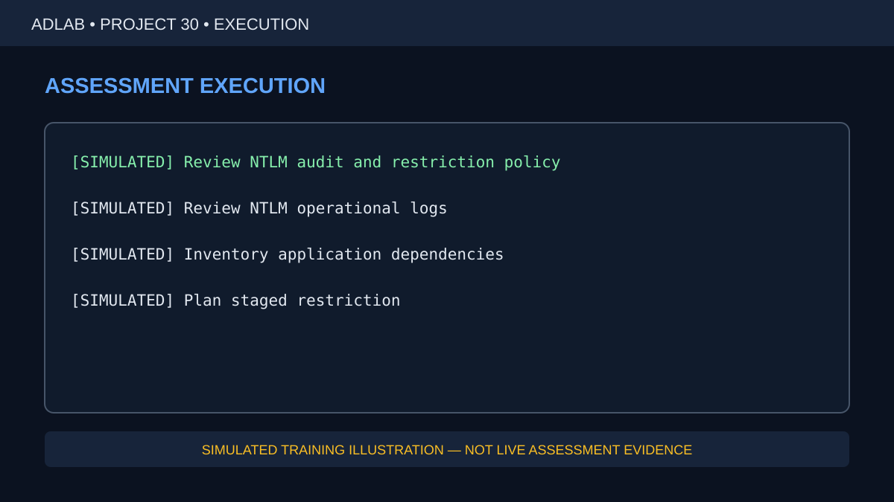
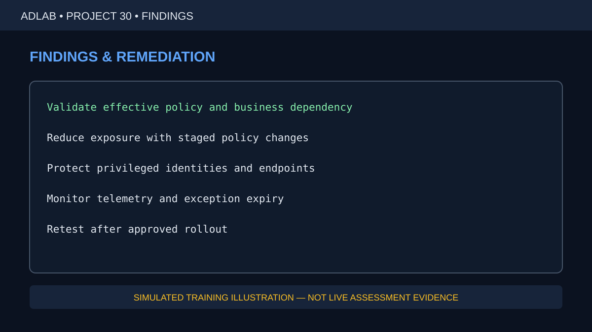

# Project 30 — NTLM Authentication Security Assessment

**Intermediate | Windows identity security | Authorized configuration assessment**

## Objective
Inventory NTLM usage, audit coverage, and policy posture; identify legacy dependencies and plan a safe reduction without disrupting business applications.

## Scope and safety
- Domain: `adlab.test`; DC: `DC01.adlab.test` (`192.168.56.10`); client: `CLIENT01` (`192.168.56.20`).
- Use an isolated lab and approved test systems only.
- Do not dump credentials, extract hashes, perform password guessing, or disable protections during assessment.
- Treat endpoint inventory and security reports as sensitive.

## Prerequisites
Projects 01–05 lab baseline; Windows RSAT/PowerShell; authorized local or domain read access; endpoint owner approval; current backup/snapshot.

## 1. Baseline and configuration
Confirm system role, OS version, policy scope, source account, and assessment window. Record a baseline before reviewing settings.



## 2. Step-by-step walkthrough
### Step 1 — Review NTLM audit and restriction policy

```powershell
Inspect Network security: Restrict NTLM policy settings in effective Group Policy and local security policy.
```

Record audit versus deny mode, exceptions, and policy scope.

### Step 2 — Review NTLM operational logs

```powershell
Inspect Microsoft-Windows-NTLM/Operational logs on representative systems where auditing is enabled.
```

Correlate source, target, application, and time; do not block NTLM until dependencies are understood.

### Step 3 — Inventory application dependencies

```powershell
Review approved service and application inventory for NTLM-only authentication dependencies.
```

Validate with application owners and identify supported Kerberos or modern authentication alternatives.

### Step 4 — Plan staged restriction

```powershell
Create a pilot policy for a test OU and measure compatibility before broader enforcement.
```

Do not deploy a domain-wide deny policy during assessment.



## 3. Example findings (synthetic)
- **OBS-30-1:** NTLMv1 or weak legacy configuration remains in use.
- **OBS-30-2:** NTLM authentication is widespread and unowned.
- **OBS-30-3:** Audit logs are not enabled or centrally collected.
- **OBS-30-4:** Exceptions have no expiration or migration plan.

These are training scenarios. Confirm OS support, endpoint role, business need, and effective policy before assigning severity.

## 4. Evidence and risk
Record sanitized asset ID, policy or setting, effective value, source command/report, timestamp, OS build, owner, business impact, likelihood, confidence, and exceptions. Do not include secrets or sensitive endpoint data in public evidence.

## 5. Remediation
- Disable NTLMv1 and legacy protocols after compatibility testing.
- Prefer Kerberos and modern authentication.
- Enable NTLM auditing before enforcement and centrally monitor events.
- Time-bound exceptions and track application migration.



## 6. Detection and retest
Validate endpoint security telemetry, Group Policy processing, and centralized compliance reporting. After approved changes, repeat the same configuration checks and test legitimate business workflows. Roll out changes in a pilot before broad enforcement.

## 7. Completion checklist
- [ ] Scope and system ownership confirmed.
- [ ] Baseline and effective policy captured.
- [ ] Configuration reviewed without credential extraction.
- [ ] Findings validated with endpoint/application owners.
- [ ] Remediation and exception plan approved.
- [ ] Pilot/retest results and residual risk documented.

## References
- https://learn.microsoft.com/en-us/windows/security/threat-protection/security-policy-settings/network-security-restrict-ntlm-audit-ntlm-authentication-in-this-domain
- https://learn.microsoft.com/en-us/windows/security/threat-protection/security-policy-settings/network-security-restrict-ntlm-ntlm-authentication-in-this-domain
- https://attack.mitre.org/techniques/T1557/

## Disclaimer
Authorized lab use only. Screenshots and sample findings are simulated training illustrations, not genuine tool captures or customer assessment evidence.
