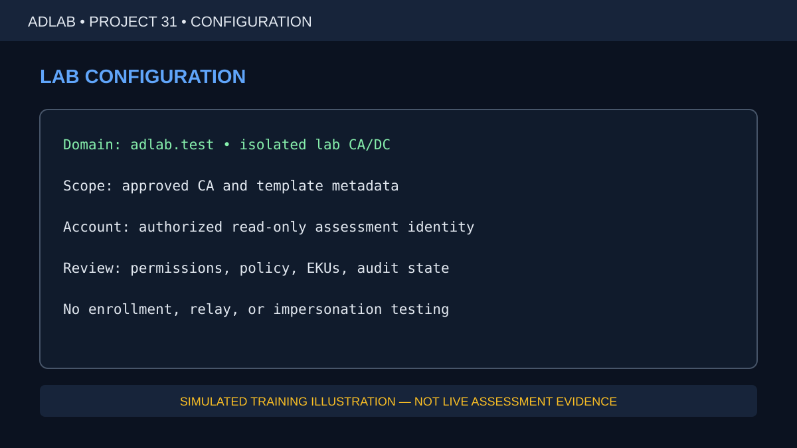
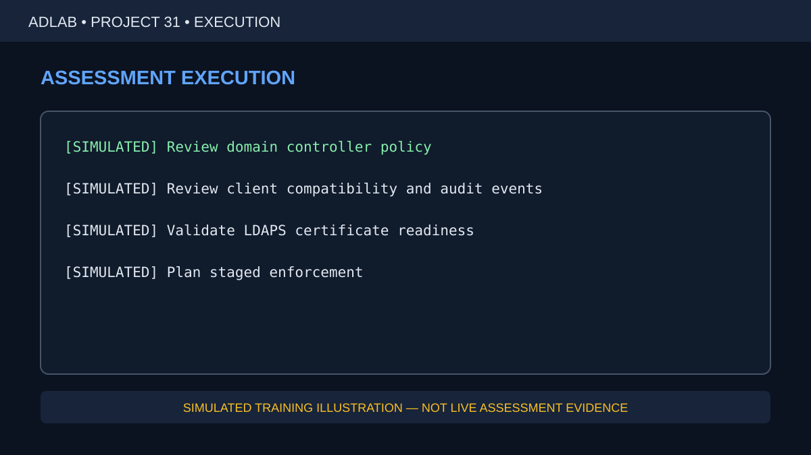
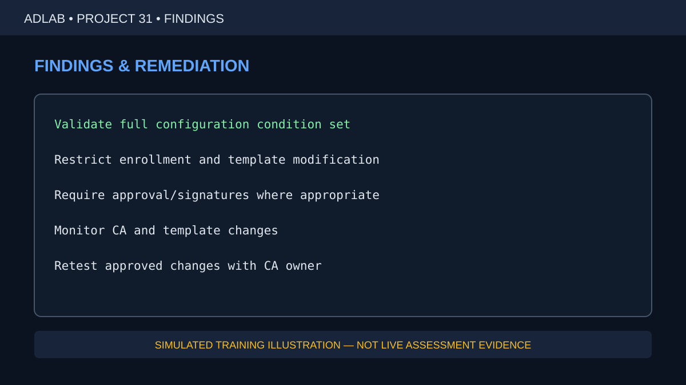

# Project 31 — LDAP Signing and Channel Binding Assessment

**Intermediate | Identity infrastructure security | Configuration-only assessment**

## Objective
Evaluate domain controller LDAP signing and channel binding configuration, client compatibility, and telemetry before enforcing stronger LDAP protections.

## Scope and safety
- Lab: `adlab.test`; DC/CA host: `DC01.adlab.test` — `192.168.56.10`.
- Use an isolated lab and approved test account.
- No relay, credential capture, impersonation, unauthorized certificate enrollment, or privilege escalation.
- Do not change CA/template settings during discovery.

## Prerequisites
Projects 01–05; AD CS role installed in the lab for AD CS exercises; Windows RSAT and Certificate Templates MMC; approved CA administrator assistance for configuration visibility.

## 1. Prepare and document baseline
Confirm CA/DC identity, CA role, template inventory, test account, authorization, and assessment time. Capture existing policy before review.



## 2. Step-by-step walkthrough
### Step 1 — Review domain controller policy

```powershell
Inspect Domain controller: LDAP server signing requirements and LDAP channel binding token requirements in effective policy.
```

Record current values for each DC; do not change policy during discovery.

### Step 2 — Review client compatibility and audit events

```powershell
Inspect Directory Service logs for LDAP interface and channel-binding compatibility events where available.
```

Correlate application, client, DC, and authentication method with owners.

### Step 3 — Validate LDAPS certificate readiness

```powershell
openssl s_client -connect 192.168.56.10:636 -servername dc01.adlab.test -showcerts
```

Confirm certificate chain, SAN, expiry, and client trust; do not suppress validation errors.

### Step 4 — Plan staged enforcement

```powershell
Build a pilot matrix of clients and applications; test signing/channel binding requirements in a lab OU or pilot DC.
```

Document exceptions and rollback steps before enforcement.



## 3. Example observations (synthetic)
- **OBS-31-1:** LDAP signing is not required where policy mandates it.
- **OBS-31-2:** Channel binding is not enforced or clients are incompatible.
- **OBS-31-3:** Applications use simple binds over unencrypted LDAP.
- **OBS-31-4:** DCs have inconsistent policy or certificate configuration.

An individual template setting is not by itself proof of exploitability. Assess the complete combination of enrollment rights, EKUs, subject controls, approval/signature requirements, CA publication, and trust.

## 4. Evidence and risk
Record sanitized CA/template name, relevant flags and EKUs, enrollment/modify permissions, issuance requirements, publication status, source and timestamp, owner, attack preconditions, impact, and confidence. Never include private keys, certificate request secrets, or customer identities.

## 5. Remediation
- Require LDAP signing after compatibility assessment.
- Enforce channel binding with supported clients and staged rollout.
- Move applications to LDAPS or StartTLS with valid certificates.
- Centralize policy and monitor DC configuration drift.



## 6. Detection and retest
Review CA audit events and directory change monitoring for template/CA modifications. Audit event availability depends on CA audit configuration and policy. After approved changes, re-query template settings and permissions and confirm legitimate enrollment workflows remain functional.

## 7. Completion checklist
- [ ] Authorization and CA scope confirmed.
- [ ] Template and CA inventory captured.
- [ ] Permissions and complete risk conditions reviewed.
- [ ] Findings validated with CA owner.
- [ ] Remediation approved and documented.
- [ ] Read-only retest completed.

## References
- https://learn.microsoft.com/en-us/windows-server/identity/ad-ds/ldap-signing
- https://learn.microsoft.com/en-us/windows-server/identity/ad-ds/ldap-channel-binding

## Disclaimer
Authorized training lab only. Screenshots and sample findings are simulated illustrations, not genuine CA screenshots or customer assessment evidence.
