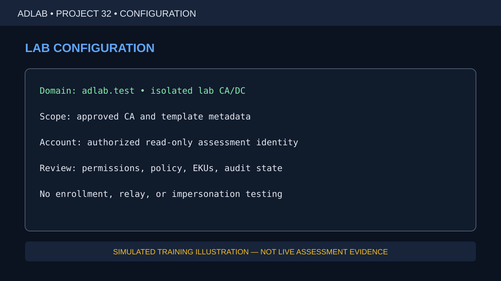
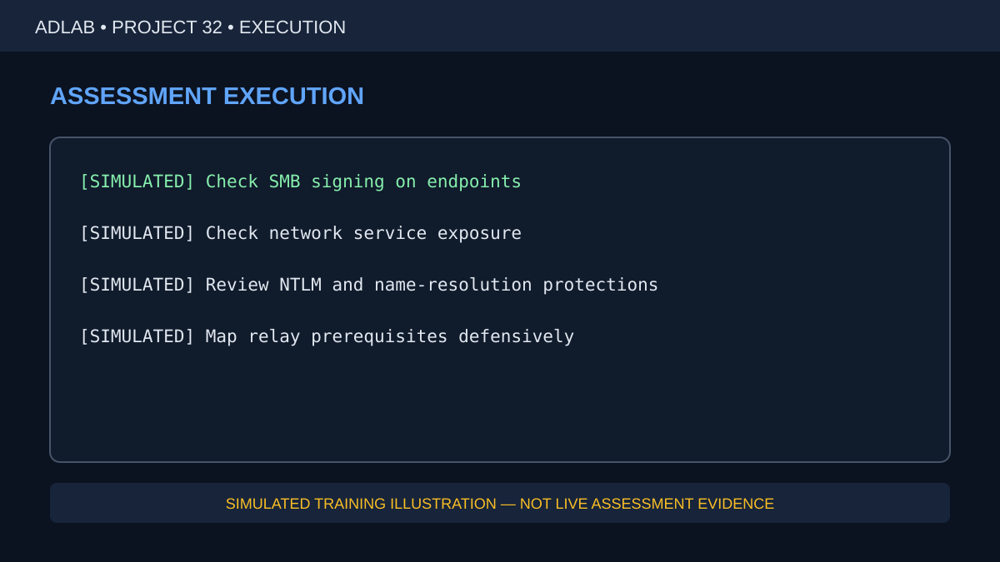
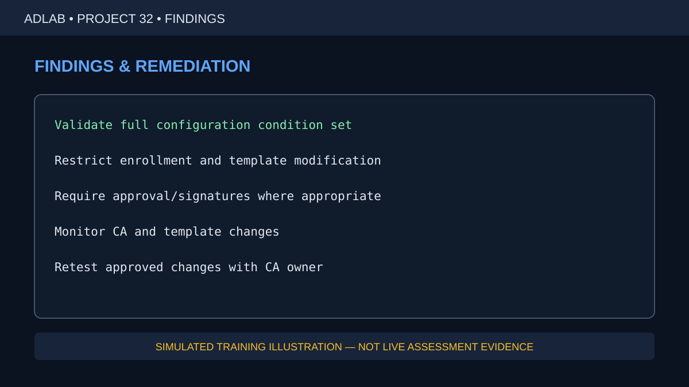

# Project 32 — SMB Signing and Relay Exposure Assessment

**Intermediate | Identity infrastructure security | Configuration-only assessment**

## Objective
Assess SMB signing requirements and relay-relevant configuration exposure using safe configuration checks only; do not perform NTLM relay, capture authentication, or alter network traffic.

## Scope and safety
- Lab: `adlab.test`; DC/CA host: `DC01.adlab.test` — `192.168.56.10`.
- Use an isolated lab and approved test account.
- No relay, credential capture, impersonation, unauthorized certificate enrollment, or privilege escalation.
- Do not change CA/template settings during discovery.

## Prerequisites
Projects 01–05; AD CS role installed in the lab for AD CS exercises; Windows RSAT and Certificate Templates MMC; approved CA administrator assistance for configuration visibility.

## 1. Prepare and document baseline
Confirm CA/DC identity, CA role, template inventory, test account, authorization, and assessment time. Capture existing policy before review.



## 2. Step-by-step walkthrough
### Step 1 — Check SMB signing on endpoints

```powershell
Get-SmbServerConfiguration | Select EnableSMB1Protocol,EnableSMB2Protocol,RequireSecuritySignature
Get-SmbClientConfiguration | Select EnableSecuritySignature,RequireSecuritySignature
```

Run on authorized Windows lab systems and capture both client and server posture.

### Step 2 — Check network service exposure

```powershell
nmap -Pn -p 445 --script smb-security-mode,smb-protocols 192.168.56.10
```

Use only the lab DC. Record signing mode and supported dialects.

### Step 3 — Review NTLM and name-resolution protections

```powershell
Review NTLM audit policy, LLMNR/NBNS policy, and endpoint network settings.
```

Use policy reports; do not poison name resolution or capture credentials.

### Step 4 — Map relay prerequisites defensively

```powershell
Document whether signing is required, where NTLM remains enabled, and whether legacy services accept NTLM.
```

Treat this as a configuration risk assessment, not proof that a relay path is exploitable.



## 3. Example observations (synthetic)
- **OBS-32-1:** SMB signing is enabled but not required on a system where policy requires it.
- **OBS-32-2:** NTLM remains enabled on legacy services without a migration plan.
- **OBS-32-3:** Name-resolution fallback is enabled without protections.
- **OBS-32-4:** Exceptions are undocumented or unmonitored.

An individual template setting is not by itself proof of exploitability. Assess the complete combination of enrollment rights, EKUs, subject controls, approval/signature requirements, CA publication, and trust.

## 4. Evidence and risk
Record sanitized CA/template name, relevant flags and EKUs, enrollment/modify permissions, issuance requirements, publication status, source and timestamp, owner, attack preconditions, impact, and confidence. Never include private keys, certificate request secrets, or customer identities.

## 5. Remediation
- Require SMB signing on supported systems after compatibility validation.
- Reduce NTLM use and prefer Kerberos.
- Disable unnecessary LLMNR/NBNS and harden name resolution.
- Monitor authentication relay indicators and document exceptions.



## 6. Detection and retest
Review CA audit events and directory change monitoring for template/CA modifications. Audit event availability depends on CA audit configuration and policy. After approved changes, re-query template settings and permissions and confirm legitimate enrollment workflows remain functional.

## 7. Completion checklist
- [ ] Authorization and CA scope confirmed.
- [ ] Template and CA inventory captured.
- [ ] Permissions and complete risk conditions reviewed.
- [ ] Findings validated with CA owner.
- [ ] Remediation approved and documented.
- [ ] Read-only retest completed.

## References
- https://learn.microsoft.com/en-us/windows-server/storage/file-server/smb-signing-overview
- https://learn.microsoft.com/en-us/windows/security/threat-protection/security-policy-settings/network-security-restrict-ntlm-audit-ntlm-authentication-in-this-domain
- https://attack.mitre.org/techniques/T1557/001/

## Disclaimer
Authorized training lab only. Screenshots and sample findings are simulated illustrations, not genuine CA screenshots or customer assessment evidence.
