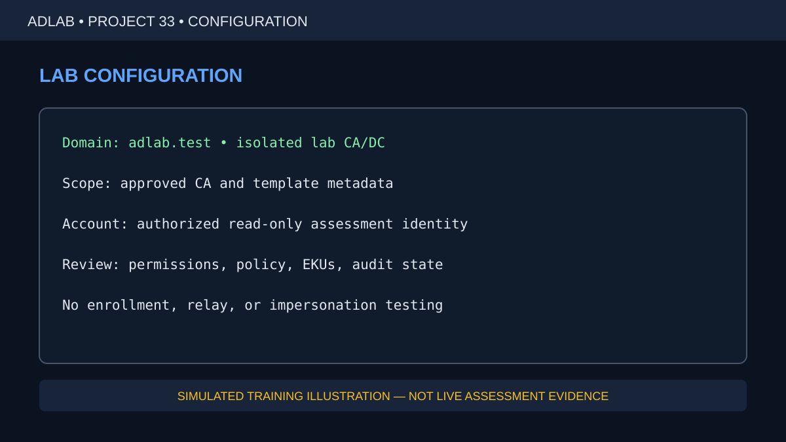
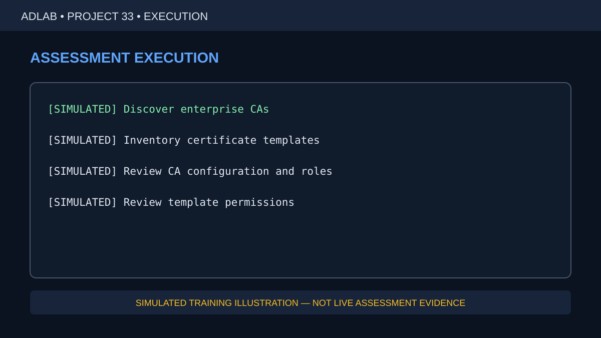
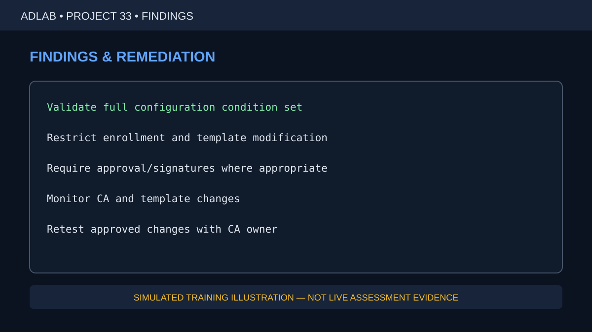

# Project 33 — Active Directory Certificate Services Enumeration

**Intermediate | Identity infrastructure security | Configuration-only assessment**

## Objective
Inventory AD CS certification authorities, templates, enrollment permissions, publication, and web enrollment exposure without requesting certificates or attempting privilege escalation.

## Scope and safety
- Lab: `adlab.test`; DC/CA host: `DC01.adlab.test` — `192.168.56.10`.
- Use an isolated lab and approved test account.
- No relay, credential capture, impersonation, unauthorized certificate enrollment, or privilege escalation.
- Do not change CA/template settings during discovery.

## Prerequisites
Projects 01–05; AD CS role installed in the lab for AD CS exercises; Windows RSAT and Certificate Templates MMC; approved CA administrator assistance for configuration visibility.

## 1. Prepare and document baseline
Confirm CA/DC identity, CA role, template inventory, test account, authorization, and assessment time. Capture existing policy before review.



## 2. Step-by-step walkthrough
### Step 1 — Discover enterprise CAs

```powershell
certutil -config - -ping
```

Use the supported Windows certutil discovery prompt in the lab; record CA names and reachability.

### Step 2 — Inventory certificate templates

```powershell
certutil -template
```

Capture template display names and key settings. Avoid exporting private keys or enrollment credentials.

### Step 3 — Review CA configuration and roles

```powershell
certutil -getreg CA\AuditFilter
certutil -getreg CA\InterfaceFlags
```

Use read-only CA configuration queries with authorized access; confirm audit configuration and role separation.

### Step 4 — Review template permissions

```powershell
Use Certificate Templates MMC or approved AD ACL review to inspect enrollment, autoenrollment, and template modification rights.
```

Pay attention to broad enrollment groups, subject-name supply, EKUs, and approval/signature requirements.



## 3. Example observations (synthetic)
- **OBS-33-1:** Templates grant enrollment to broad groups without business need.
- **OBS-33-2:** Subject name supply or EKUs create an unintended certificate use case.
- **OBS-33-3:** Template modification rights are delegated too broadly.
- **OBS-33-4:** CA auditing or role separation is insufficient.

An individual template setting is not by itself proof of exploitability. Assess the complete combination of enrollment rights, EKUs, subject controls, approval/signature requirements, CA publication, and trust.

## 4. Evidence and risk
Record sanitized CA/template name, relevant flags and EKUs, enrollment/modify permissions, issuance requirements, publication status, source and timestamp, owner, attack preconditions, impact, and confidence. Never include private keys, certificate request secrets, or customer identities.

## 5. Remediation
- Restrict enrollment and template administration permissions.
- Remove unnecessary EKUs and subject supply options.
- Require manager approval or authorized signatures for sensitive templates.
- Enable CA auditing, secure CA hosts, and monitor template/CA changes.



## 6. Detection and retest
Review CA audit events and directory change monitoring for template/CA modifications. Audit event availability depends on CA audit configuration and policy. After approved changes, re-query template settings and permissions and confirm legitimate enrollment workflows remain functional.

## 7. Completion checklist
- [ ] Authorization and CA scope confirmed.
- [ ] Template and CA inventory captured.
- [ ] Permissions and complete risk conditions reviewed.
- [ ] Findings validated with CA owner.
- [ ] Remediation approved and documented.
- [ ] Read-only retest completed.

## References
- https://learn.microsoft.com/en-us/windows-server/identity/ad-cs/active-directory-certificate-services-overview
- https://learn.microsoft.com/en-us/windows-server/identity/ad-cs/manage/manage-certificate-templates
- https://www.specterops.io/assets/resources/Certified_Pre-Owned.pdf

## Disclaimer
Authorized training lab only. Screenshots and sample findings are simulated illustrations, not genuine CA screenshots or customer assessment evidence.
