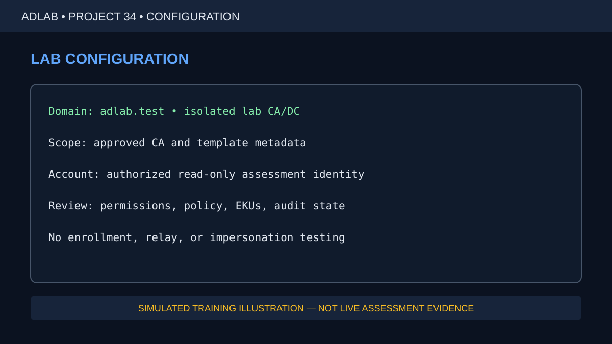
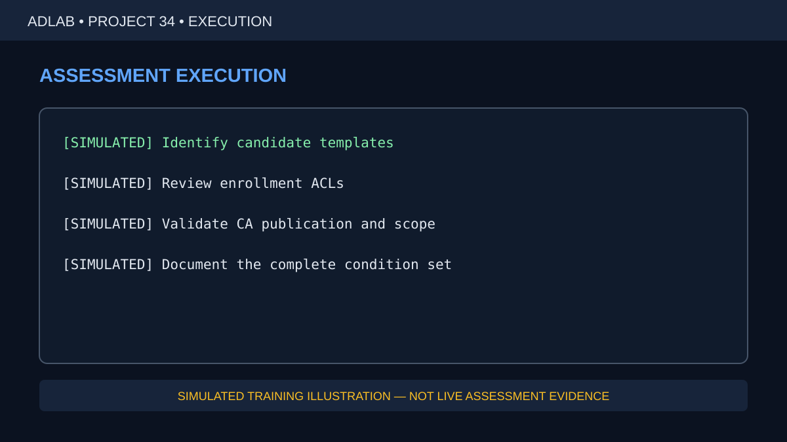
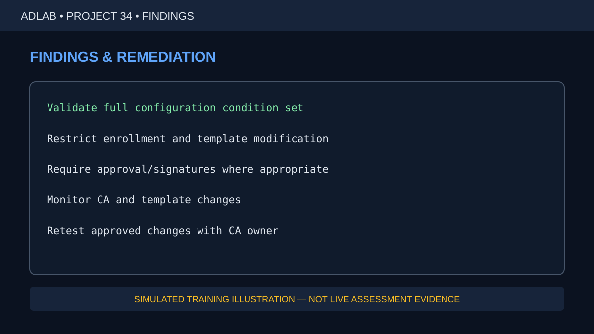

# Project 34 — ADCS Misconfiguration Assessment — ESC1

**Intermediate | Identity infrastructure security | Configuration-only assessment**

## Objective
Evaluate certificate templates for ESC1-like risk conditions through configuration review only. Do not enroll as another user, request impersonation certificates, or authenticate with test certificates.

## Scope and safety
- Lab: `adlab.test`; DC/CA host: `DC01.adlab.test` — `192.168.56.10`.
- Use an isolated lab and approved test account.
- No relay, credential capture, impersonation, unauthorized certificate enrollment, or privilege escalation.
- Do not change CA/template settings during discovery.

## Prerequisites
Projects 01–05; AD CS role installed in the lab for AD CS exercises; Windows RSAT and Certificate Templates MMC; approved CA administrator assistance for configuration visibility.

## 1. Prepare and document baseline
Confirm CA/DC identity, CA role, template inventory, test account, authorization, and assessment time. Capture existing policy before review.



## 2. Step-by-step walkthrough
### Step 1 — Identify candidate templates

```powershell
Review template properties for enrollee-supplied subject/SAN, client authentication EKU, enrollment rights, and approval/signature settings.
```

Use Certificate Templates MMC and read-only AD template metadata.

### Step 2 — Review enrollment ACLs

```powershell
Inspect who has Enroll and Autoenroll permissions on each candidate template.
```

Resolve nested groups and confirm whether low-privilege principals can enroll.

### Step 3 — Validate CA publication and scope

```powershell
Confirm candidate template is published by an enterprise CA and determine which CA/forest trusts it.
```

Do not request a certificate as another identity.

### Step 4 — Document the complete condition set

```powershell
Record whether all required conditions coexist and validate the intended business use with the CA owner.
```

Do not label a template ESC1 solely because one setting appears risky.



## 3. Example observations (synthetic)
- **OBS-34-1:** Low-privilege users can enroll in a template with enrollee-supplied subject and client authentication.
- **OBS-34-2:** Approval or authorized-signature controls are absent for a sensitive template.
- **OBS-34-3:** Template is published by a trusted CA without documented need.

An individual template setting is not by itself proof of exploitability. Assess the complete combination of enrollment rights, EKUs, subject controls, approval/signature requirements, CA publication, and trust.

## 4. Evidence and risk
Record sanitized CA/template name, relevant flags and EKUs, enrollment/modify permissions, issuance requirements, publication status, source and timestamp, owner, attack preconditions, impact, and confidence. Never include private keys, certificate request secrets, or customer identities.

## 5. Remediation
- Disable enrollee-supplied subject where not required.
- Restrict enrollment to the exact approved group.
- Require manager approval and authorized signatures for sensitive issuance.
- Remove unused templates from CA publication and monitor changes.



## 6. Detection and retest
Review CA audit events and directory change monitoring for template/CA modifications. Audit event availability depends on CA audit configuration and policy. After approved changes, re-query template settings and permissions and confirm legitimate enrollment workflows remain functional.

## 7. Completion checklist
- [ ] Authorization and CA scope confirmed.
- [ ] Template and CA inventory captured.
- [ ] Permissions and complete risk conditions reviewed.
- [ ] Findings validated with CA owner.
- [ ] Remediation approved and documented.
- [ ] Read-only retest completed.

## References
- https://learn.microsoft.com/en-us/windows-server/identity/ad-cs/manage/manage-certificate-templates
- https://www.specterops.io/assets/resources/Certified_Pre-Owned.pdf

## Disclaimer
Authorized training lab only. Screenshots and sample findings are simulated illustrations, not genuine CA screenshots or customer assessment evidence.
