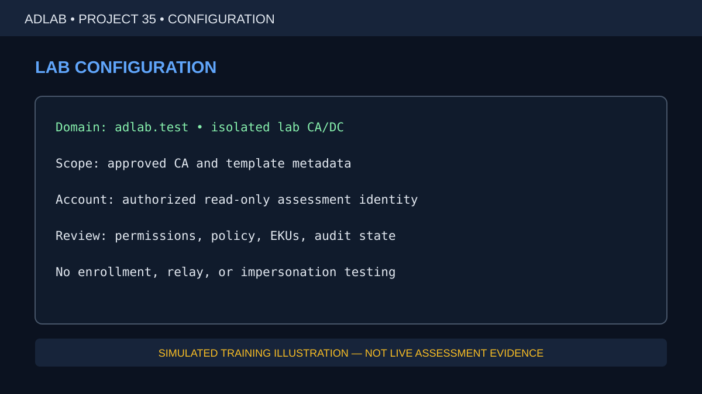
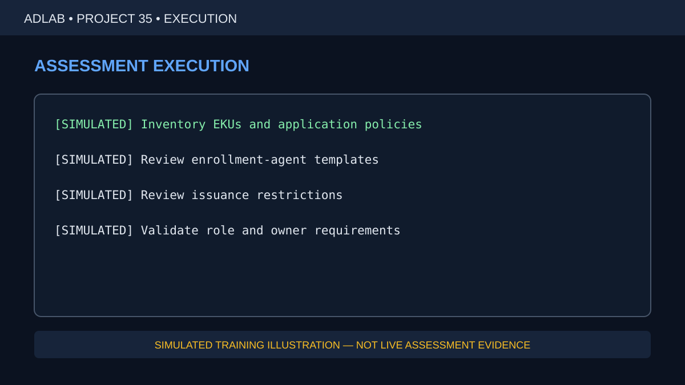
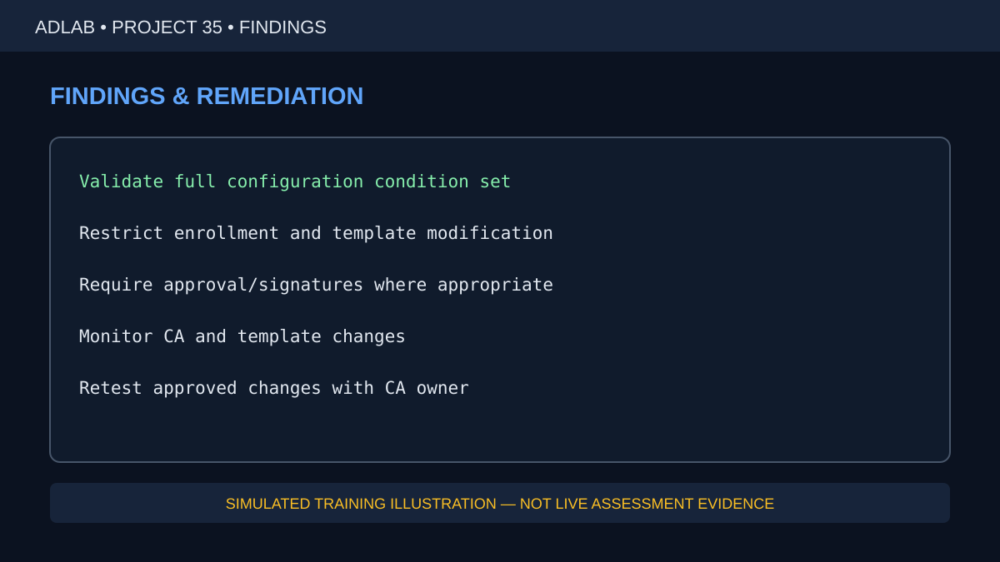

# Project 35 — ADCS Misconfiguration Assessment — ESC2 and ESC3

**Intermediate | Identity infrastructure security | Configuration-only assessment**

## Objective
Review certificate templates for broad EKU scope and enrollment-agent capabilities associated with ESC2/ESC3-style risk. This is a metadata and permissions review only.

## Scope and safety
- Lab: `adlab.test`; DC/CA host: `DC01.adlab.test` — `192.168.56.10`.
- Use an isolated lab and approved test account.
- No relay, credential capture, impersonation, unauthorized certificate enrollment, or privilege escalation.
- Do not change CA/template settings during discovery.

## Prerequisites
Projects 01–05; AD CS role installed in the lab for AD CS exercises; Windows RSAT and Certificate Templates MMC; approved CA administrator assistance for configuration visibility.

## 1. Prepare and document baseline
Confirm CA/DC identity, CA role, template inventory, test account, authorization, and assessment time. Capture existing policy before review.



## 2. Step-by-step walkthrough
### Step 1 — Inventory EKUs and application policies

```powershell
Inspect candidate template EKUs, issuance requirements, and purpose settings through Certificate Templates MMC.
```

Identify Any Purpose or overly broad application policy configurations.

### Step 2 — Review enrollment-agent templates

```powershell
Find templates with Certificate Request Agent EKU and review enrollment permissions and authorized-signature requirements.
```

Do not use enrollment-agent certificates or submit on-behalf-of requests.

### Step 3 — Review issuance restrictions

```powershell
Inspect CA enrollment-agent restrictions and template approval/signature settings.
```

Confirm restrictions are enforced on the issuing CA and cover the intended target templates.

### Step 4 — Validate role and owner requirements

```powershell
Ask CA and application owners to justify broad EKUs, enrollment-agent use, and template publication.
```

Record exceptions with owner, expiry, and compensating controls.



## 3. Example observations (synthetic)
- **OBS-35-1:** Any Purpose or broad EKU template is enrollable by untrusted users.
- **OBS-35-2:** Enrollment-agent capability is available without tight scope or approval.
- **OBS-35-3:** CA enrollment-agent restrictions are missing or overly broad.
- **OBS-35-4:** Sensitive templates lack owner and review date.

An individual template setting is not by itself proof of exploitability. Assess the complete combination of enrollment rights, EKUs, subject controls, approval/signature requirements, CA publication, and trust.

## 4. Evidence and risk
Record sanitized CA/template name, relevant flags and EKUs, enrollment/modify permissions, issuance requirements, publication status, source and timestamp, owner, attack preconditions, impact, and confidence. Never include private keys, certificate request secrets, or customer identities.

## 5. Remediation
- Replace broad EKUs with purpose-specific templates.
- Restrict enrollment-agent rights and enforce CA-side restrictions.
- Require authorized signatures and approval for sensitive issuance.
- Remove unused templates and review CA/template permissions regularly.



## 6. Detection and retest
Review CA audit events and directory change monitoring for template/CA modifications. Audit event availability depends on CA audit configuration and policy. After approved changes, re-query template settings and permissions and confirm legitimate enrollment workflows remain functional.

## 7. Completion checklist
- [ ] Authorization and CA scope confirmed.
- [ ] Template and CA inventory captured.
- [ ] Permissions and complete risk conditions reviewed.
- [ ] Findings validated with CA owner.
- [ ] Remediation approved and documented.
- [ ] Read-only retest completed.

## References
- https://learn.microsoft.com/en-us/windows-server/identity/ad-cs/manage/manage-certificate-templates
- https://www.specterops.io/assets/resources/Certified_Pre-Owned.pdf

## Disclaimer
Authorized training lab only. Screenshots and sample findings are simulated illustrations, not genuine CA screenshots or customer assessment evidence.
