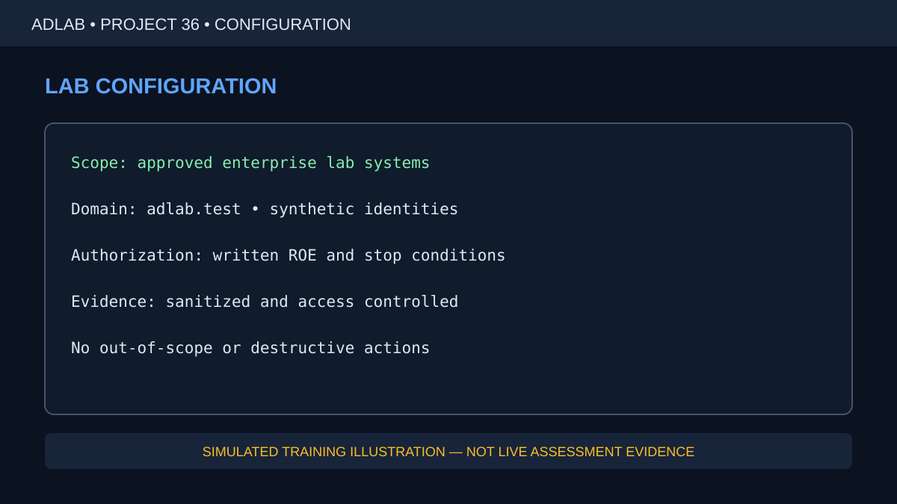
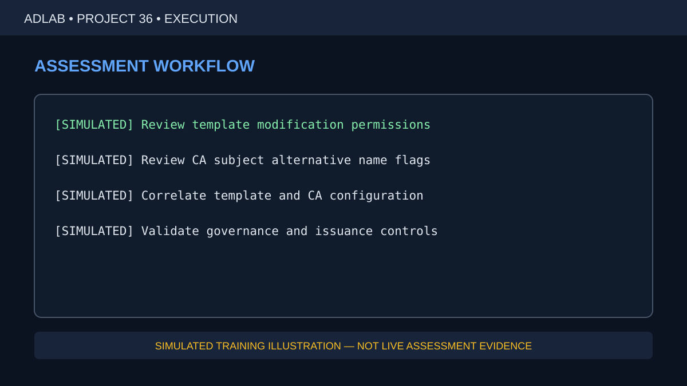
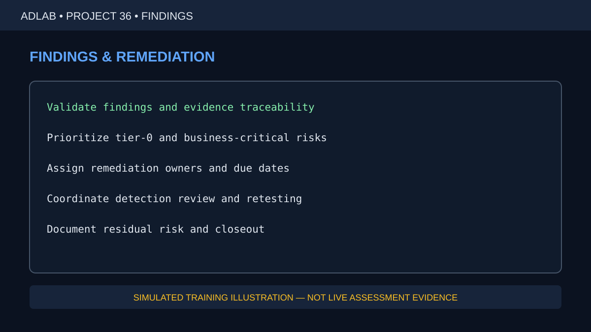

# Project 36 — Advanced ADCS Assessment — ESC4 and ESC6

**Advanced | Enterprise Active Directory security assessment | Authorized lab framework**

## Objective
Review certificate-template ACLs and CA EDITF_ATTRIBUTESUBJECTALTNAME2-style settings associated with ESC4/ESC6 risk, without modifying templates or requesting certificates.

## Scope and safety
- Use the isolated `adlab.test` environment and synthetic identities unless a separate written engagement authorizes additional assets.
- Obtain written authorization, define exclusions and stop conditions, and coordinate with system owners.
- Do not perform credential theft, ticket forgery, persistence, relay, unauthorized lateral movement, or destructive actions as part of this educational walkthrough.
- All evidence must be sanitized and handled as confidential assessment material.

## Prerequisites
Projects 01–35 as applicable; current lab snapshot; approved tool versions; documented rules of engagement; evidence storage; owner and emergency contacts.

## 1. Preparation
Confirm objectives, scope, authorization, system owners, allowed methods, testing windows, monitoring contacts, and rollback/stop procedures.



## 2. Step-by-step walkthrough
### Step 1 — Review template modification permissions

```powershell
Inspect template DACLs for WriteDACL, WriteOwner, GenericAll, and relevant property-write rights.
```

Resolve trustees and nested groups; validate the complete effective permission.

### Step 2 — Review CA subject alternative name flags

```powershell
certutil -getreg CA\EditFlags
```

Record whether subject alternative name-related flags are enabled; interpret in context of CA version and template settings.

### Step 3 — Correlate template and CA configuration

```powershell
Compare candidate template settings, publication, EKUs, enrollment rights, and CA-wide flags.
```

Do not change flags or template ACLs during assessment.

### Step 4 — Validate governance and issuance controls

```powershell
Review CA owner, change tickets, audit policy, and certificate issuance controls.
```

Treat an isolated flag as a lead; establish the full condition chain before rating.



## 3. Example observations (synthetic)
- **OBS-36-1:** Unprivileged principal can modify a security-sensitive template.
- **OBS-36-2:** CA-wide SAN behavior broadens certificate request options unexpectedly.
- **OBS-36-3:** Template and CA settings combine to weaken identity assurance.
- **OBS-36-4:** Template/CA changes lack change approval and monitoring.

These are possible assessment observations, not assertions about a real environment. Validate each against authoritative configuration and owner context.

## 4. Evidence and risk analysis
For each confirmed finding, document:
- Unique finding ID, title, severity, and confidence.
- Affected assets and sanitized object identifiers.
- Evidence source, command or screenshot, timestamp, and account context.
- Preconditions, technical impact, and business impact.
- Relevant ATT&CK technique or control mapping where applicable.
- Remediation owner, target date, and retest criteria.

Do not include passwords, hashes, ticket blobs, private keys, tokens, or unnecessary personal data.

## 5. Remediation and reporting
- Restrict template ACL modification to dedicated PKI administrators.
- Disable risky CA-wide flags after compatibility and impact review.
- Harden template subject and EKU settings; require appropriate approval.
- Enable auditing and alert on CA and template configuration changes.



## 6. Detection and retest
Correlate relevant domain controller, endpoint, CA, identity-provider, and network telemetry as applicable. Audit availability depends on configuration. Record detection coverage and gaps, validate approved remediation with repeatable read-only checks, and document residual risk.

## 7. Completion checklist
- [ ] Authorization, scope, exclusions, and stop conditions recorded.
- [ ] Baseline and methodology documented.
- [ ] Assessment performed within approved boundaries.
- [ ] Findings validated and evidence sanitized.
- [ ] Critical issues communicated through agreed channels.
- [ ] Remediation owners and retest criteria assigned.
- [ ] Final report peer-reviewed and securely delivered.

## References
- https://learn.microsoft.com/en-us/windows-server/identity/ad-cs/manage/manage-certificate-templates
- https://learn.microsoft.com/en-us/windows-server/identity/ad-cs/
- https://www.specterops.io/assets/resources/Certified_Pre-Owned.pdf

## Disclaimer
For authorized assessment and training use only. Screenshots and sample observations are simulated training illustrations, not genuine tool captures or customer assessment evidence.
