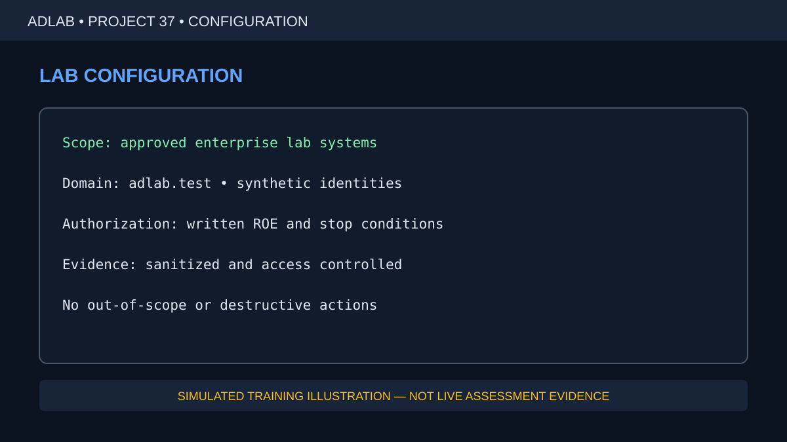
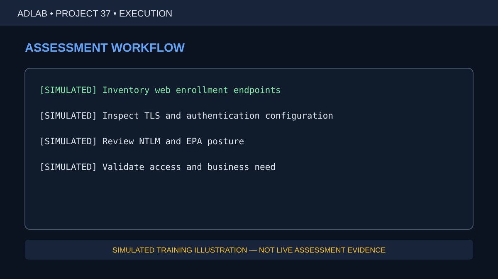
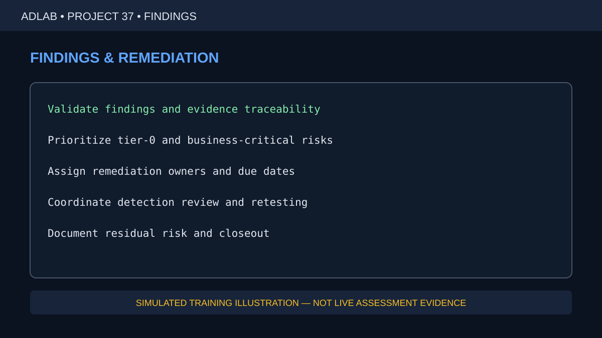

# Project 37 — ADCS ESC8 Web Enrollment Assessment

**Advanced | Enterprise Active Directory security assessment | Authorized lab framework**

## Objective
Assess AD CS web enrollment exposure, transport security, authentication settings, and NTLM relay prerequisites by configuration review only. No relay or credential capture is performed.

## Scope and safety
- Use the isolated `adlab.test` environment and synthetic identities unless a separate written engagement authorizes additional assets.
- Obtain written authorization, define exclusions and stop conditions, and coordinate with system owners.
- Do not perform credential theft, ticket forgery, persistence, relay, unauthorized lateral movement, or destructive actions as part of this educational walkthrough.
- All evidence must be sanitized and handled as confidential assessment material.

## Prerequisites
Projects 01–35 as applicable; current lab snapshot; approved tool versions; documented rules of engagement; evidence storage; owner and emergency contacts.

## 1. Preparation
Confirm objectives, scope, authorization, system owners, allowed methods, testing windows, monitoring contacts, and rollback/stop procedures.



## 2. Step-by-step walkthrough
### Step 1 — Inventory web enrollment endpoints

```powershell
Review IIS sites and installed AD CS role services on the lab CA.
```

Record HTTP/HTTPS bindings, authentication providers, and whether the service is required.

### Step 2 — Inspect TLS and authentication configuration

```powershell
Use IIS Manager and approved configuration reports to review HTTPS certificate, Windows Authentication, and Extended Protection settings.
```

Do not send captured authentication to the endpoint or perform relay tests.

### Step 3 — Review NTLM and EPA posture

```powershell
Check whether NTLM is accepted and whether Extended Protection for Authentication is configured where supported.
```

Correlate with the domain's NTLM restriction policy and service dependencies.

### Step 4 — Validate access and business need

```powershell
Confirm who can reach the enrollment portal and which templates are exposed.
```

Use read-only checks and a test browser session with a lab account.



## 3. Example observations (synthetic)
- **OBS-37-1:** Web enrollment is exposed over HTTP.
- **OBS-37-2:** NTLM authentication is accepted without appropriate protections.
- **OBS-37-3:** Extended Protection is absent where required by the security design.
- **OBS-37-4:** Enrollment portal is reachable from networks beyond the approved admin segment.

These are possible assessment observations, not assertions about a real environment. Validate each against authoritative configuration and owner context.

## 4. Evidence and risk analysis
For each confirmed finding, document:
- Unique finding ID, title, severity, and confidence.
- Affected assets and sanitized object identifiers.
- Evidence source, command or screenshot, timestamp, and account context.
- Preconditions, technical impact, and business impact.
- Relevant ATT&CK technique or control mapping where applicable.
- Remediation owner, target date, and retest criteria.

Do not include passwords, hashes, ticket blobs, private keys, tokens, or unnecessary personal data.

## 5. Remediation and reporting
- Disable unused web enrollment role services.
- Require HTTPS with valid certificates and secure TLS settings.
- Configure Extended Protection and reduce NTLM where supported.
- Restrict network access and template enrollment permissions.



## 6. Detection and retest
Correlate relevant domain controller, endpoint, CA, identity-provider, and network telemetry as applicable. Audit availability depends on configuration. Record detection coverage and gaps, validate approved remediation with repeatable read-only checks, and document residual risk.

## 7. Completion checklist
- [ ] Authorization, scope, exclusions, and stop conditions recorded.
- [ ] Baseline and methodology documented.
- [ ] Assessment performed within approved boundaries.
- [ ] Findings validated and evidence sanitized.
- [ ] Critical issues communicated through agreed channels.
- [ ] Remediation owners and retest criteria assigned.
- [ ] Final report peer-reviewed and securely delivered.

## References
- https://learn.microsoft.com/en-us/windows-server/identity/ad-cs/active-directory-certificate-services-overview
- https://learn.microsoft.com/en-us/iis/configuration/system.webserver/security/authentication/windowsauthentication/
- https://www.specterops.io/assets/resources/Certified_Pre-Owned.pdf

## Disclaimer
For authorized assessment and training use only. Screenshots and sample observations are simulated training illustrations, not genuine tool captures or customer assessment evidence.
