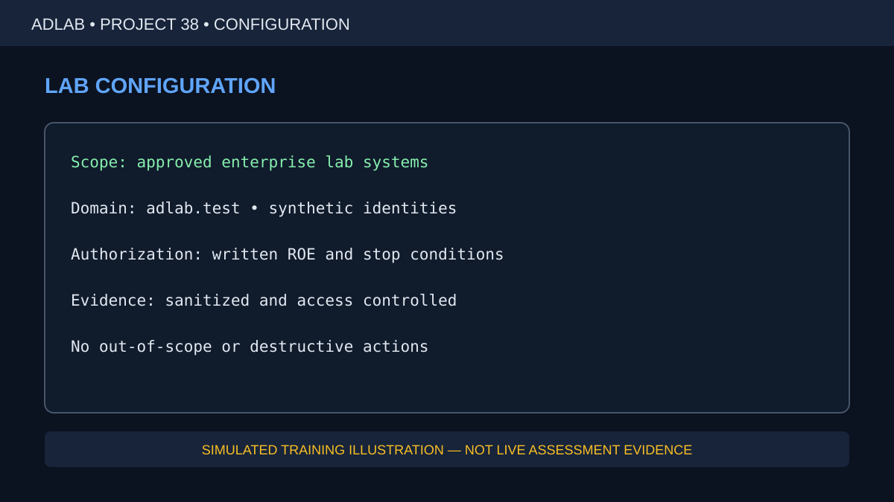
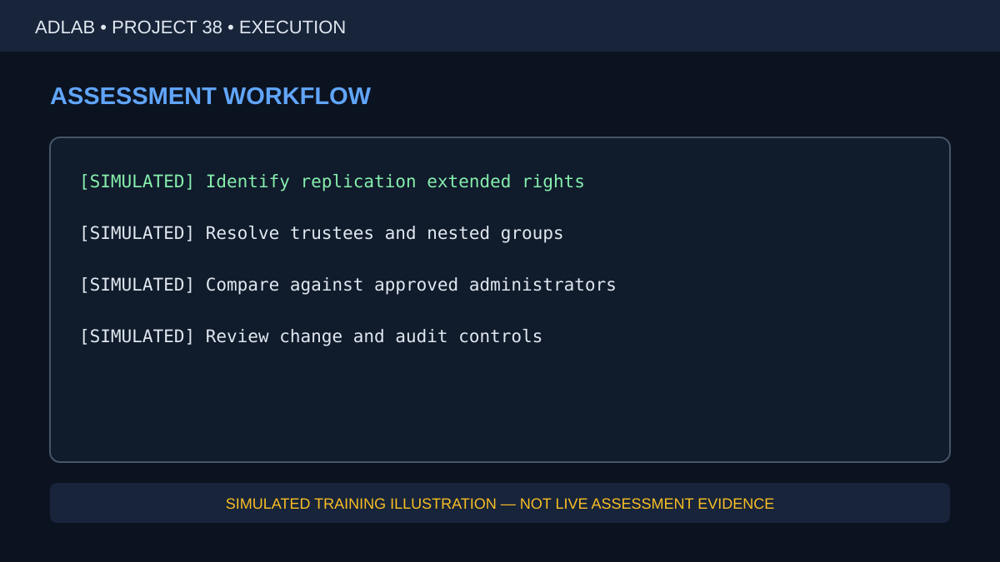
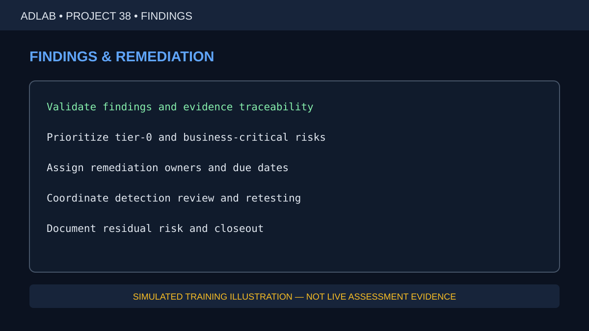

# Project 38 — DCSync Permission and Replication Rights Assessment

**Advanced | Enterprise Active Directory security assessment | Authorized lab framework**

## Objective
Audit directory replication extended rights and identify principals that could replicate directory secrets. Do not invoke DCSync or request password data.

## Scope and safety
- Use the isolated `adlab.test` environment and synthetic identities unless a separate written engagement authorizes additional assets.
- Obtain written authorization, define exclusions and stop conditions, and coordinate with system owners.
- Do not perform credential theft, ticket forgery, persistence, relay, unauthorized lateral movement, or destructive actions as part of this educational walkthrough.
- All evidence must be sanitized and handled as confidential assessment material.

## Prerequisites
Projects 01–35 as applicable; current lab snapshot; approved tool versions; documented rules of engagement; evidence storage; owner and emergency contacts.

## 1. Preparation
Confirm objectives, scope, authorization, system owners, allowed methods, testing windows, monitoring contacts, and rollback/stop procedures.



## 2. Step-by-step walkthrough
### Step 1 — Identify replication extended rights

```powershell
Inspect domain-root ACLs for DS-Replication-Get-Changes, DS-Replication-Get-Changes-All, and related replication rights.
```

Use AD ACL viewers or a reviewed read-only script; record trustee and scope.

### Step 2 — Resolve trustees and nested groups

```powershell
Map each trustee SID to its directory object and recursively review group membership.
```

Do not assume only Domain Admins should have rights; verify service and backup dependencies.

### Step 3 — Compare against approved administrators

```powershell
Compare the permission list with documented domain controller replication and backup roles.
```

Validate service accounts with owners and least-privilege documentation.

### Step 4 — Review change and audit controls

```powershell
Inspect directory ACL change monitoring and change-management records.
```

Do not test permissions by requesting replication data.



## 3. Example observations (synthetic)
- **OBS-38-1:** Unexpected account has replication rights on the domain root.
- **OBS-38-2:** Broad group is granted replication extended rights.
- **OBS-38-3:** Stale service principal retains replication permissions.
- **OBS-38-4:** Replication ACL changes are not monitored.

These are possible assessment observations, not assertions about a real environment. Validate each against authoritative configuration and owner context.

## 4. Evidence and risk analysis
For each confirmed finding, document:
- Unique finding ID, title, severity, and confidence.
- Affected assets and sanitized object identifiers.
- Evidence source, command or screenshot, timestamp, and account context.
- Preconditions, technical impact, and business impact.
- Relevant ATT&CK technique or control mapping where applicable.
- Remediation owner, target date, and retest criteria.

Do not include passwords, hashes, ticket blobs, private keys, tokens, or unnecessary personal data.

## 5. Remediation and reporting
- Remove unauthorized replication rights using approved change control.
- Restrict replication permissions to required DC and documented service identities.
- Review nested group membership and stale service accounts.
- Alert on changes to replication extended rights.



## 6. Detection and retest
Correlate relevant domain controller, endpoint, CA, identity-provider, and network telemetry as applicable. Audit availability depends on configuration. Record detection coverage and gaps, validate approved remediation with repeatable read-only checks, and document residual risk.

## 7. Completion checklist
- [ ] Authorization, scope, exclusions, and stop conditions recorded.
- [ ] Baseline and methodology documented.
- [ ] Assessment performed within approved boundaries.
- [ ] Findings validated and evidence sanitized.
- [ ] Critical issues communicated through agreed channels.
- [ ] Remediation owners and retest criteria assigned.
- [ ] Final report peer-reviewed and securely delivered.

## References
- https://learn.microsoft.com/en-us/windows/win32/adschema/extended-rights
- https://attack.mitre.org/techniques/T1003/006/
- https://learn.microsoft.com/en-us/windows-server/identity/ad-ds/manage/understand-security-groups

## Disclaimer
For authorized assessment and training use only. Screenshots and sample observations are simulated training illustrations, not genuine tool captures or customer assessment evidence.
