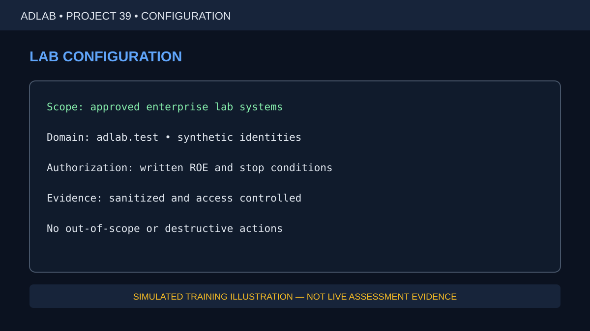
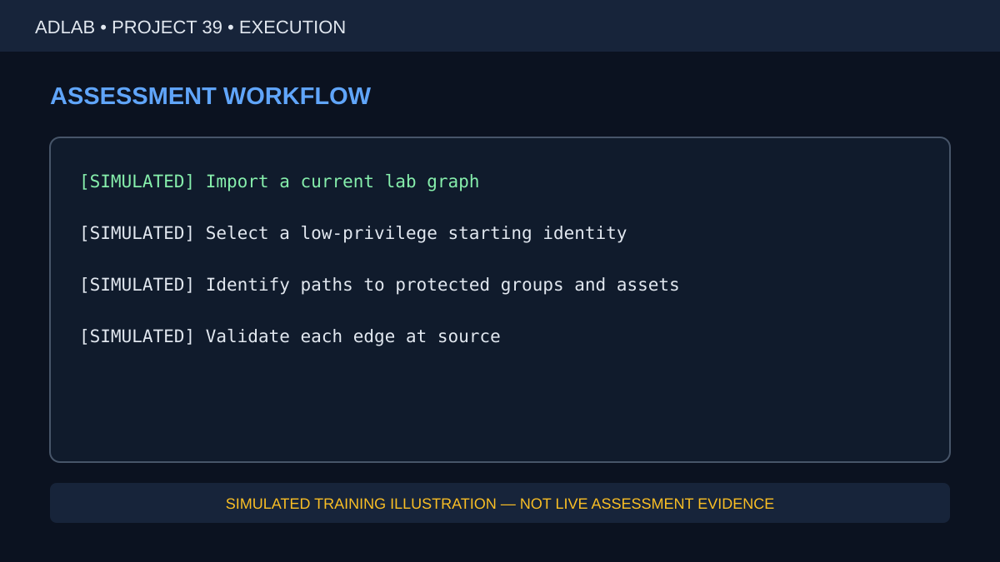
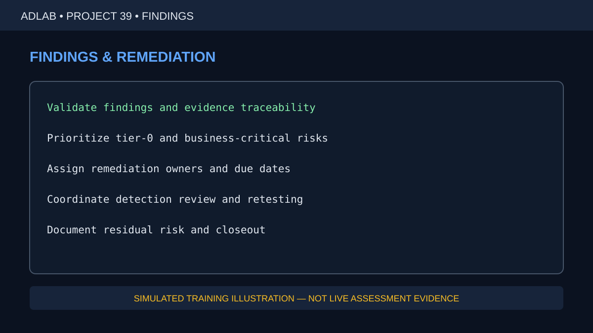

# Project 39 — Domain Privilege Escalation Attack Path Analysis

**Advanced | Enterprise Active Directory security assessment | Authorized lab framework**

## Objective
Model potential privilege escalation paths from a synthetic low-privilege identity to protected assets, then validate the underlying permissions and controls without executing the path.

## Scope and safety
- Use the isolated `adlab.test` environment and synthetic identities unless a separate written engagement authorizes additional assets.
- Obtain written authorization, define exclusions and stop conditions, and coordinate with system owners.
- Do not perform credential theft, ticket forgery, persistence, relay, unauthorized lateral movement, or destructive actions as part of this educational walkthrough.
- All evidence must be sanitized and handled as confidential assessment material.

## Prerequisites
Projects 01–35 as applicable; current lab snapshot; approved tool versions; documented rules of engagement; evidence storage; owner and emergency contacts.

## 1. Preparation
Confirm objectives, scope, authorization, system owners, allowed methods, testing windows, monitoring contacts, and rollback/stop procedures.



## 2. Step-by-step walkthrough
### Step 1 — Import a current lab graph

```powershell
Use a fresh, approved BloodHound/SharpHound dataset from the isolated domain.
```

Record collection time and coverage gaps.

### Step 2 — Select a low-privilege starting identity

```powershell
Choose a synthetic user with documented baseline rights.
```

Do not use real employee identities or attempt to traverse a path.

### Step 3 — Identify paths to protected groups and assets

```powershell
Use built-in analysis queries to locate shortest paths to Domain Admins, DCs, and critical servers.
```

Export only sanitized path descriptions.

### Step 4 — Validate each edge at source

```powershell
Review group membership, ACLs, local admin rights, delegation, and sessions through read-only methods.
```

Discard stale or unsupported graph edges and note confidence.



## 3. Example observations (synthetic)
- **OBS-39-1:** A standard user has a multi-step path to a privileged group.
- **OBS-39-2:** Path depends on stale sessions or outdated collection data.
- **OBS-39-3:** Multiple independent misconfigurations compound risk.
- **OBS-39-4:** Critical assets are reachable through broad local admin assignments.

These are possible assessment observations, not assertions about a real environment. Validate each against authoritative configuration and owner context.

## 4. Evidence and risk analysis
For each confirmed finding, document:
- Unique finding ID, title, severity, and confidence.
- Affected assets and sanitized object identifiers.
- Evidence source, command or screenshot, timestamp, and account context.
- Preconditions, technical impact, and business impact.
- Relevant ATT&CK technique or control mapping where applicable.
- Remediation owner, target date, and retest criteria.

Do not include passwords, hashes, ticket blobs, private keys, tokens, or unnecessary personal data.

## 5. Remediation and reporting
- Break the shortest high-impact path at its earliest least-privilege control point.
- Reduce privileged group membership and local admin rights.
- Harden service identities and delegation.
- Repeat graph collection and validate the path is removed.



## 6. Detection and retest
Correlate relevant domain controller, endpoint, CA, identity-provider, and network telemetry as applicable. Audit availability depends on configuration. Record detection coverage and gaps, validate approved remediation with repeatable read-only checks, and document residual risk.

## 7. Completion checklist
- [ ] Authorization, scope, exclusions, and stop conditions recorded.
- [ ] Baseline and methodology documented.
- [ ] Assessment performed within approved boundaries.
- [ ] Findings validated and evidence sanitized.
- [ ] Critical issues communicated through agreed channels.
- [ ] Remediation owners and retest criteria assigned.
- [ ] Final report peer-reviewed and securely delivered.

## References
- https://bloodhound.specterops.io/
- https://attack.mitre.org/tactics/TA0004/
- https://learn.microsoft.com/en-us/windows-server/identity/ad-ds/plan/security-best-practices

## Disclaimer
For authorized assessment and training use only. Screenshots and sample observations are simulated training illustrations, not genuine tool captures or customer assessment evidence.
