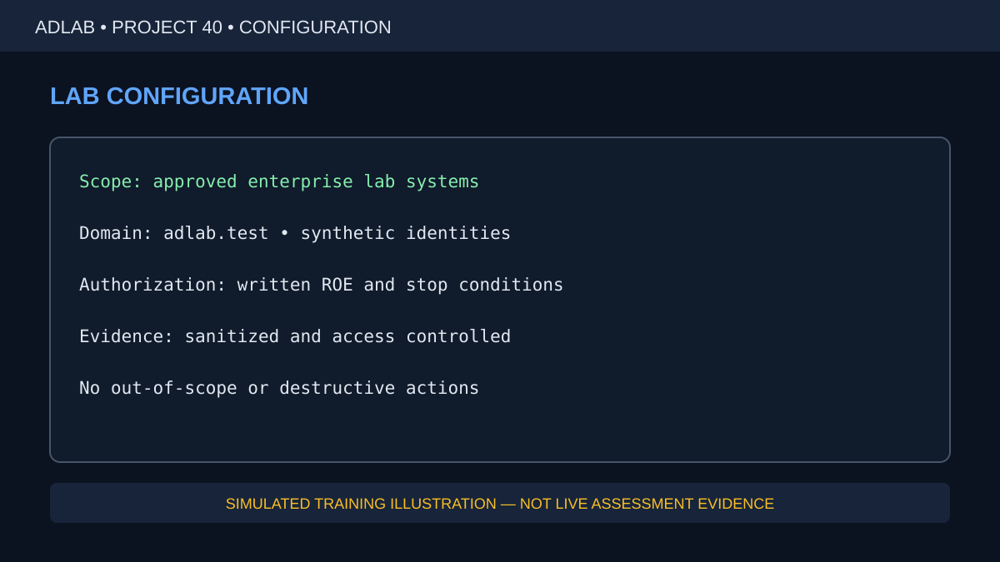
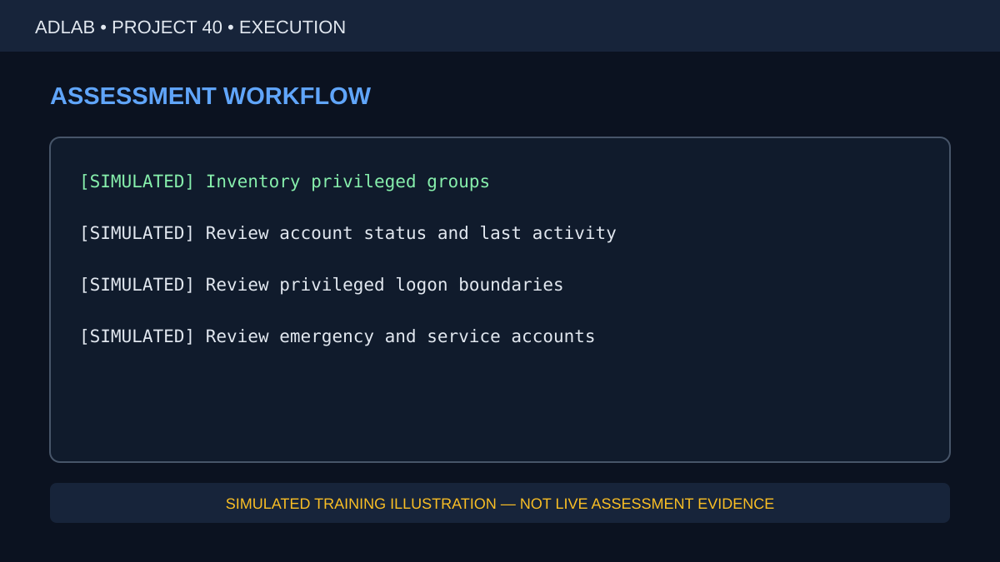
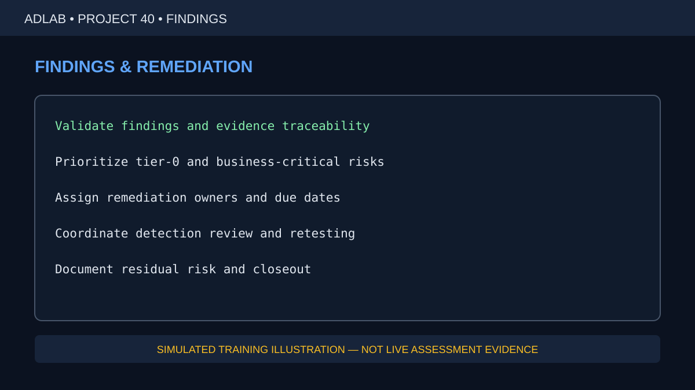

# Project 40 — Domain Admin Exposure and Privileged Group Assessment

**Advanced | Enterprise Active Directory security assessment | Authorized lab framework**

## Objective
Assess privileged group membership, account hygiene, logon exposure, delegation, and tier-0 administration controls.

## Scope and safety
- Use the isolated `adlab.test` environment and synthetic identities unless a separate written engagement authorizes additional assets.
- Obtain written authorization, define exclusions and stop conditions, and coordinate with system owners.
- Do not perform credential theft, ticket forgery, persistence, relay, unauthorized lateral movement, or destructive actions as part of this educational walkthrough.
- All evidence must be sanitized and handled as confidential assessment material.

## Prerequisites
Projects 01–35 as applicable; current lab snapshot; approved tool versions; documented rules of engagement; evidence storage; owner and emergency contacts.

## 1. Preparation
Confirm objectives, scope, authorization, system owners, allowed methods, testing windows, monitoring contacts, and rollback/stop procedures.



## 2. Step-by-step walkthrough
### Step 1 — Inventory privileged groups

```powershell
Get-ADGroupMember 'Domain Admins' -Recursive | Select Name,SamAccountName,ObjectClass
```

Repeat for Enterprise Admins and Schema Admins where applicable; protect output.

### Step 2 — Review account status and last activity

```powershell
Get-ADUser -Filter * -Properties Enabled,LastLogonDate,PasswordLastSet | Select SamAccountName,Enabled,LastLogonDate,PasswordLastSet
```

Validate stale accounts with owners; replicated last-logon attributes may not represent exact activity.

### Step 3 — Review privileged logon boundaries

```powershell
Compare privileged account sign-in records and workstation tiering with the approved admin model.
```

Do not sign in as privileged users to test access.

### Step 4 — Review emergency and service accounts

```powershell
Check ownership, vaulting, MFA, alerting, and periodic access recertification records.
```

Never display credentials or recovery secrets.



## 3. Example observations (synthetic)
- **OBS-40-1:** Unnecessary or stale members remain in Domain Admins.
- **OBS-40-2:** Privileged accounts are used on lower-trust endpoints.
- **OBS-40-3:** Service or emergency identities have excessive standing privileges.
- **OBS-40-4:** Privileged group membership changes are not monitored.

These are possible assessment observations, not assertions about a real environment. Validate each against authoritative configuration and owner context.

## 4. Evidence and risk analysis
For each confirmed finding, document:
- Unique finding ID, title, severity, and confidence.
- Affected assets and sanitized object identifiers.
- Evidence source, command or screenshot, timestamp, and account context.
- Preconditions, technical impact, and business impact.
- Relevant ATT&CK technique or control mapping where applicable.
- Remediation owner, target date, and retest criteria.

Do not include passwords, hashes, ticket blobs, private keys, tokens, or unnecessary personal data.

## 5. Remediation and reporting
- Remove unnecessary membership and use time-bound elevation where possible.
- Enforce tiered administration and dedicated privileged workstations.
- Vault emergency credentials and test recovery procedures.
- Alert and periodically recertify privileged group membership.



## 6. Detection and retest
Correlate relevant domain controller, endpoint, CA, identity-provider, and network telemetry as applicable. Audit availability depends on configuration. Record detection coverage and gaps, validate approved remediation with repeatable read-only checks, and document residual risk.

## 7. Completion checklist
- [ ] Authorization, scope, exclusions, and stop conditions recorded.
- [ ] Baseline and methodology documented.
- [ ] Assessment performed within approved boundaries.
- [ ] Findings validated and evidence sanitized.
- [ ] Critical issues communicated through agreed channels.
- [ ] Remediation owners and retest criteria assigned.
- [ ] Final report peer-reviewed and securely delivered.

## References
- https://learn.microsoft.com/en-us/windows-server/identity/ad-ds/plan/security-best-practices/implementing-least-privilege-administrative-models
- https://learn.microsoft.com/en-us/entra/id-governance/privileged-identity-management/pim-configure
- https://attack.mitre.org/techniques/T1098/

## Disclaimer
For authorized assessment and training use only. Screenshots and sample observations are simulated training illustrations, not genuine tool captures or customer assessment evidence.
