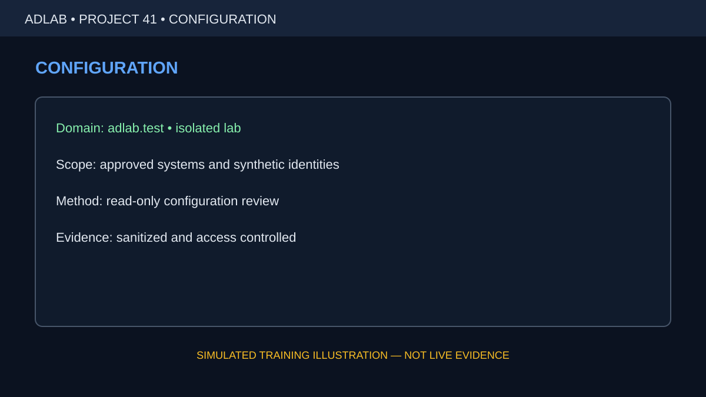
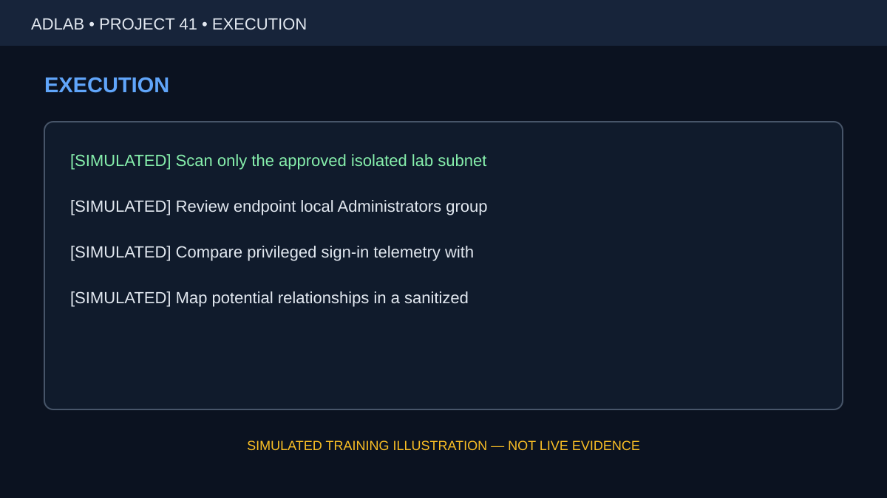
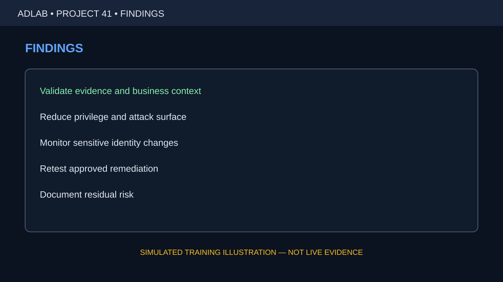

# Project 41 — Lateral Movement Risk Assessment

**Advanced | Enterprise Active Directory security assessment | Read-only validation**

## Objective
Assess pathways that could enable movement between domain systems through remote management exposure, local admin assignments, privileged sessions, and segmentation. No lateral movement is performed.

## Scope and safety
Use only the isolated `adlab.test` lab and synthetic identities. Obtain written authorization and define exclusions and stop conditions. Do not perform credential replay, lateral movement, persistence, ticket forgery, or unauthorized access.

## Prerequisites
Projects 01–40 as applicable; current lab snapshot; approved administrative tools; documented scope, owners, and evidence handling.

## 1. Prepare
Confirm target systems, account context, source host, authorization, and assessment window. Record baseline configuration.

## 2. Walkthrough
### Step 1 — Scan only the approved isolated lab subnet for management ports using Nmap.

Use the approved read-only administrative view or query. Record tool version, timestamp, account context, and sanitized output. Validate the observation with the relevant system owner; do not modify settings during discovery.

### Step 2 — Review endpoint local Administrators group membership through approved inventory reports.

Use the approved read-only administrative view or query. Record tool version, timestamp, account context, and sanitized output. Validate the observation with the relevant system owner; do not modify settings during discovery.

### Step 3 — Compare privileged sign-in telemetry with the tiered administration model.

Use the approved read-only administrative view or query. Record tool version, timestamp, account context, and sanitized output. Validate the observation with the relevant system owner; do not modify settings during discovery.

### Step 4 — Map potential relationships in a sanitized BloodHound graph and validate firewall boundaries.

Use the approved read-only administrative view or query. Record tool version, timestamp, account context, and sanitized output. Validate the observation with the relevant system owner; do not modify settings during discovery.

## 3. Example observations (synthetic)
- **OBS-41-1:** Remote management is broadly reachable across workstation/server tiers.
- **OBS-41-2:** Local administrator membership is shared across unrelated assets.
- **OBS-41-3:** Privileged sessions occur on lower-trust endpoints.

These are training examples, not claims about your environment. Confirm the complete configuration and business context before assigning severity.

## 4. Evidence and risk
Record sanitized asset/object identifiers, source and timestamp, relevant policy/attribute, account context, expected versus observed state, attack preconditions, impact, confidence, and owner. Do not publish passwords, hashes, tickets, private keys, or personal data.

## 5. Remediation
- Restrict management protocols to hardened jump hosts.
- Use unique managed local admin passwords and tiered groups.
- Enforce privileged workstation and session isolation.

## 6. Detection and retest
Review applicable DC, endpoint, authentication, and identity telemetry. Audit availability depends on policy and logging configuration. After approved remediation, repeat read-only checks and document residual risk.

## 7. Completion checklist
- [ ] Scope and authorization confirmed.
- [ ] Baseline and tool versions recorded.
- [ ] Assessment completed without unauthorized access or changes.
- [ ] Findings validated and evidence sanitized.
- [ ] Remediation owners and due dates assigned.
- [ ] Retest and residual risk documented.

## References
- https://attack.mitre.org/tactics/TA0008/
- https://learn.microsoft.com/en-us/windows-server/identity/laps/laps-overview

## Disclaimer
For authorized lab use only. Screenshots and sample observations are simulated training illustrations, not genuine tool captures or customer assessment evidence.
