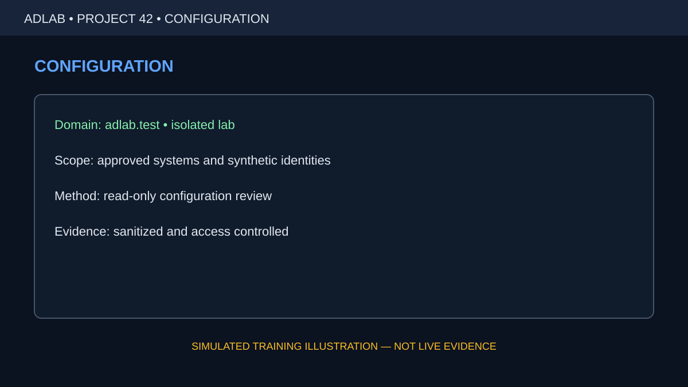
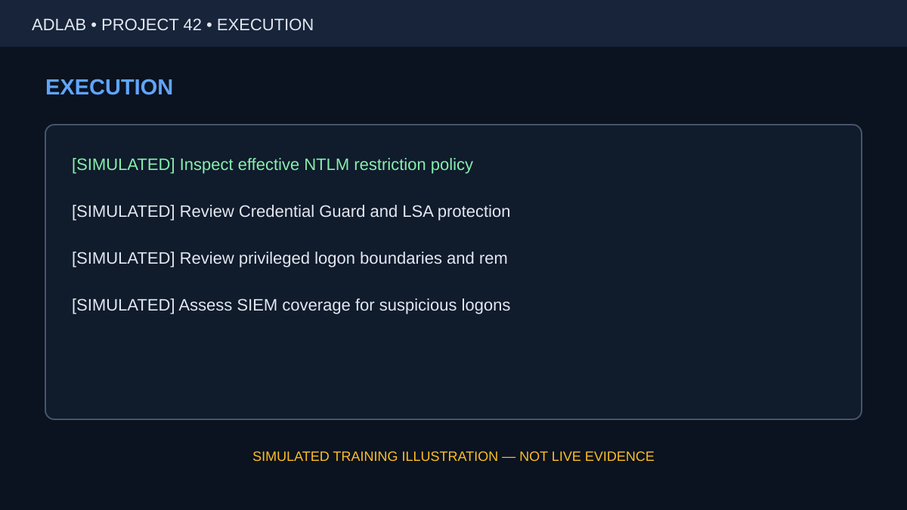
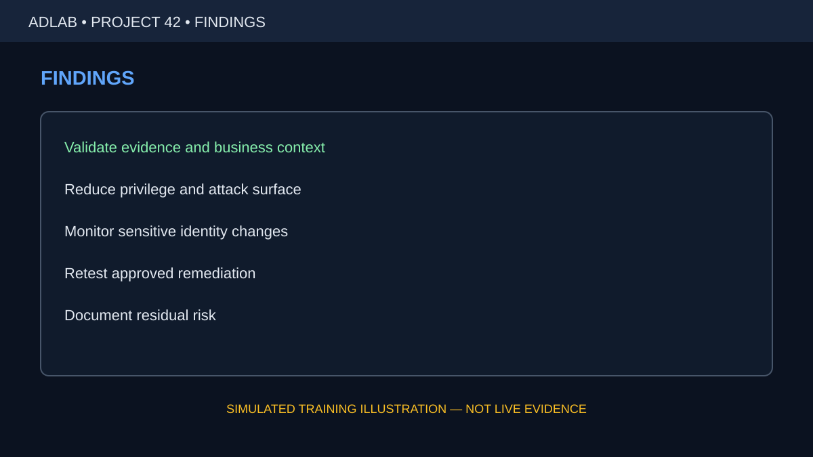

# Project 42 — Pass-the-Hash and Pass-the-Ticket Exposure Assessment

**Advanced | Enterprise Active Directory security assessment | Read-only validation**

## Objective
Review controls that reduce credential replay and ticket theft risks. No hashes or tickets are extracted, exported, or replayed.

## Scope and safety
Use only the isolated `adlab.test` lab and synthetic identities. Obtain written authorization and define exclusions and stop conditions. Do not perform credential replay, lateral movement, persistence, ticket forgery, or unauthorized access.

## Prerequisites
Projects 01–40 as applicable; current lab snapshot; approved administrative tools; documented scope, owners, and evidence handling.

## 1. Prepare
Confirm target systems, account context, source host, authorization, and assessment window. Record baseline configuration.

## 2. Walkthrough
### Step 1 — Inspect effective NTLM restriction policy and audit events.

Use the approved read-only administrative view or query. Record tool version, timestamp, account context, and sanitized output. Validate the observation with the relevant system owner; do not modify settings during discovery.

### Step 2 — Review Credential Guard and LSA protection status on supported systems.

Use the approved read-only administrative view or query. Record tool version, timestamp, account context, and sanitized output. Validate the observation with the relevant system owner; do not modify settings during discovery.

### Step 3 — Review privileged logon boundaries and remote credential protection policy.

Use the approved read-only administrative view or query. Record tool version, timestamp, account context, and sanitized output. Validate the observation with the relevant system owner; do not modify settings during discovery.

### Step 4 — Assess SIEM coverage for suspicious logons, ticket anomalies, and credential access.

Use the approved read-only administrative view or query. Record tool version, timestamp, account context, and sanitized output. Validate the observation with the relevant system owner; do not modify settings during discovery.

## 3. Example observations (synthetic)
- **OBS-42-1:** NTLM remains broadly enabled without a migration plan.
- **OBS-42-2:** Credential Guard is missing on supported endpoints.
- **OBS-42-3:** Privileged identities sign in to lower-trust systems.

These are training examples, not claims about your environment. Confirm the complete configuration and business context before assigning severity.

## 4. Evidence and risk
Record sanitized asset/object identifiers, source and timestamp, relevant policy/attribute, account context, expected versus observed state, attack preconditions, impact, confidence, and owner. Do not publish passwords, hashes, tickets, private keys, or personal data.

## 5. Remediation
- Reduce NTLM and prefer Kerberos/modern authentication.
- Enable Credential Guard and LSA protection where supported.
- Use dedicated admin workstations and tune endpoint detections.

## 6. Detection and retest
Review applicable DC, endpoint, authentication, and identity telemetry. Audit availability depends on policy and logging configuration. After approved remediation, repeat read-only checks and document residual risk.

## 7. Completion checklist
- [ ] Scope and authorization confirmed.
- [ ] Baseline and tool versions recorded.
- [ ] Assessment completed without unauthorized access or changes.
- [ ] Findings validated and evidence sanitized.
- [ ] Remediation owners and due dates assigned.
- [ ] Retest and residual risk documented.

## References
- https://learn.microsoft.com/en-us/windows/security/identity-protection/credential-guard/
- https://attack.mitre.org/techniques/T1550/002/
- https://attack.mitre.org/techniques/T1550/003/

## Disclaimer
For authorized lab use only. Screenshots and sample observations are simulated training illustrations, not genuine tool captures or customer assessment evidence.
