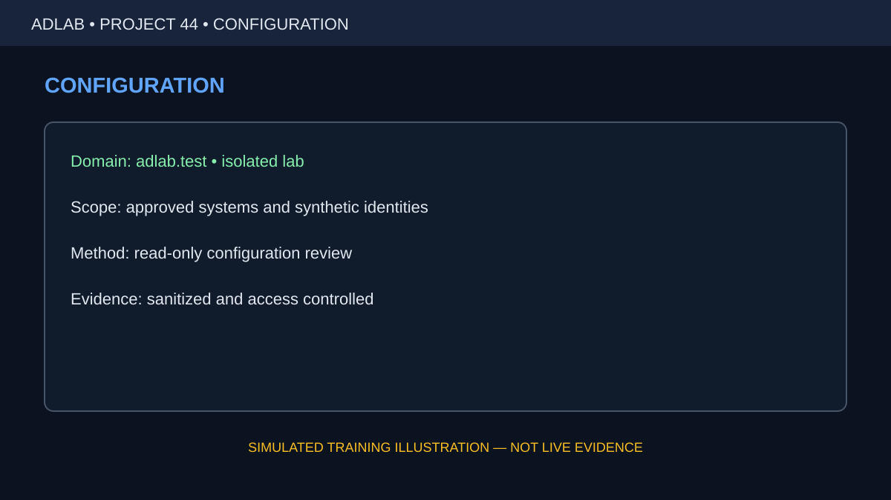
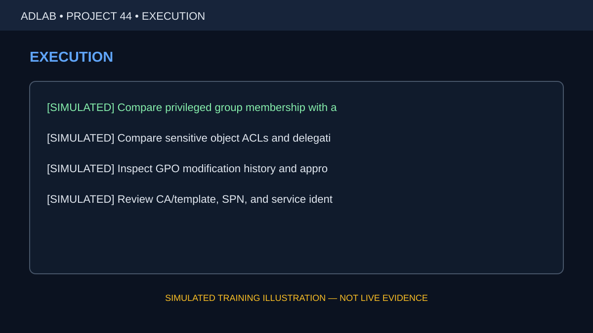
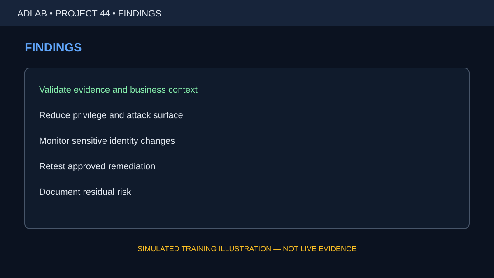

# Project 44 — Active Directory Persistence Risk Assessment

**Advanced | Enterprise Active Directory security assessment | Read-only validation**

## Objective
Review persistence surfaces such as privileged membership, delegation, ACLs, GPOs, certificates, and service identities. Do not create backdoor accounts or establish persistence.

## Scope and safety
Use only the isolated `adlab.test` lab and synthetic identities. Obtain written authorization and define exclusions and stop conditions. Do not perform credential replay, lateral movement, persistence, ticket forgery, or unauthorized access.

## Prerequisites
Projects 01–40 as applicable; current lab snapshot; approved administrative tools; documented scope, owners, and evidence handling.

## 1. Prepare
Confirm target systems, account context, source host, authorization, and assessment window. Record baseline configuration.

## 2. Walkthrough
### Step 1 — Compare privileged group membership with approved access records and change tickets.

Use the approved read-only administrative view or query. Record tool version, timestamp, account context, and sanitized output. Validate the observation with the relevant system owner; do not modify settings during discovery.

### Step 2 — Compare sensitive object ACLs and delegation attributes with a known-good baseline.

Use the approved read-only administrative view or query. Record tool version, timestamp, account context, and sanitized output. Validate the observation with the relevant system owner; do not modify settings during discovery.

### Step 3 — Inspect GPO modification history and approved startup/logon scripts.

Use the approved read-only administrative view or query. Record tool version, timestamp, account context, and sanitized output. Validate the observation with the relevant system owner; do not modify settings during discovery.

### Step 4 — Review CA/template, SPN, and service identity changes with owners.

Use the approved read-only administrative view or query. Record tool version, timestamp, account context, and sanitized output. Validate the observation with the relevant system owner; do not modify settings during discovery.

## 3. Example observations (synthetic)
- **OBS-44-1:** Unapproved privileged group member or delegated right.
- **OBS-44-2:** Unexpected GPO/script modification.
- **OBS-44-3:** Certificate template or CA configuration drift.

These are training examples, not claims about your environment. Confirm the complete configuration and business context before assigning severity.

## 4. Evidence and risk
Record sanitized asset/object identifiers, source and timestamp, relevant policy/attribute, account context, expected versus observed state, attack preconditions, impact, confidence, and owner. Do not publish passwords, hashes, tickets, private keys, or personal data.

## 5. Remediation
- Establish baselines and alert on sensitive directory changes.
- Use approval and dual control for tier-0 modifications.
- Remove unauthorized artifacts through incident/change processes.

## 6. Detection and retest
Review applicable DC, endpoint, authentication, and identity telemetry. Audit availability depends on policy and logging configuration. After approved remediation, repeat read-only checks and document residual risk.

## 7. Completion checklist
- [ ] Scope and authorization confirmed.
- [ ] Baseline and tool versions recorded.
- [ ] Assessment completed without unauthorized access or changes.
- [ ] Findings validated and evidence sanitized.
- [ ] Remediation owners and due dates assigned.
- [ ] Retest and residual risk documented.

## References
- https://attack.mitre.org/tactics/TA0003/
- https://learn.microsoft.com/en-us/windows-server/identity/ad-cs/

## Disclaimer
For authorized lab use only. Screenshots and sample observations are simulated training illustrations, not genuine tool captures or customer assessment evidence.
