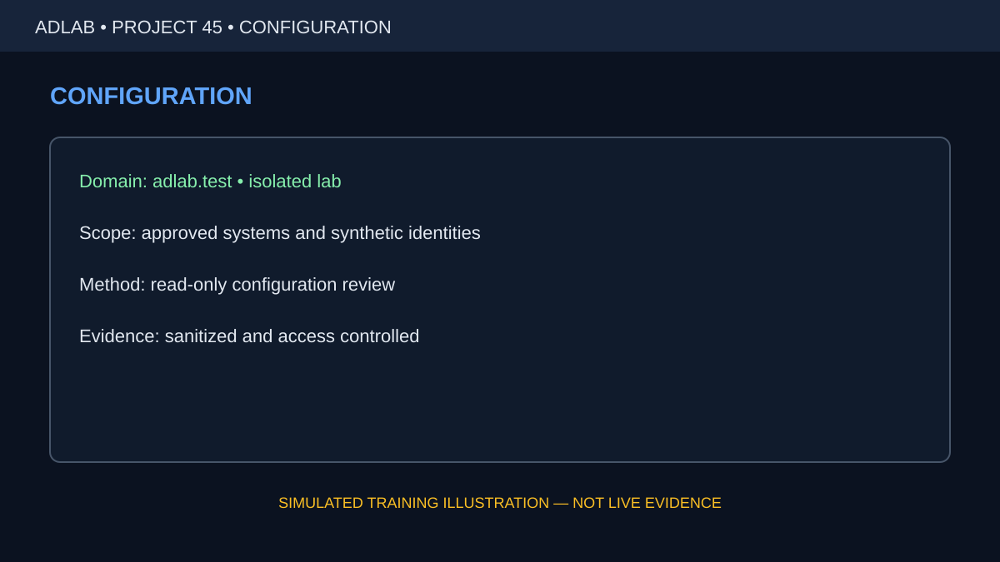
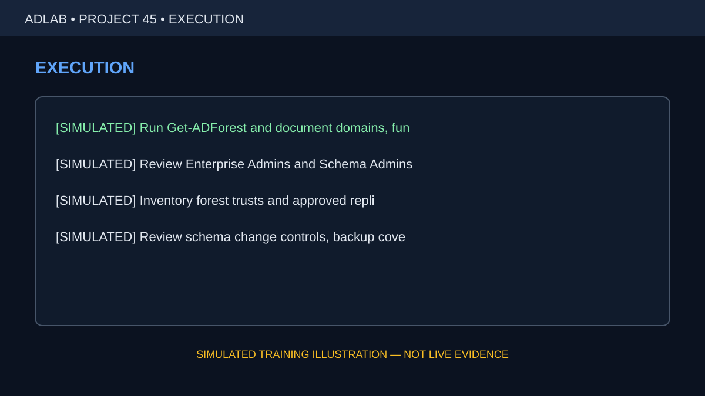
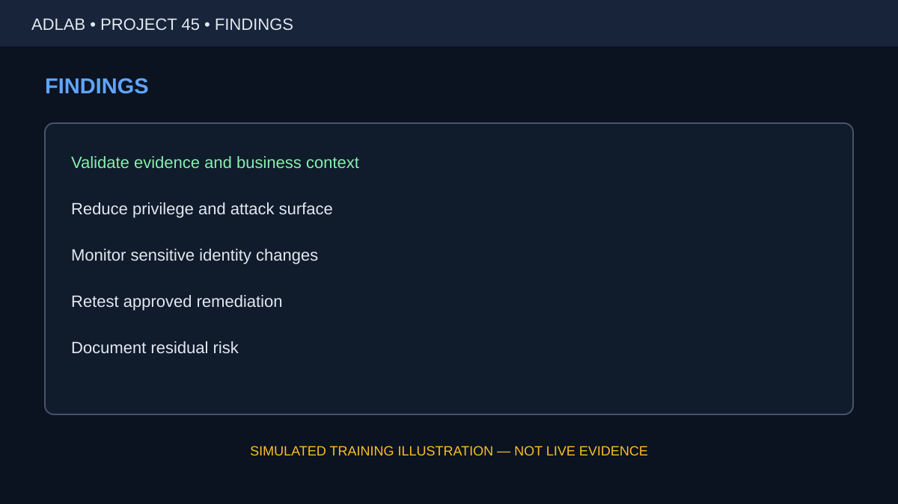

# Project 45 — Forest and Enterprise Admin Security Assessment

**Advanced | Enterprise Active Directory security assessment | Read-only validation**

## Objective
Assess forest-level privileged groups, schema/configuration partitions, trust boundaries, replication, and forest recovery governance.

## Scope and safety
Use only the isolated `adlab.test` lab and synthetic identities. Obtain written authorization and define exclusions and stop conditions. Do not perform credential replay, lateral movement, persistence, ticket forgery, or unauthorized access.

## Prerequisites
Projects 01–40 as applicable; current lab snapshot; approved administrative tools; documented scope, owners, and evidence handling.

## 1. Prepare
Confirm target systems, account context, source host, authorization, and assessment window. Record baseline configuration.

## 2. Walkthrough
### Step 1 — Run Get-ADForest and document domains, functional level, global catalogs, and FSMO roles.

Use the approved read-only administrative view or query. Record tool version, timestamp, account context, and sanitized output. Validate the observation with the relevant system owner; do not modify settings during discovery.

### Step 2 — Review Enterprise Admins and Schema Admins membership with approved read-only queries.

Use the approved read-only administrative view or query. Record tool version, timestamp, account context, and sanitized output. Validate the observation with the relevant system owner; do not modify settings during discovery.

### Step 3 — Inventory forest trusts and approved replication relationships.

Use the approved read-only administrative view or query. Record tool version, timestamp, account context, and sanitized output. Validate the observation with the relevant system owner; do not modify settings during discovery.

### Step 4 — Review schema change controls, backup coverage, and forest recovery runbooks.

Use the approved read-only administrative view or query. Record tool version, timestamp, account context, and sanitized output. Validate the observation with the relevant system owner; do not modify settings during discovery.

## 3. Example observations (synthetic)
- **OBS-45-1:** Enterprise Admin membership is broader than necessary.
- **OBS-45-2:** Schema Admins has permanent members outside change windows.
- **OBS-45-3:** Forest recovery process is untested or backups are incomplete.

These are training examples, not claims about your environment. Confirm the complete configuration and business context before assigning severity.

## 4. Evidence and risk
Record sanitized asset/object identifiers, source and timestamp, relevant policy/attribute, account context, expected versus observed state, attack preconditions, impact, confidence, and owner. Do not publish passwords, hashes, tickets, private keys, or personal data.

## 5. Remediation
- Use tightly controlled temporary forest-level privilege.
- Keep Schema Admins empty except during approved changes.
- Test forest recovery and maintain protected system-state backups.

## 6. Detection and retest
Review applicable DC, endpoint, authentication, and identity telemetry. Audit availability depends on policy and logging configuration. After approved remediation, repeat read-only checks and document residual risk.

## 7. Completion checklist
- [ ] Scope and authorization confirmed.
- [ ] Baseline and tool versions recorded.
- [ ] Assessment completed without unauthorized access or changes.
- [ ] Findings validated and evidence sanitized.
- [ ] Remediation owners and due dates assigned.
- [ ] Retest and residual risk documented.

## References
- https://learn.microsoft.com/en-us/windows-server/identity/ad-ds/plan/active-directory-forest-design
- https://learn.microsoft.com/en-us/windows-server/identity/ad-ds/manage/forest-recovery-guide/ad-forest-recovery-guide

## Disclaimer
For authorized lab use only. Screenshots and sample observations are simulated training illustrations, not genuine tool captures or customer assessment evidence.
