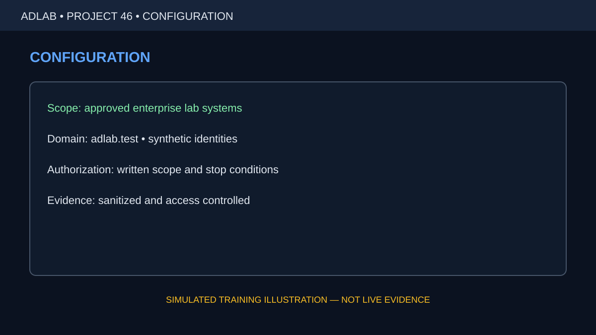
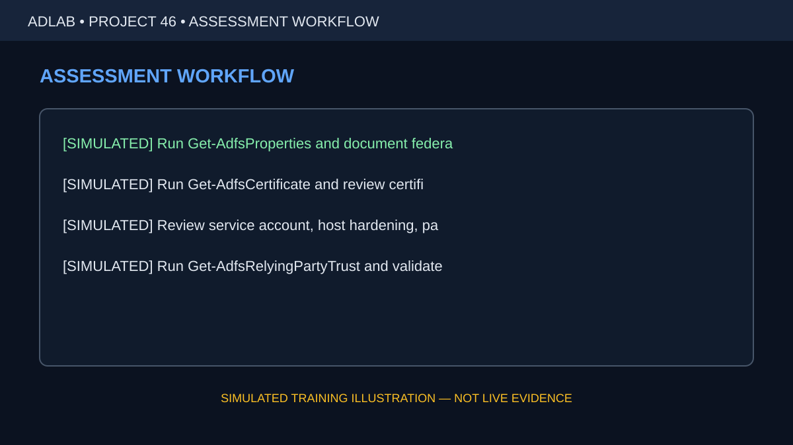

# Project 46 — Active Directory Federation Services Assessment

**Advanced | Enterprise Active Directory assessment | Authorized lab framework**

## Objective
Review AD FS topology, service accounts, certificates, endpoints, relying parties, patching, and audit controls without forging tokens or testing unauthorized relying parties.

## Scope and safety
Use only the isolated `adlab.test` lab and synthetic identities unless a separate written engagement authorizes additional assets. Define written scope, exclusions, stop conditions, emergency contacts, and evidence handling. Do not perform unauthorized access, credential theft, persistence, ticket forgery, or destructive actions.

## Prerequisites
Projects 01–45 as applicable; current lab snapshot; approved tool versions; documented authorization and rules of engagement; secure evidence storage.

## 1. Preparation
Confirm objectives, targets, system owners, allowed methods, testing window, monitoring contacts, and rollback/stop procedures. Record the baseline.

## 2. Walkthrough
### Step 1 — Run Get-AdfsProperties and document federation service name and identifier.

Use the approved read-only administrative view or query. Record exact tool version, timestamp, account context, and sanitized output. Validate the observation with the relevant owner; do not make changes during discovery.

### Step 2 — Run Get-AdfsCertificate and review certificate type, primary status, and expiry; do not export private keys.

Use the approved read-only administrative view or query. Record exact tool version, timestamp, account context, and sanitized output. Validate the observation with the relevant owner; do not make changes during discovery.

### Step 3 — Review service account, host hardening, patching, and tiering controls.

Use the approved read-only administrative view or query. Record exact tool version, timestamp, account context, and sanitized output. Validate the observation with the relevant owner; do not make changes during discovery.

### Step 4 — Run Get-AdfsRelyingPartyTrust and validate each trust owner and business need.

Use the approved read-only administrative view or query. Record exact tool version, timestamp, account context, and sanitized output. Validate the observation with the relevant owner; do not make changes during discovery.

## 3. Example observations (synthetic)
- **OBS-46-1:** Token-signing certificate expiry is near or rollover is untested.
- **OBS-46-2:** AD FS service identity has excessive privilege.
- **OBS-46-3:** Obsolete relying party trusts remain enabled.

These are training scenarios, not assertions about a real environment. Validate evidence and business context before assigning severity.

## 4. Evidence and risk
For each confirmed finding, record unique ID, title, severity, confidence, affected assets, sanitized object identifiers, evidence source and timestamp, account context, preconditions, technical/business impact, control mapping, owner, and due date. Never include passwords, hashes, ticket blobs, private keys, tokens, or unnecessary personal data.

## 5. Remediation
- Test certificate rollover and owner notification.
- Use least-privilege service identity and hardened hosts.
- Remove stale relying party trusts after validation.

## 6. Detection and retest
Correlate relevant DC, endpoint, CA, identity-provider, and network telemetry. Audit availability depends on configuration. Validate approved remediation using repeatable read-only checks and document residual risk.

## 7. Completion checklist
- [ ] Authorization, scope, exclusions, and stop conditions recorded.
- [ ] Baseline and methodology documented.
- [ ] Assessment performed within approved boundaries.
- [ ] Findings validated and evidence sanitized.
- [ ] Critical findings communicated through agreed channels.
- [ ] Remediation owners and retest criteria assigned.
- [ ] Final report peer-reviewed and securely delivered.

## References
- https://learn.microsoft.com/en-us/windows-server/identity/ad-fs/overview/ad-fs-overview
- https://learn.microsoft.com/en-us/windows-server/identity/ad-fs/operations/ad-fs-certificate-renewal

## Disclaimer
For authorized assessment and training use only. Screenshots and sample observations are simulated training illustrations, not genuine tool captures or customer assessment evidence.
