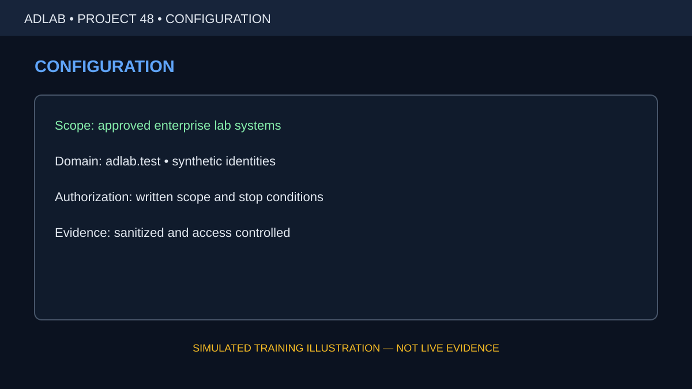
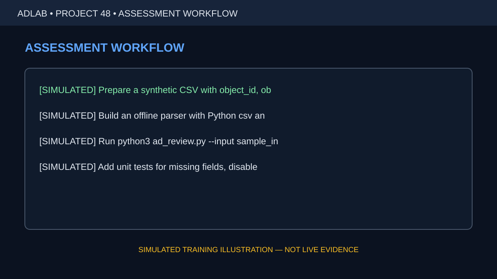

# Project 48 — Active Directory Attack Path Automation with Python

**Advanced | Enterprise Active Directory assessment | Authorized lab framework**

## Objective
Build a safe offline Python reporting utility that parses sanitized directory inventory and flags review conditions. The script does not connect to AD or exploit permissions.

## Scope and safety
Use only the isolated `adlab.test` lab and synthetic identities unless a separate written engagement authorizes additional assets. Define written scope, exclusions, stop conditions, emergency contacts, and evidence handling. Do not perform unauthorized access, credential theft, persistence, ticket forgery, or destructive actions.

## Prerequisites
Projects 01–45 as applicable; current lab snapshot; approved tool versions; documented authorization and rules of engagement; secure evidence storage.

## 1. Preparation
Confirm objectives, targets, system owners, allowed methods, testing window, monitoring contacts, and rollback/stop procedures. Record the baseline.

## 2. Walkthrough
### Step 1 — Prepare a synthetic CSV with object_id, object_type, enabled, privileged, spn_present, delegation_enabled, and owner fields.

Use the approved read-only administrative view or query. Record exact tool version, timestamp, account context, and sanitized output. Validate the observation with the relevant owner; do not make changes during discovery.

### Step 2 — Build an offline parser with Python csv and argparse; validate required headers and malformed rows.

Use the approved read-only administrative view or query. Record exact tool version, timestamp, account context, and sanitized output. Validate the observation with the relevant owner; do not make changes during discovery.

### Step 3 — Run python3 ad_review.py --input sample_inventory.csv --output findings.csv.

Use the approved read-only administrative view or query. Record exact tool version, timestamp, account context, and sanitized output. Validate the observation with the relevant owner; do not make changes during discovery.

### Step 4 — Add unit tests for missing fields, disabled accounts, false positives, and invalid data.

Use the approved read-only administrative view or query. Record exact tool version, timestamp, account context, and sanitized output. Validate the observation with the relevant owner; do not make changes during discovery.

## 3. Example observations (synthetic)
- **OBS-48-1:** Tool flags findings without confirming business context.
- **OBS-48-2:** Input contains real personal or sensitive directory data.
- **OBS-48-3:** Output is treated as proof of exploitability.

These are training scenarios, not assertions about a real environment. Validate evidence and business context before assigning severity.

## 4. Evidence and risk
For each confirmed finding, record unique ID, title, severity, confidence, affected assets, sanitized object identifiers, evidence source and timestamp, account context, preconditions, technical/business impact, control mapping, owner, and due date. Never include passwords, hashes, ticket blobs, private keys, tokens, or unnecessary personal data.

## 5. Remediation
- Use synthetic or explicitly approved sanitized input.
- Add schema validation, tests, and data minimization.
- Label results as review leads and require human validation.

## 6. Detection and retest
Correlate relevant DC, endpoint, CA, identity-provider, and network telemetry. Audit availability depends on configuration. Validate approved remediation using repeatable read-only checks and document residual risk.

## 7. Completion checklist
- [ ] Authorization, scope, exclusions, and stop conditions recorded.
- [ ] Baseline and methodology documented.
- [ ] Assessment performed within approved boundaries.
- [ ] Findings validated and evidence sanitized.
- [ ] Critical findings communicated through agreed channels.
- [ ] Remediation owners and retest criteria assigned.
- [ ] Final report peer-reviewed and securely delivered.

## References
- https://docs.python.org/3/library/csv.html
- https://docs.python.org/3/library/argparse.html

## Disclaimer
For authorized assessment and training use only. Screenshots and sample observations are simulated training illustrations, not genuine tool captures or customer assessment evidence.
