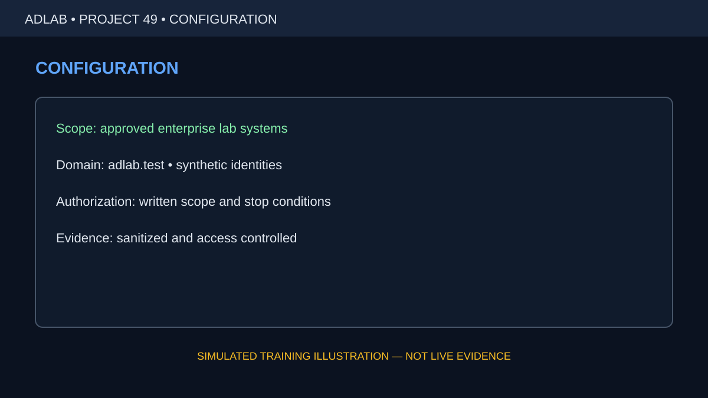
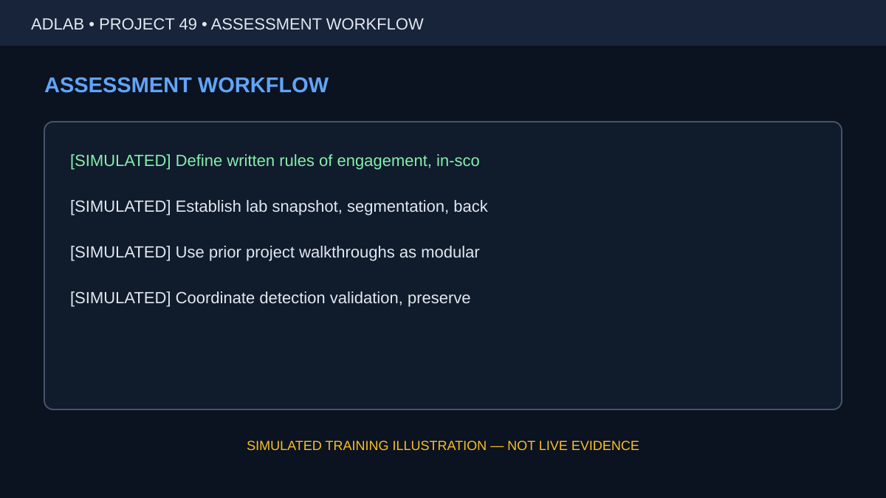

# Project 49 — Complete Active Directory Red Team Assessment

**Advanced | Enterprise Active Directory assessment | Authorized lab framework**

## Objective
Plan and document an authorized end-to-end AD red team assessment using defined objectives, safety controls, evidence, detection validation, and remediation. This is a rules-of-engagement framework, not a live compromise playbook.

## Scope and safety
Use only the isolated `adlab.test` lab and synthetic identities unless a separate written engagement authorizes additional assets. Define written scope, exclusions, stop conditions, emergency contacts, and evidence handling. Do not perform unauthorized access, credential theft, persistence, ticket forgery, or destructive actions.

## Prerequisites
Projects 01–45 as applicable; current lab snapshot; approved tool versions; documented authorization and rules of engagement; secure evidence storage.

## 1. Preparation
Confirm objectives, targets, system owners, allowed methods, testing window, monitoring contacts, and rollback/stop procedures. Record the baseline.

## 2. Walkthrough
### Step 1 — Define written rules of engagement, in-scope domains/hosts, exclusions, test identities, allowed methods, windows, emergency contacts, and stop conditions.

Use the approved read-only administrative view or query. Record exact tool version, timestamp, account context, and sanitized output. Validate the observation with the relevant owner; do not make changes during discovery.

### Step 2 — Establish lab snapshot, segmentation, backups, monitoring contacts, and synthetic data.

Use the approved read-only administrative view or query. Record exact tool version, timestamp, account context, and sanitized output. Validate the observation with the relevant owner; do not make changes during discovery.

### Step 3 — Use prior project walkthroughs as modular work packages: discovery, identity, ACLs, delegation, ADCS, endpoint hardening, trust, and hybrid review.

Use the approved read-only administrative view or query. Record exact tool version, timestamp, account context, and sanitized output. Validate the observation with the relevant owner; do not make changes during discovery.

### Step 4 — Coordinate detection validation, preserve minimal evidence, deconflict activity, and stop on unexpected impact.

Use the approved read-only administrative view or query. Record exact tool version, timestamp, account context, and sanitized output. Validate the observation with the relevant owner; do not make changes during discovery.

## 3. Example observations (synthetic)
- **OBS-49-1:** ROE lacks clear exclusions or stop conditions.
- **OBS-49-2:** Assessment relies on stale inventory or incomplete coverage.
- **OBS-49-3:** Detection gaps are not communicated to defenders.

These are training scenarios, not assertions about a real environment. Validate evidence and business context before assigning severity.

## 4. Evidence and risk
For each confirmed finding, record unique ID, title, severity, confidence, affected assets, sanitized object identifiers, evidence source and timestamp, account context, preconditions, technical/business impact, control mapping, owner, and due date. Never include passwords, hashes, ticket blobs, private keys, tokens, or unnecessary personal data.

## 5. Remediation
- Use signed ROE with scope, limits, and emergency stop process.
- Validate inventory and maintain activity logs.
- Conduct purple-team review and map detections to ATT&CK.

## 6. Detection and retest
Correlate relevant DC, endpoint, CA, identity-provider, and network telemetry. Audit availability depends on configuration. Validate approved remediation using repeatable read-only checks and document residual risk.

## 7. Completion checklist
- [ ] Authorization, scope, exclusions, and stop conditions recorded.
- [ ] Baseline and methodology documented.
- [ ] Assessment performed within approved boundaries.
- [ ] Findings validated and evidence sanitized.
- [ ] Critical findings communicated through agreed channels.
- [ ] Remediation owners and retest criteria assigned.
- [ ] Final report peer-reviewed and securely delivered.

## References
- https://csrc.nist.gov/pubs/sp/800/115/final
- https://attack.mitre.org/

## Disclaimer
For authorized assessment and training use only. Screenshots and sample observations are simulated training illustrations, not genuine tool captures or customer assessment evidence.
